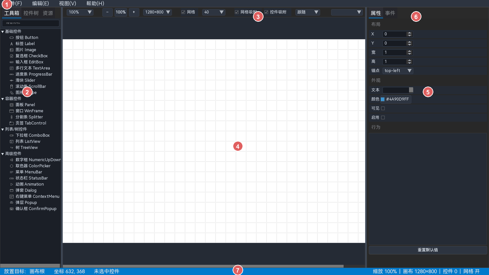

# CornerstoneDesigner

当前发布：**CornerstoneDesigner v0.1.0**，同步 **UICornerstone v1.2.0**。

CornerstoneDesigner 是 [UICornerstone](https://github.com/SeaOceanLiu/UICornerstone) 的可视化 UI 设计器。它采用 Dogfooding 方式：设计器自身就是 UICornerstone 应用（SDL3 后端），用同一套控件、布局、主题和事件体系完成 UI 设计，并导出可直接运行的 JSON 布局或 C/C++ 宿主工程。



## 功能概览

- **可视化画布**：从工具箱拖放/双击放置控件，拖动、缩放、框选、多选、对齐/分布、网格吸附和参考线。
- **27 种 UICornerstone 控件**：基础控件、容器、列表/树、菜单/状态栏、动画、Shape、Dialog/Popup 等。
- **结构化属性编辑**：背景色、边框色、字体及阴影、常规四组动态表单；支持原始 JSON 编辑。
- **事件绑定**：普通控件事件、MenuBar/StatusBar/ContextMenu 条目事件树、handler 代码编辑与唯一性校验。
- **右键菜单目标**：ContextMenu 可绑定普通控件、纯显示控件或画布根，并随工程保存目标映射。
- **组件系统**：从选中子树创建组件，声明 props，使用 `{{prop}}` 占位符和 `_comp_` 实例事件。
- **主题系统**：CSS-like 主题、变量、类、变体、媒体/容器条件和内置明亮/暗黑模板。
- **预览与导出**：独立预览窗体；导出 JSON、可编译 C/C++ 工程、事件侧车和项目报告。
- **Launcher**：启动进度界面、隐藏创建主窗口、ready 后平滑切换。
- **构建信息**：帮助 → 关于显示当前构建时间戳。

## 快速开始

### 环境要求

- Windows 10/11 x64（当前验证平台）
- Visual Studio 2022 Build Tools（C++ 桌面开发工作负载）
- CMake 3.16+
- Git
- UICornerstone 发布依赖：`UICornerstone.dll`、`UIBackend_sdl3.dll`、SDL3 运行库、`assets/`、`binding/`

### 获取代码

```batch
git clone --recursive git@github.com:SeaOceanLiu/CornerstoneDesigner.git
cd CornerstoneDesigner
```

如果子模块尚未拉取：

```batch
git submodule update --init --recursive
```

UICornerstone 通过 `subModules/UICornerstone` 子模块（`UICornerstone-release` 发布仓）同步。升级引擎时，更新发布子模块提交，再更新设计器父仓中的 submodule 指针。

### 构建

```batch
build_scripts\build.bat sdl3
```

构建脚本会调用 Visual Studio 开发环境并执行 CMake configure/build。输出目录：

```text
build\sdl3\Debug\
  CornerstoneDesigner.exe
  CornerstoneLauncher.exe
  UICornerstone.dll
  UIBackend_sdl3.dll
  SDL3*.dll
  assets\
  main_layout.json
  ...
```

也可以直接使用 CMake：

```batch
cmake -S . -B build/sdl3 -G "Visual Studio 17 2022" -DUICORNERSTONE_BACKEND=sdl3
cmake --build build/sdl3 --config Debug
```

### 运行

```batch
cd build\sdl3\Debug
CornerstoneLauncher.exe
```

或直接运行 `CornerstoneDesigner.exe`（跳过启动界面）。

### 发布包

```batch
build_scripts\make_release.bat
```

脚本会先构建 Release，然后把运行文件、`assets/`、`themes/`、`schema/`、`sdk/`、用户手册、README 和 LICENSE 归档到项目根目录的 `release/`。`release/` 已加入 `.gitignore`，不会进入版本库。

发布包不包含 `designer_settings.json`、运行日志或 `Temp/` 测试产物。Release 版 Designer/Launcher 使用 Windows GUI 子系统，不打开新的 Console 窗口；Designer 日志写入 exe 同目录 `designer.log`，Launcher 写入 `launcher.log`。发布前请在干净的 Windows 环境验证启动、预览和导出流程。

发布包同时包含：

- `vc_redist.x64.exe`：微软官方 Microsoft Visual C++ 2015–2022 x64 运行库安装程序
- `install_vc_runtime.bat`：自动请求管理员权限并静默安装
- `VC_Runtime_README_zh-CN.txt`：安装、静默命令、退出码和注意事项

> Release 版使用 MSVC 动态运行库。目标机器需要安装 **Microsoft Visual C++ 2015–2022 x64 运行库**；建议运行随包提供的 `install_vc_runtime.bat`，不要只手工复制单个 `MSVCP140.dll` 运行库文件。

### 验证

```batch
cd build\sdl3\Debug
CornerstoneDesigner.exe auto=2
CornerstoneDesigner.exe auto=3
```

- `auto=2`：项目 IO/保存/打开/导入导出自测。
- `auto=3`：预览窗体、图片、动画、主题等集成探针。
- 布局校验：

```batch
subModules\UICornerstone\tools\validate_layout.exe --strict layouts\main_layout.json
```

测试前后可用 `build_scripts\cleanup_processes.bat` 清理 Launcher/Designer 残留进程。

## 使用流程

1. 文件 → 新建（`Ctrl+N`）。
2. 从左侧工具箱双击或拖入控件。
3. 在右侧属性面板设置 ID、位置尺寸、颜色、字体和控件专有属性。
4. 在事件页签绑定事件；菜单/状态栏/右键菜单使用条目树。
5. 按 `F5` 打开独立预览，确认运行时效果。
6. 保存 `.csd` 工程；通过文件菜单导出 JSON、C/C++ 工程或项目报告。

## 工程结构

| 路径 | 说明 |
|------|------|
| `src/` | 设计器实现：`App`、`CanvasPane`、`ControlModel`、`Launcher`、入口 |
| `include/Designer/` | 设计器公共头文件 |
| `layouts/` | 设计器自身 JSON 布局和主题 |
| `themes/` | 内置明亮/暗黑项目主题模板 |
| `docs/` | HTML 用户手册（可直接发布到 GitHub Pages） |
| `design/` | 需求、规格、概念、详细设计、实施编码和专题设计文档 |
| `subModules/UICornerstone/` | 同步的 UICornerstone 发布依赖（DLL/assets/binding） |
| `build_scripts/` | Windows 构建与进程清理脚本 |
| `build/` | CMake 构建产物（本地生成，不入库） |
| `Temp/` | 本地临时测试产物（不入库） |

## 架构简述

```text
CornerstoneLauncher
        |
        v
CornerstoneDesigner (C++17)
  App / 主循环
    ├─ CanvasPane     画布、选中、拖拽、撤销、事件编辑
    ├─ ControlModel   设计期控件模型 / JSON 序列化
    ├─ Theme / 组件   项目主题、主题管理器、组件模板
    └─ Export          JSON / C / C++ 宿主工程
        |
        v
UICornerstone Binding（C++ Binding，运行时动态加载核心 DLL + SDL3 后端）
```

设计器通过 C++ Binding 动态加载 UICornerstone，不链接核心静态库；导出工程同样只依赖运行目录中的 DLL 和资源。

## 文档

- [用户手册](docs/index.html)：面向使用者的完整操作说明、控件指南和导出流程。
- [开发指南](design/guidelines/README.md)：编码规范、构建测试、设计文档规范。
- [需求说明](design/01_需求说明文档.md)
- [设计规格](design/02_设计规格文档.md)
- [概念设计](design/03_概念设计文档.md)
- [详细设计](design/04_详细设计文档.md)
- [实施编码](design/05_实施编码文档.md)
- [主题系统设计](design/08_主题系统设计.md)
- [Launcher 设计](design/09_启动Launcher设计.md)
- [菜单事件绑定设计](design/10_菜单事件绑定设计.md)

## 当前边界

- 当前主要验证 Windows + SDL3 后端；SFML/Raylib 路径未作为设计器运行环境验证。
- 动画/特效控件只托管 rect、资源路径和播放状态，不编辑时间轴/关键帧内容。
- UICornerstone 以发布依赖形式同步；更换版本时需同步 DLL、后端、`assets/` 和 `binding/`。
- 用户手册讲“怎么用”；内部实现和设计取舍以 `design/` 下文档为准。

## 许可证

本项目采用 GNU General Public License v3.0，详见 [LICENSE](LICENSE)。
