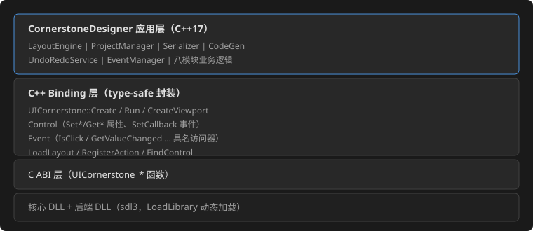
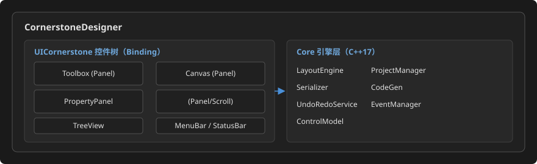

# CornerstoneDesigner 设计规格文档

> 修订记录：v2.3 —— 全量刷新对齐 UICornerstone **v1.1.1**（2026-08）：§1 依赖获取改"手动同步目录"（非注册子模块，无 .gitmodules）；§5 控件注册表 21→27 种（新增 Image/Shape/TabControl/ContextMenu/ListView/StatusBar）；§5 工具组分 4 类；§6 补 Shape/TabControl/StatusBar/ContextMenu/ListView 工厂 + leadingControl SetPtr + ResourceProvider/DataContext/HotReloader/FocusManager；§7 决策新增 ResourceProvider/DataContext 非可视化能力；§9 耦合边界升级至 v1.1.1。
> 修订记录：v2.2 —— 全链路一致性审核修正：M4 分组与 03/04 对齐为三组（事件为右栏独立 Tab）；§9 事件范围补 color-changed/enter（04 §3.2 完整表）。
> 修订记录：v2.1 —— 工程结构 §8 目录树刷新：doc/ 迁移为 design/（瀑布流程 5 篇 + 控件需求输入 + assets 图集 + guidelines 规范），新增 docs/ 预留 GitHub Pages 发布目录。
> 修订记录：v2 —— 依据 UICornerstone **v1.0.0**（2026-08-14 发布，tag commit `202346a5`；C++ Binding 已发布，TreeView/NumericUpDown/ColorPicker/ComboBox/Splitter 等控件已全部实现并附测试），技术方案由"C ABI + JSON"细化升级为 **"C++ Binding + JSON"**。
> 前置条件：需求说明文档已审批通过。

## 1. 开发环境

| 项目 | 规格 |
|------|------|
| 语言 | C++17 |
| UI 框架 | UICornerstone **v1.1.1**（SDL3 后端，C++ Binding 层接入；2026-08 发布，27 种控件、Shape/TabControl/ContextMenu/ListView/StatusBar 等新增） |

依赖获取方式：`subModules/UICornerstone/` 为**手动同步目录**（非 git 子模块：无 `.gitmodules`，被 `.gitignore` 忽略，目录内无 `.git`），需按 UICornerstone 仓库最新提交**手动替换**整个 `subModules/UICornerstone/` 目录（含核心库 DLL、预编译 SDK、binding 工程与头文件）。当前基线为 v1.1.1（2026-08）。构建沿用 `build_scripts\build.bat sdl3` 仅针对 CornerstoneDesigner 自身；UICornerstone 预编译产物（`UICornerstone.dll`、`UIBackend_sdl3.dll`、`SDL3*.dll`、`UICornerstoneBinding.lib`）随目录同步提供。
| 构建系统 | CMake 3.16+ |
| IDE | Visual Studio 2022（含"使用 C++ 的桌面开发"工作负载） |
| 平台 | Windows 10+ |
| JSON 库 | nlohmann/json（UICornerstone 子模块内已带，复用） |

依赖获取方式：`git clone --recursive` 后 `subModules/UICornerstone/` 即提供核心库源码、预编译 SDK 与 binding 工程；编译 `build_scripts\build.bat sdl3` 产出核心/后端 DLL 与 `UICornerstoneBinding.lib`。

## 2. 技术选型：C++ Binding + JSON 双引擎方案

### 2.1 总体分层

CornerstoneDesigner 是 UICornerstone 的"dogfooding 应用"：通过 **C++ Binding**（`binding/`，纯动态加载封装）获得类型安全的控件代理、属性系统与事件回调，以 **JSON 声明式布局**搭建自身静态 UI 骨架，以 **Binding 命令式 API** 驱动画布、属性面板等动态区域。



### 2.2 双引擎分工

| 引擎 | 职责 | 对应场景 |
|------|------|---------|
| **JSON 声明式** | 主界面静态骨架：MenuBar、Toolbox、TreeView、PropertyPanel 框架、StatusBar、默认控件工厂定义 | `layouts/main_layout.json` 及其子面板 JSON |
| **Binding 命令式** | 动态行为：画布控件树增删改、属性面板动态表单生成、事件注册/解绑、预览刷新、撤销重做 | 用户拖拽/编辑/绑定事件的全过程 |

原则：**静态用 JSON，动态用代码**。静态骨架以 `LoadLayout` 加载并 `RegisterAction` 桥接菜单/按钮动作；画布与属性面板属于运行时高频变更区，用 Binding 工厂与属性 API 命令式构建，避免频繁整体重载。

### 2.3 为什么选 C++ Binding 而非裸 C ABI

| 维度 | C ABI 方案 | C++ Binding 方案（选定） |
|------|------------|--------------------------|
| 事件回调 | C 函数指针 + userData 手工管理 | `std::function` lambda 就地捕获，类型安全（`Control::SetCallback`） |
| 生命周期 | Create/Destroy 手动，易泄漏 | RAII + 句柄活性跟踪（`ControlState::alive`），`FindControl` 后判 `IsValid()` |
| 属性访问 | 8 组 Set/Get 函数签名区分 | `Control::SetColor/SetFloat/SetString/SetEnum/SetBool/SetInt` + 同名 `Get*` 重载 |
| 事件数据 | union 布局手工解析 | `Event` 具名访问器（`IsValueChanged/GetValueChanged`、`IsSelectionChanged`…）零误用 |
| 动态加载 | 手写 LoadLibrary/GetProcAddress | `Create(Config)` 内置，三后端运行时切换 |
| Dogfooding 价值 | 验证 C ABI | 同时验证 Binding 层，反馈更贴近编辑器用户 |

### 2.4 设计原则

- **Dogfooding**：设计器自身 UI = JSON 骨架 + Binding 动态区，与用户目标应用同构
- **事件驱动**：交互经 Binding 回调进入业务层；全局快捷键经 Embedded 循环 + 键盘事件通道解析
- **内存模型**：设计器维护独立于渲染的控件内存树（nlohmann::json 结构），与 Binding 控件树保持双向同步
- **JSON 核心**：.csd 项目、导出布局、内部交换均以 JSON 为载体
- **便利设施直用**：视口缩放（`SetViewportScaleMode/SetCanvasSize`）承担画布缩放；`HandleControl` 承担选中控点；`RegisterAction` 承担 JSON 事件桥接

## 3. 系统架构概述



## 4. 模块分解

### M1 项目模块 (ProjectManager)

| 职责 | 说明 | Binding/依赖映射 |
|------|------|------------------|
| 项目生命周期 | 创建、打开、保存、关闭 .csd 项目 | std::fstream + nlohmann::json |
| 文件对话框 | 打开/保存原生对话框 | Win32 `GetOpenFileName/GetSaveFileName`（Binding 不含此能力，宿主侧补） |
| 最近文件 | 记录最近 10 个文件路径 | JSON 配置文件 |
| 自动保存 | 定时自动备份 | 定时器线程 + Serializer |

### M2 控件内存模型 (ControlModel)

| 职责 | 说明 |
|------|------|
| 控件属性映射 | 内存中的控件属性表（nlohmann::json 承载），与 UICornerstone 控件类型对齐 |
| 类型注册 | 注册所有支持控件类型、默认属性与**Binding 工厂创建器**（`std::function<Control(...)>`，工具箱/属性表单/导出共用同一注册表驱动） |
| 序列化 | ToJson / FromJson；FromJson 负责把 LayoutParser 既有文件无损读入内存模型 |

### M3 布局引擎 (LayoutEngine)

| 职责 | 说明 | Binding/依赖映射 |
|------|------|------------------|
| 排版计算 | 用户拖拽 → 控件 rect | `Control::GetRect` 读、`SetRect` 写；网格/对齐取整 |
| 对齐/分布命令 | 多选 ≥2 控件 → 对齐/分布 | 业务层包围盒坐标计算（左/水平居中/右、顶/垂直居中/底、等宽/等高、水平/垂直分布），命令入 Undo 栈 |
| 画布缩放 | 25%–200% 缩放与平移 | 画布区为**子视口**：`SetViewportScaleMode(1|2)` + `SetCanvasSize(w,h)` 等比/拉伸缩放；`GetViewportScale` 做鼠标坐标 → 画布坐标反变换；平移经画布锚点/滚动 |
| 对齐辅助线 | 拖拽自动吸附（阈值 8px），等距分布 | 定位运算在内存模型上做；辅助线/网格/选框用图形绘制层呈现 |
| Z-Order | 置前/置后/上移/下移 | `AddChild` 顺序重排 |
| 约束检测 | 子控件不得超出父容器边界 | 内存模型校验 + 错误提示（Dialog） |
| 选中与控点 | 单击选中、8 方向缩放 | `CreateHandleControl(target,...)` 挂到选中控件上，拖动回调更新 rect（写入 Undo 命令） |
| 多选 | Ctrl+单击多选，批量编辑 | 内存模型维护 selection 集合 |

### M4 属性编辑器 (PropertyPanel)

| 职责 | 说明 | Binding/依赖映射 |
|------|------|------------------|
| 动态表单 | 按选中控件类型生成属性编辑 UI | 每行 = `Label + 数值微调/EditBox/ColorPicker/ComboBox/CheckBox`，`CreateNumericUpDown/CreateColorPicker/CreateComboBox` 等命令式构建 |
| 分组 | 布局/外观/行为三组（**事件为右栏独立 Tab**，见 03 §6.2 / 04 §3.5） | 面板内部分组（Panel 嵌套）；布局组含 anchor/margin/padding/layout（h-flow/v-flow/grid）/matchParentRect/sizeRatio 等 UICS 布局属性 |
| 值验证 | 数值范围、颜色格式、必填校验 | 编辑控件回调 + 校验器 |
| 批量编辑 | 多选仅显示共有属性 | 注册表求交集 |
| 回写管线 | 编辑 → 内存模型 → 渲染刷新 | `Control::SetColor/SetFloat/SetString/SetEnum/SetBool/SetInt` 更新画布对应控件；变更入 Undo 栈（合并策略：连续同类合并） |
| 重置 | 恢复默认值 | 注册表默认属性 |

### M5 事件管理器 (EventManager)

| 职责 | 说明 | Binding/依赖映射 |
|------|------|------------------|
| 事件绑定 | 为控件实例绑定事件并命名 | 数据存入 .csd 的 `events` 段；渲染侧由 `Control::SetCallback(event, lambda)` 实演 |
| 事件类型表 | 与 Binding `Event` 具名访问器全集对齐 | `IsClick/IsValueChanged/IsTextChanged/IsSelectionChanged/IsCheckChanged/IsPositionChanged/IsConfirm/IsCancel/IsSelect/IsExpand/IsCollapse…` |
| 命名检查 | 冲突检测与标识符合规 | 正则 + 全局符号表 |
| 导出 | 函数签名列表 + .h/.c 骨架 | CodeGen（M6） |

### M6 代码生成器 (CodeGen)

| 职责 | 说明 | 依赖映射 |
|------|------|----------|
| JSON 导出 | 控件树序列化为 **LayoutParser 兼容 JSON** | Schema 基准：UICornerstone `layouts/test_layout.json` / `test_layout_advanced.json`（N4 验证基准） |
| C/C++ 骨架 | `void handler(UIControlHandle ctl, void* user)` 函数定义 | C 标识符规范命名 |
| 项目报告 | 控件/事件清单（F7.3） | 文本生成 |

### M7 撤销/重做 (UndoRedoService)

| 职责 | 说明 |
|------|------|
| 命令模式 | 每个操作封装为可撤销命令对象（作用于内存模型；完成后触发画布刷新） |
| 历史栈 | 至少 50 步 |
| 合并策略 | 连续同类操作（移动/缩放）自动合并 |
| 快捷键 | Ctrl+Z / Ctrl+Y 经绑定层键盘事件通道派发 |

### M8 预览引擎 (PreviewEngine)


| 职责 | 说明 | Binding/依赖映射 |
|------|------|------------------|
| 内嵌实时预览 | 预览区即主实例内的**子视口**（`CreateViewport`），与编辑器其它面板共享同一渲染循环 | `instance->CreateViewport(x,y,w,h)` |
| 事件实演 | 预览中点击等事件按用户绑定响应 | `RegisterAction(handlerName, lambda)` 桥接；未实现的动作给出占位提示 |
| 防抖刷新 | 属性连续微调时 300ms 合并刷新，满足 ≥30 FPS | Embedded 循环内 `Update/Render` |

## 5. 控件类型注册表

支持控件与 UICornerstone **v1.1.1** 现状对齐（27 种，含 v1.1.x 新增的 Shape / TabControl / ContextMenu / ListView / StatusBar，以及独立的 Image 节点）：

| 控件类型 | JSON `type` | Binding 工厂 | 核心属性 | 特有属性 |
|---------|-------------|-------------|---------|---------|
| Actor（图片） | `image` | `CreateImage`（C ABI 同 Actor） | rect, image | scale-type / anchor / alpha / match-parent-rect（**纯显示，不命中事件**；`type:"image"` 独立节点，非仅 Button actors） |
| Animation（LuotiAni） | `animation` | `CreateAnimation` / `CreateAnimatedButton` | rect, animation（JSONC 路径） | playing / loop / frame / total-frames（内容不编辑，仅托管） |
| Button | `button` | `CreateButton` | rect, caption, colors.background | normal/hover/pressed/disabled-image / luotiAni 内嵌动画 / onClick |
| CheckBox | `check-box` | `CreateCheckBox` | rect, caption, checked | threeState / style(classic/cross/circle) / tri-state |
| ColorPicker | `color-picker` | `CreateColorPicker` | rect, color | closed-font-size / preset-cols/rows（F3.3） |
| ComboBox | `combo-box` | `CreateComboBox` | rect, items, text | selectedIndex / editable / max-visible-items |
| ContextMenu | `context-menu` | `CreateContextMenu` | rect, items[] | 项图标 / shortcut / separator / onClick；任意控件经 `contextMenu` 键绑定 |
| Dialog | `dialog` | `CreateDialog` | rect | confirm/cancel/close / button-height/gap |
| EditBox | `edit-box` | `CreateEditBox` | rect, text, placeholder | password-mode / password-char / align |
| HandleControl | —（无 JSON 类型） | `CreateHandleControl` | rect, target | 选中控点（画布用，不列工具箱） |
| **Image（独立节点）** | `image` | `CreateImage` | rect, image（路径） | scale-type / alpha / anchor（v1.1.x 明确支持；原 1.0.0 仅 Button 三态） |
| Label | `label` | `CreateLabel` | rect, caption, font | align / font-file / font-resource / shadow |
| ListView | `list-view` | `CreateListView` | rect, columns[], rows[] | mode(multi/single) / multiSelect / rowHeight / headerHeight / gridlines / hover / leadingControl（列头/行首/单元格三级） |
| Menu / MenuBar | `menu-bar` + items | `CreateMenuBar` / `CreateMenuItem` / `CreateMenuPanel` | rect, menus[] | orientation / 子菜单 / contextMenu 键 |
| NumericUpDown | `numeric-up-down` | `CreateNumericUpDown` | rect, value | min/max/step/page-step/decimals（F3.4） |
| Panel | `panel` | `CreatePanel` | rect, children, visible | layout（h-flow/v-flow/grid/anchor） |
| ProgressBar | `progress-bar` | `CreateProgressBar` | rect, value | range-min/max / style(horizontal/vertical) / textMode / animation-speed |
| ScrollBar | `scroll-bar` | `CreateScrollBar` | rect, orientation | min/max/value/step-size/page-size |
| Shape | `shape` | `CreateShape` | rect | shape(rect/filled-rect/round-rect/circle/ellipse/polyline/polygon) / fill / stroke / lineWidth / radius / ringWidth / points / primitives[]（多图元组合） |
| Slider | `slider` | `CreateSlider` | rect, value | min/max/step / show-value-label / style / tick-interval |
| Splitter | `splitter` | `CreateSplitter` | rect, horizontal | edge-margin / first-min / second-min / ratio / thickness / onSplitterMoved |
| **StatusBar** | `status-bar` | `CreateStatusBar` | rect, items[] | fontSize / itemHeight / items[].align(left/right) / items[].icon / items[].menu / items[].onClick |
| TextArea | `text-area` | `CreateTextArea` | rect, text | word-wrap / scroll-x/y / line-height |
| **TabControl** | `tab-control` | `CreateTabControl` | rect, tabs[] | position(top/bottom/left/right) / fontSize / currentIndex / tabs[].page / tabs[].icon / onTabChange |
| TreeView | `tree-view` | `CreateTreeView` | rect, items[] | indent-width / row-height / selected-id / leadingControl（行首前置控件容器，运行时 SetPtr 立即挂树） / onSelect/onExpand/onCollapse |
| WinFrame | `win-frame` | `CreateWinFrame` | rect, title, children | resizable / edge-margin / close-on-esc |

> 工具箱（F1.1）分组：
> - **基础控件**：Label / Button / CheckBox / EditBox / TextArea / ProgressBar / Slider / ScrollBar / Image / Shape
> - **容器控件**：Panel / WinFrame / Splitter / TabControl
> - **列表/树控件**：ListView / TreeView / ComboBox
> - **高级控件**：Menu/MenuBar / ColorPicker / NumericUpDown / Dialog / Animation / ContextMenu / StatusBar
> 不列 File 对话框等宿主能力。
>
> **Image 节点**（`type:"image"`）：v1.1.x 明确的独立布局控件（原 1.0.0 中图片仅作为 Button actors 三态外观）。JSON 键：`image`（文件路径，相对 `resourceRoot`）/ `imageResource`（内存资源 ID）/ `providerName`（ResourceProvider 引用）/ `matchParentRect` / `scaleType`。不参与事件命中（`isContainsPoint` 恒 false）。
>
> **Shape 控件**：七种图元（`rect`/`filled-rect`/`round-rect`/`circle`/`ellipse`/`polyline`/`polygon`）+ `primitives[]` 多图元组合。无事件、无子控件。设计器用于画布辅助绘制（背景装饰、自定义控点形状等），可导出。
>
> **leadingControl 概念**（TreeView / ListView / StatusBar 通用）：行首/列头/单元格可挂任意子控件容器，通过 SetPtr 运行时挂树/摘树。设计器的属性面板、事件面板可利用此能力实现复杂行内控件。
>
> **TabControl**：页签位置 top/bottom/left/right，`currentIndex` 切换；事件 `onTabChange(newIdx)`。设计器工具箱/右栏可用 TabControl 替代当前自建的 Tab 按钮（可选重构，P2）。
>
> **ContextMenu**：JSON 控件级 `contextMenu` 键绑定；任意控件可挂右键菜单。设计器画布/属性面板的右键菜单可用 ContextMenu（替代当前自建菜单面板）。
>
> **StatusBar**：VSCode 风格底部栏，items 左右对齐，支持 `menu`（点击弹菜单）与 `onClick`。设计器底部状态栏可用 StatusBar 替代当前自建 label 面板。
>
> **LuotiAni**：基础托管（`type="animation"`，`animation` 键为 JSONC 路径，`.jsonc` 字符串）——画布可放置、rect 可编辑、playing/loop 可切换；动画内容（时间轴/关键帧）不编辑，往返原样保留。
>
> **组件**（v1.1.x 引擎级 `components` 区）：顶层 `components`（`props` + `template` + `{{ }}` 占位符 + `_comp_` 事件），控件以 `type=组件名` 引用并传 props（`layouts/test_layout_advanced.json` 实测，支持嵌套）。设计器以 P2 落地：组件编辑器（模板 + props 表单）、工具箱"组件"动态分组（类型注册表扩展）。

## 6. C++ Binding API 映射表

| Designer 功能 | Binding API | 备注 |
|--------------|-------------|------|
| 应用入口 | `UICornerstone::Create(Config.WithBackend("sdl3").WithWindow(...))` | 核心/后端 DLL 纯动态加载 |
| 主循环 | `Run(update, render)`（Hosted）或 `ProcessEvents/Update/Render/Clear/Present`（Embedded） | 设计器用 **Embedded** 以预留多实例调度 |
| 静态骨架 | `LoadLayout(json)` / `LoadLayoutFromFile(path)` | main_layout.json + 各面板 JSON |
| JSON 动作桥接 | `RegisterAction(name, ActionCallback)` | 菜单/按钮 → 业务层 |
| 控件查找 | `FindControl(id)` + `Control::IsValid()` | 骨架内控件定位；`GetControlType` 查容器类型 |
| 子视口 | `CreateViewport(x,y,w,h)` → 子视口代理（各自独立 UIContext/FocusManager/事件队列） | 预览区/画布区；单窗口多视口按绝对坐标命中 |
| 画布缩放 | `SetViewportScaleMode(0|1|2)`、`SetCanvasSize`、`SetViewportAnchor`、`GetViewportScale` | F2.3 缩放 25%–200%；`off`/`fit`/`stretch` |
| 控件创建 | `CreateButton/CreateLabel/CreateImage/CreatePanel/CreateButton/CreateTree…` 全工厂（含 `CreateShape`/`CreateTabControl`/`CreateStatusBar`/`CreateContextMenu`/`CreateListView`） | 画布放置；`CreateHandleControl` 选中控点 |
| 属性读写 | `Control::SetColor/SetStateColor/SetBool/SetInt/SetFloat/SetString/SetEnum` + `Get*` | F3.1 实时编辑 |
| 事件绑定 | `Control::SetCallback("click"\|"value-changed"\|"text-changed"\|"selection-changed"\|"check-changed"\|"position-changed"\|"confirm"\|"cancel"\|"close"\|"select"\|"expand"\|"collapse"\|"color-changed"\|"enter"\|"onTabChange"\|"onSplitterMoved"\|"onColumnSort"\|"onItemClick"\|..., lambda)`；`Event` 具名访问器 | F4.1 |
| leadingControl 挂载 | `SetPtr(control, "item-leading-control", subHandle)` / `GetPtr` | TreeView/ListView/StatusBar 行首/列头/单元格挂子控件容器，SetPtr 立即挂树、NULL 解除并摘树 |
| 树操作 | TreeView 节点 addChild/removeNode/expandNode/collapseNode/selectNode/setNodeUserData；`SetString("items", json)` 批量设置 | F2.2 控件树 |
| ListView 操作 | addRow/insertRow/removeRow/removeRowById / addColumn/insertColumn / getRowCount/getColumnCount / setCell / setRowLeadingControl | F2.2 数据视图 |
| TabControl 操作 | addTab/insertTab/removeTab/setCurrentIndex/setTabText/setTabPage/setTabLeadingControl | F2.2 Tab 切换 |
| StatusBar 操作 | addStatusItem/updateStatusItemText/removeStatusItem/setStatusItemMenu/setStatusItemOnClick | F2.2 状态栏 |
| 非可视化 | **ResourceProvider**（createFilesystem(basePath)/readFile/exists）：文件读取统一入口，图片/字体/动画/布局均经其解析为字节流（带内存缓存）；**DataContext**（set/get/has/watch）：双向数据绑定（caption/text/placeholder/value/checkState/visible/enabled）；**HotReloader**（poll/reload/setPollInterval）：布局 JSON 热加载（完全重建策略）；**FocusManager**（registerControl/focusNext/focusPrev/registerBoundary）：焦点环 | 属性面板数据绑定、布局热加载、焦点环绘制 |
| 画布自绘层 | 图形原语 + 覆盖层控件（Shape / Image 节点） | F2.4 对齐线 / F2.7 网格 |
| 错误诊断 | `GetLastError()` | 加载/解析失败提示 |

## 7. 关键技术决策

| 决策 | 选择 | 理由 |
|------|------|------|
| 框架接入方式 | **C++ Binding**（动态加载） | 类型安全回调/属性访问；RAII 生命周期；与 C ABI 方案相比显著降低编辑器复杂度（§2.3） |
| UI 静态骨架 | JSON 声明式（LoadLayout） | dogfooding；与导出格式同构；布局调整零重编译 |
| 动态区域 | Binding 命令式 | 画布/属性面板高频变更，避免整树重载 |
| 预览方式 | 主实例内**子视口 + LoadLayout + RegisterAction** | 设计器自身即 UICornerstone 应用，天然支持，无需外部进程 |
| 画布缩放 | 视口缩放机制（ViewportScaleMode/CanvasSize） | 框架能力复用，鼠标坐标经 GetViewportScale 反变换 |
| JSON 库 | nlohmann/json | UICornerstone 已依赖，复用 |
| 撤销/重做 | 命令模式（≥50 步，连续同类合并） | 内存可控，支持批量 |
| 文件对话框 | Win32 原生对话框 | Binding 不含此能力，宿主侧薄封装 |
| 资源读取 | **ResourceProvider**（createFilesystem + readFile） | v1.1.1 统一入口，图片/字体/动画/布局字节流走同一通道，带内存缓存；相对路径解析对 resourceRoot |
| 数据绑定 | **DataContext**（set/get/watch） | 双向模式支持属性 ↔ 数据源同步，属性面板/预览实演可复用 |
| 布局热加载 | **HotReloader**（poll/reload） | 开发期布局 JSON 自动刷新（完全重建策略），30 帧轮询 |
| 覆盖层渲染 | **布局 JSON 内 Image 节点**（`type:"image"`）+ Shape | v1.1.1 布局支持 `image` 节点，覆盖层（网格/选中框/对齐线）作为布局 children 追加，Z 序由 children 顺序保证（后渲染在上），无需命令式 CreateImage 层级错乱 |

## 8. 工程结构

```
CornerstoneDesigner/
├── CMakeLists.txt                    # 根 CMake（链接 UICornerstoneBinding.lib）
├── design/                           # 文档（瀑布流程 + 开发规范 + 控件需求输入）
│   ├── 01_需求说明文档.md            #   瀑布流程：需求
│   ├── 02_设计规格文档.md            #   瀑布流程：设计规格（本文档）
│   ├── 03_概念设计文档.md            #   瀑布流程：概念设计（UI 界面 + SVG 图集）
│   ├── 04_详细设计文档.md            #   瀑布流程：详细设计
│   ├── 05_实施编码文档.md            #   瀑布流程：实施编码
│   ├── TreeView_需求文档.md          #   控件需求输入（UICS 侧已交付）
│   ├── ColorPicker_需求文档.md
│   ├── ComboBox_需求文档.md
│   ├── NumericUpDown_需求文档.md
│   ├── Splitter_需求文档.md
│   ├── assets/                       #   SVG 图集（概念设计插图）
│   └── guidelines/                   #   开发规范（AGENTS.md 引用）
│       ├── README.md                 #   规范索引
│       ├── coding.md / design-rules.md / design-docs.md
│       ├── build.md / testing.md / dependencies.md
│       ├── pixel-format.md / history.md
├── build_scripts/
│   └── build.bat                     # 编译脚本
├── include/
│   └── Designer/
│       ├── App.h                     # 应用入口（Embedded 循环）
│       ├── ControlModel.h            # 控件内存模型 + 类型注册表
│       ├── ProjectManager.h          # 项目管理
│       ├── LayoutEngine.h            # 布局引擎（拖拽/缩放/对齐/Z-Order）
│       ├── EventManager.h            # 事件管理器
│       ├── CodeGenerator.h           # 代码生成器
│       ├── PreviewEngine.h           # 预览引擎
│       ├── UndoRedoService.h         # 撤销/重做
│       └── Serializer.h              # JSON 序列化
├── src/
│   ├── main.cpp                      # 入口
│   ├── App.cpp
│   ├── ControlModel.cpp
│   ├── ProjectManager.cpp
│   ├── LayoutEngine.cpp
│   ├── EventManager.cpp
│   ├── CodeGenerator.cpp
│   ├── PreviewEngine.cpp
│   ├── UndoRedoService.cpp
│   └── Serializer.cpp
├── layouts/                          # 设计器自身的 JSON 布局（静态骨架）
│   ├── main_layout.json              #   主界面布局（MenuBar/三栏/StatusBar）
│   ├── toolbar_panel.json            #   工具箱（注册表驱动展示）
│   ├── property_panel.json           #   属性面板框架（动态表单区）
│   └── event_panel.json              #   事件管理面板
├── subModules/UICornerstone/         # 子模块（含 binding 工程与预编译 SDK）
│   └── …/binding                     #   UICornerstoneBinding.lib + 头文件
└── assets/                           # 字体、图片等资源
```

## 9. 与 UICornerstone 的耦合边界

| 项 | 契约 |
|----|------|
| 依赖基线 | UICornerstone **v1.1.1**（2026-08；27 种控件；C++ Binding 层已覆盖 Shape/TabControl/ContextMenu/ListView/StatusBar；独立 Image 节点；Shape 七种图元 + primitives 组合；leadingControl 三级挂载；ResourceProvider/DataContext/HotReloader/FocusManager 非可视化能力；`subModules/UICornerstone/` 为**手动同步目录**（非注册子模块）） |
| 导出 JSON | 严格符合 `LayoutParser` 输入格式；以 `layouts/test_layout.json`、`test_layout_advanced.json` 为 Schema 基准（N4） |
| 事件类型范围 | 以 Binding `Event` 具名访问器全集为上限（click/value-changed/text-changed/selection-changed/check-changed/position-changed/confirm/cancel/close/select/expand/collapse/color-changed/enter/onTabChange/onSplitterMoved/onColumnSort/onItemClick，完整表见 04 §3.2） |
| 动画/特效 | LuotiAni（`type="animation"` / Button 的 `luotiAni` 字段）：rect 与资源路径（`.jsonc` 字符串）可编辑、playing/loop 可切换；动画内容（时间轴/关键帧）不编辑，往返原样保留（需求 §7） |
| 资源挂载 | 引擎提供 **ResourceProvider**（createFilesystem/basePath + readFile + 内存缓存）：图片/字体/动画/布局字节流统一入口；JSON `image` 键路径相对 `resourceRoot`；内存资源 `RegisterResource/AdoptResource` + `provider:<id>` 引用仍可用。设计器提供布局级资源面板（P1） |
| 数据绑定 | **DataContext**（set/get/watch）双向绑定属性：caption/text/placeholder/value/checkState/visible/enabled；JSON `"bind"` 键；设计器属性面板/预览可复用此机制 |
| 热加载 | **HotReloader**（poll/reload/setPollInterval）：布局 JSON 完全重建策略；开发期可用；设计期预览不阻塞用户编辑 |
| leadingControl | TreeView/ListView/StatusBar 的 leadingControl 行首/列头/单元格容器，SetPtr 运行时挂树/摘树；设计器属性面板行内控件（如每行加"删除"按钮）可复用 |
| 组件 | 顶层 `components`（`props`/`template`/`{{ }}`/`_comp_`），`type=组件名` 引用；设计器 P2 提供组件编辑器与工具箱动态"组件"分组，导出原样保留 components 区 |
| 兼容性维护 | 恢复/迁移：从旧版本 JSON 读取时未知字段原样保留，避免往返丢失 |

---

## 本阶段测试内容

### 设计验证

| 测试项 | 方法 | 通过标准 |
|--------|------|---------|
| 架构评审 | 对照需求 F1-F7 检查架构覆盖率 | 每个功能需求映射到 >= 1 个模块 |
| Binding API 可行性 | 用官方样例（sample_cpp_hosted/embed/multiinstance/scale）验证 §6 映射表每项 API | 映射项全部可用（demo 级验证） |
| JSON 兼容性验证 | 导出 JSON 与 UICornerstone 的 layouts/ 样本对比 | 结构完全一致 |
| 事件命名检查 | CodeGen 输出符合 C 标识符规范 | 100% 合规 |
| 撤销覆盖 | 检查所有可编辑操作都有对应的 Undo | 无遗漏 |
| 接口评审 | 模块间接口清晰，无循环依赖 | 依赖图无环 |

### 设计器自身布局原型

- 使用 UICornerstone JSON 构建设计器主界面布局原型（main_layout.json），`LoadLayout` + `RegisterAction` 验证菜单/按钮动作桥接
- 验证关键交互流程：创建布局 -> 绑定事件 -> 导出，导出 JSON 以 `test_layout` 输入规格自检