# CornerstoneDesigner 概念设计（UI 界面）

> 修订记录：v4.22 —— 主界面布局 §2 当前落地阶段更新（阶段一·E）：canvasArea 工具栏下方创建子视口承载画布内容，纸面+网格画在视口内部（网格=单元瓦片 scale-type=tile 平铺，resize 零纹理重建、缩放档重建小瓦片）；依赖 UICornerstone v1.1.1+ 视口事件回退（splitter 跨视口拖拽续接）与 SDL3 drawTexture srcRect 修复。
> 修订记录：v4.21 —— 主界面布局 §2"当前落地阶段"注明 canvasArea 顶部画布工具栏（canvasToolbar：缩放 25%~200%/−/1:1/+、网格/对齐 CheckBox、对齐分布下拉、预览切换），阶段一·D；尺寸经验：工具栏 40/控件 32/font 16、ComboBox 行高 ≥32（字母下伸部被裁）、右栏表单行高 30→32。
> 修订记录：v4.20 —— 主界面布局 §2"当前落地阶段"注明右栏 propertyPanel 内容：propertyTabs TabControl 两 Tab（属性 tabProperty 三组表单/事件 tabEvent 绑定面板），阶段一·C。
> 修订记录：v4.19 —— 主界面布局 §2"当前落地阶段"：资源 Tab 由 tvResource(tree-view) 改为 lvResource(list-view 多列，mode:"multi"，columns 名称/路径)，resourceProviders 为平面映射。
> 修订记录：v4.18 —— 主界面布局 §2"当前落地阶段"注明 toolboxPanel 内容：tvToolbox 4 分组 27 控件（leadingControl image 图标）、tvTree/tvResource 占位；工具箱控件清单与图标规格详见 05 阶段一·B。
> 修订记录：v4.17 —— 主界面布局 §2"当前落地阶段"：toolboxPanel 三 Tab 页由 panel 改为 tree-view（工具箱 tvToolbox/控件树 tvTree/资源 tvResource，均 `anchor:"fill"`）。
> 修订记录：v4.16 —— 主界面布局 §2"当前落地阶段"：toolboxPanel 补内部 TabControl（v1.1.1 原生 `anchor:"fill"` 三 Tab：工具箱/控件树/资源）。
> 修订记录：v4.15 —— 主界面布局 §2"当前落地阶段"：Splitter 引擎整链自动重排（resize 时 splitter1 保持、splitter2/property 随 canvas 弹性链式移动），移除按面板边界手动同步描述。
> 修订记录：v4.14 —— 主界面布局 §2"当前落地阶段"更新为五元素链式布局：middleArea h-flow 插入 splitter1/splitter2（Splitter 引擎模式 v1.1.1）。
> 修订记录：v4.13 —— 主界面布局 §2"当前落地阶段"更新为 v-flow+h-flow 嵌套完整布局：新增 menu-bar/status-bar 原生控件、middleArea 弹性容器，窗口 resize 整体 reflow（v1.1.1 验证通过）。
> 修订记录：v4.12 —— 主界面布局 §2 增补"当前落地阶段（阶段一·A）"：三栏纯面板 h-flow 布局（左/右固定宽 flowWeight:0 + 中弹性 flowWeight:1），移除 menuBar/splitter/statusBar（后续回归），窗口 resize 经 syncRootToWindow 同步 root；布局引擎选型结论（anchor fill 不适用→h-flow）。
> 修订记录：v4.11 —— §9 界面参数规格从 01 移入（概念设计配套 SVG 示意图，参数有意义）；§8 配色表更新引用指向本节。
> 修订记录：v4.10 —— 效果图 ui-concept-main.svg 叠加控件类型标注（menu-bar / toolboxPanel / canvasToolbar / viewport / propertyPanel / statusBar / splitter，JSON 静态 vs 命令式动态）。
> 修订记录：v4.9 —— 新增§14静态控件映射表（主窗口/左栏/画布/右栏各区域控件类型定义、静态vs动态边界、实施阶段一检查清单）及§15双接口规范（Binding API kebab-case vs JSON Schema camelCase 命名差异对照、踩坑记录）。
> 修订记录：v4.8 —— 等宽对比后回退 HarmonyOS（01 v2.7），图集 SVG 恢复 HarmonyOS 字体族。
> 修订记录：v4.6 —— 界面字体切换 MapleMono-NF-CN-Regular（01 v2.6），§7 状态栏与图集 SVG 同步。
> 修订记录：v4.5 —— 字号统一 20px（01 v2.5），§7 状态栏与图集 SVG 同步。
> 修订记录：v4.4 —— 字号统一 18px（01 v2.4），§7 状态栏与图集 SVG 同步。
> 修订记录：v4.3 —— 字号统一 16px（01 v2.3），§7 状态栏与图集 SVG 同步。
> 修订记录：v4.2 —— 字号令牌整体上调（title 14 / body 13 / caption 12），§7 状态栏与图集 SVG 同步。
> 修订记录：v4.1 —— 界面参数规格化：§2 状态栏 52→28 高、栏区 720→744（坐标自洽 28+744+28=800，左栏 id 修正为 toolboxPanel）；§7 状态栏补字体规格；§8 补错误行底色并指向 01 §9（实现级规格来源）；本图集全部 SVG 按 01 §9 令牌化（HarmonyOS 字体族、统一色板与字号 13/12/11，关键图标注规格条）。v4 —— 按详细设计（04 v2.4）反向刷新：§4.2 资源面板补名称唯一约束；§6.2 事件类型按控件类型注册表过滤；§12 工具栏构成引用 04 §9 定稿。各面板配套 SVG 图（§3–§7）。
> 定位：UI 概念设计先行，是设计规格 v2（C++ Binding + JSON）的界面落地蓝图，供 UI 评审与后续 main_layout.json 定稿使用。
> 前置：设计规格文档已审核通过。

## 1. 体验基调

- **深色专业主题**：对齐 UICornerstone 测试/示例一贯的深色面板风格（#202020 系），Dogfooding 一致性。
- **三栏式专业设计器布局**：参照主流设计器（Figma / Visual Studio / Godot 编辑器的信息密度与分区习惯）。
- 主窗口 **1200×800**，最小 1024×768，可拉伸；dpiScale 自适应。
- 交互基调：单击选中、拖拽放置/移动、Ctrl 修饰多选、右键上下文、快捷键驱动。

## 2. 主界面布局（信息架构）

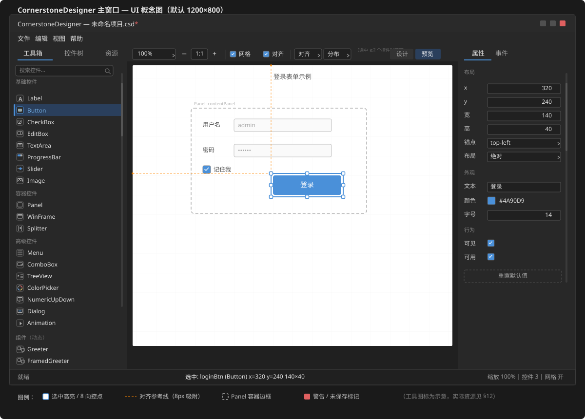

> 上图状态：编辑中的"登录表单示例"（Panel 容器 + Button 选中态 + 8 向控点 + 对齐参考线），右栏为属性面板，布局分组含锚点/布局模式等 UICS 布局属性；左栏 Tab 为工具箱/控件树/资源，工具箱含 Animation（高级控件组）与"组件"动态分组（示例 Greeter/FramedGreeter）。画布工具栏含**对齐/分布命令组**（选中 ≥2 个控件时启用，示意文字）。画布底部"预览"Tab 切换子视口实时渲染。

| 区域 | 位置 | 尺寸（默认） | 内容 | JSON ID |
|------|------|-------------|------|---------|
| 菜单栏 | 顶部 | 1200×28 | 文件/编辑/视图/帮助 | menuBar |
| 左栏 | 左侧 | 240×744 | 工具箱、控件树、资源（Tab 切换） | toolboxPanel |
| 左分隔条 | 左栏右侧 | 6×744 | 栏宽拖拽调整 | leftSplitter |
| 画布区 | 中央 | 708×744（可被 Splitter 调整） | 设计画布 / 预览 | canvasArea |
| 右分隔条 | 画布右侧 | 6×744 | 栏宽拖拽调整 | rightSplitter |
| 右栏 | 右侧 | 240×744 | 属性面板、事件面板（Tab 切换） | propertyPanel |
| 状态栏 | 底部 | 1200×28 | 提示 / 选中信息 / 缩放 / 统计（Panel + 3 Label） | statusBar |

> 坐标自洽：1200 = 240（左栏）+ 6（左分隔）+ 708（画布）+ 6（右分隔）+ 240（右栏）；纵向 = 28（菜单栏）+ 744（栏区）+ 28（状态栏）= 800。左/右栏宽度、画布宽度由 Splitter 拖拽调整（对应 04 详细设计 §9 main_layout.json 原型）。

> **当前落地阶段（阶段一·A/B/C/D/E）**：上述规划为完整目标；当前 `layouts/main_layout.json` 采用 **v-flow + h-flow 嵌套**布局引擎自适应窗口，已含菜单栏/状态栏原生控件与 Splitter 分隔条：
> - root（`v-flow`）：`menuBar`（menu-bar，固定高 28）→ `middleArea`（panel，`flowWeight:1` 弹性）→ `statusBar`（status-bar，固定高 28）
> - `middleArea`（`h-flow`）五元素链式布局：`toolboxPanel`（`flowWeight:0` 固定宽 240，内含 `toolboxTabs` TabControl `anchor:"fill"` 三 Tab）→ `splitter1`（`orientation:"vertical"`，厚 6）→ `canvasArea`（`flowWeight:1` 弹性填充）→ `splitter2`（厚 6）→ `propertyPanel`（`flowWeight:0` 固定宽 240）
> - `toolboxPanel` 内容（阶段一·B）：`toolboxTabs` TabControl 三 Tab，各 TreeView `anchor:"fill"`；**工具箱 tvToolbox** 4 分组 27 控件（含 leadingControl SVG 图标），**控件树 tvTree**（tree-view 层级）/ **资源 lvResource**（list-view 多列：名称/路径）——清单与图标规格见 05 阶段一·B
> - `propertyPanel` 内容（阶段一·C）：`propertyTabs` TabControl `anchor:"fill"` 两 Tab——**属性 tabProperty**（v-flow 三组属性表单：布局 x/y/w/h+锚点、外观 文本/颜色/可见/启用、行为占位，编辑控件 NumericUpDown/ColorPicker/ComboBox/CheckBox/EditBox + 重置按钮）、**事件 tabEvent**（事件类型 ComboBox 16 种 + handler 弹性行 + 建议命名/添加绑定按钮 + 已绑定列表骨架）——详见 05 阶段一·C
> - `canvasArea` 内容（阶段一·D/E）：顶部画布工具栏（阶段一·D）；工具栏下方**子视口**承载画布内容（阶段一·E）：纸面+网格画在视口内部（网格=单元瓦片纹理 scale-type=tile 平铺，resize 零纹理重建）；事件回退保证 owner splitter 拖拽正常
> - 阶段一·D 其余：顶部**画布工具栏** `canvasToolbar`（panel h-flow 40 高）——缩放 ComboBox 25%~200%（初始 100%）+ −/1:1/+ 按钮、网格/对齐 CheckBox（初始勾选）、对齐/分布组合下拉（左/水平居中/右/顶/垂直居中/底）、弹性占位、行尾"预览"切换按钮；子视口（后续阶段）占工具栏下方区域——详见 05 阶段一·D
> - Splitter 引擎模式（v1.1.1 增强）：h-flow 内自动链式布局，无需 first/second 关联，拖拽整链重排三栏宽度（详见 05 阶段一·A）
> - 窗口 resize 时 `src/App.cpp::syncRootToWindow()` 将 root `SetRect` 到新窗口尺寸 → v-flow 整体 reflow（菜单顶/三栏弹性/状态栏底）+ h-flow 五元素 reflow；Splitter 引擎整链自动重排（splitter1 保持、splitter2/property 随 canvas 弹性链式移动）
> - 布局引擎选型：三栏中间自适应**不用 anchor `fill`**（铺满父容器会盖住左右），正确用 **h-flow + flowWeight + Splitter 引擎模式**；menu-bar/status-bar 挂入 v-flow 自动参与布局引擎重排（v1.1.1，详见 05 阶段一·A）

## 3. 菜单栏

| 菜单 | 菜单项 | 快捷键 | RegisterAction |
|------|--------|--------|----------------|
| 文件(F) | 新建项目 / 打开 / 保存 / 另存为 / 导入 JSON / 导出 JSON / 导出代码 / 最近文件(子菜单) / 退出 | Ctrl+N / Ctrl+O / Ctrl+S | onMenuNew…onMenuExit |
| 编辑(E) | 撤销 / 重做 / 复制 / 粘贴 / 删除 / 置前 / 置后 / 上移 / 下移 | Ctrl+Z / Ctrl+Y / Ctrl+C / Ctrl+V / Del | onMenuUndo…onMenuMoveDown |
| 视图(V) | 缩放 25%/50%/75%/100%/150%/200% / 网格开关 / 对齐开关 / 预览模式 | Ctrl+0…5 / Ctrl+G / Ctrl+Shift+G / F5 | onMenuZoom25… |
| 帮助(H) | 关于 | | onMenuAbout |

> 菜单动作全部经 `RegisterAction` 桥接业务层；快捷键同时支持菜单内 `shortcut` 属性与 Embedded 循环键盘捕获两条路径。

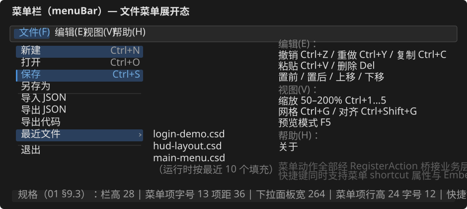

## 4. 左栏：工具箱 + 控件树（Tab）

### 4.1 工具箱（F1）

- 顶部搜索框（F1.3，P2）：按名称过滤控件。
- 分组（F1.2）：
  - 基础控件：Label、Button、CheckBox、EditBox、TextArea、ProgressBar、Slider、ScrollBar、Image
  - 容器控件：Panel、WinFrame、Splitter
  - 高级控件：Menu、ComboBox、TreeView、ColorPicker、NumericUpDown、Dialog、Animation（LuotiAni）
- 每项：小图标 + 名称（类型注册表驱动，与工具箱/F3 动态表单/导出共用同一数据源）。
- 交互：**点击选中 → 画布拖拽放置**；**双击 → 放入画布中心**；悬停提示默认尺寸。
- Animation：内容不可视化编辑（需求 §7 边界），放置后仅编辑 rect 与动画资源路径（`luotiAni` 字段，`.jsonc` 路径 EditBox 输入），预览中由 UICornerstone 播放。

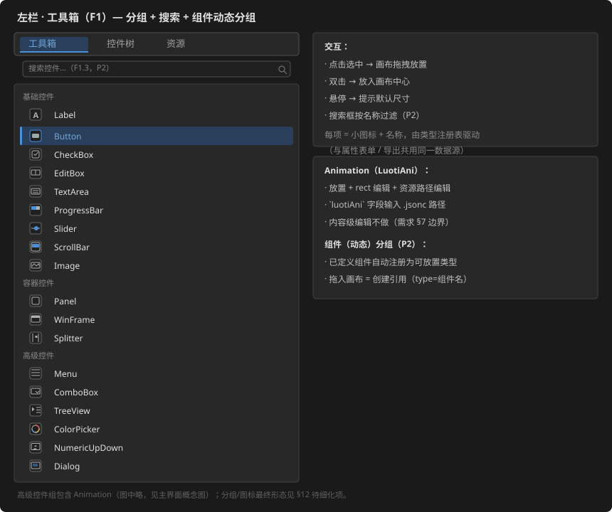

### 4.2 资源面板（F1 补充，P1）

- 左栏第三个 Tab："资源"——布局级 `resourceProviders` 挂载点列表（`name` + `path` 两列，可增/删/改，EditBox 行内编辑；**名称唯一约束**，重名时行内红色提示，04 §6 校验接口）。
- 用途：挂载资源目录后，图片/字体/动画等资源属性可填 `provider:<id>` 或相对路径。
- 说明：v1.1.1 无 ResourceLoader 控件（非可视控件概念由挂载点机制取代），故资源面板为布局级配置而非画布控件。

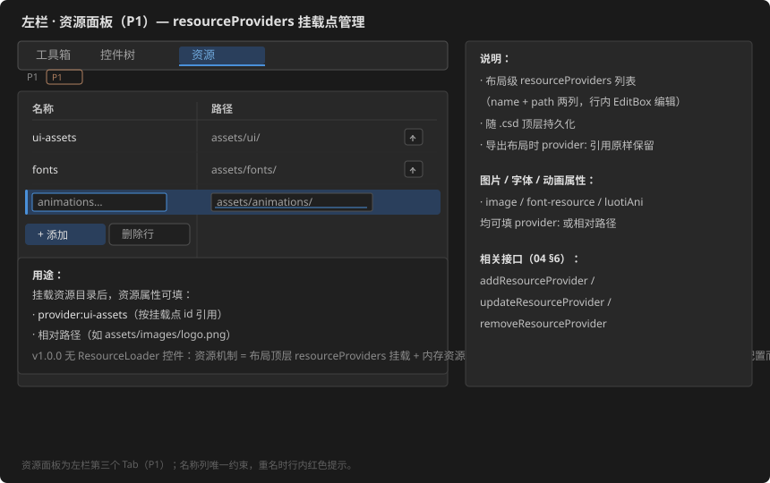

### 4.3 组件管理（P2）

- **组件编辑器**：进入组件编辑模式后，画布即组件 `template` 编辑区（复用设计态/属性面板/控件树）；旁挂 **props 声明表单**（名称/类型/默认值，增删改）；组件内控件默认锁定，防止误改引用侧。
- **工具箱"组件"动态分组**：已定义组件自动注册为可放置类型（类型注册表扩展），拖入画布 = 创建引用（`type=组件名`）。
- **引用交互**：画布中组件引用为整体块（rect 常规编辑）；属性面板显示组件 props 传值表单 + `_comp_` 对外事件绑定；**双击引用 → 进入组件编辑**；控件树中以组件图标区分。
- **导出**：`components` 区 + 引用（type + props）原样保留，引擎侧展开渲染（v1.1.1 实测支持嵌套）。

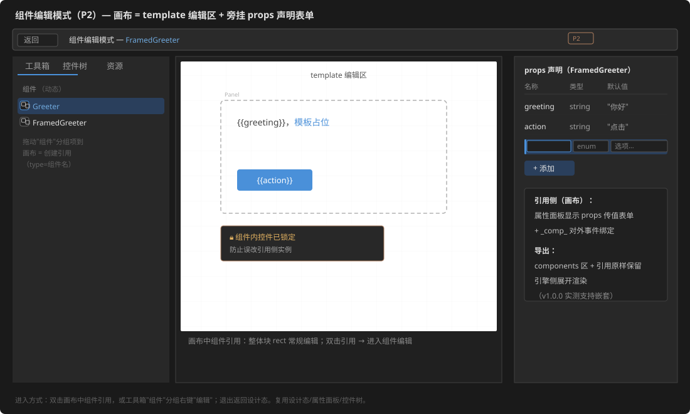

### 4.4 控件树（F2.2）

- `CreateTreeView` 展示内存模型层级；按控件类型区分图标；展开/折叠、选中联动。
- 选中 → 画布同步高亮 + 右栏加载属性（三联动，见 §9）。
- 右键菜单（P2）：重命名、复制、删除、置前/置后；P1 替代：属性面板 id 可编辑（重命名）、编辑菜单动作（复制/删除/置前/置后）。
- 拖拽节点调整父子关系（P2）。

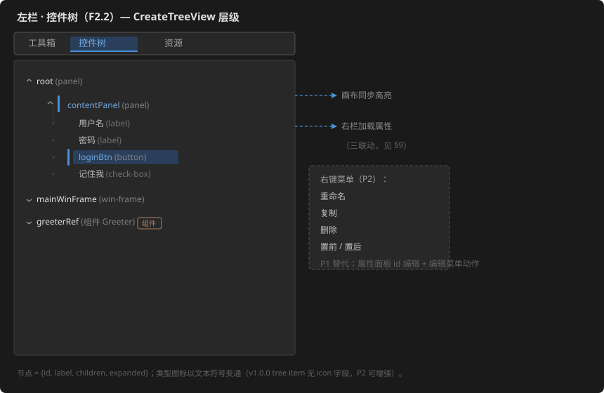

## 5. 中央画布（F2）

顶部画布工具栏（浮于画布左上角，视觉示意；实现为 canvasArea 面板内控件组，见 04 §9）：**缩放百分比选择（25%–200%）**、缩放重置、**网格开关**、**对齐开关**、**对齐/分布命令组**、**设计/预览切换**。

### 5.1 设计态

- 背景网格：25/50/100px 三档，颜色 #303030，随缩放联动。
- 被设计布局显示为独立"纸面"（默认白色 #FFFFFF，可经属性改为深色），与编辑器面板色区分。
- 选中高亮：蓝色边框 #4A90D9 + 8 方向 `HandleControl` 控点（拖动缩放）。
- 拖拽：从工具箱拖入 → 画布反变换定位；移动时**对齐参考线吸附（8px）**：#FF8800 辅助线。
- 多选：Ctrl+单击累计、框选（P2）；批量操作（移动/删除/属性交集编辑）。
- **对齐/分布命令**（选中 ≥2 个控件时启用）：左对齐/水平居中/右对齐、顶对齐/垂直居中/底对齐、等宽/等高、水平分布/垂直分布——作用于多选包围盒，坐标计算在业务层（LayoutEngine），并入 Undo 栈。
- 空白处右键：粘贴、全选、网格设置。
- 缩放：Ctrl+滚轮 或 工具栏选择；平移：中键拖拽 / 空格+拖拽（P2）。

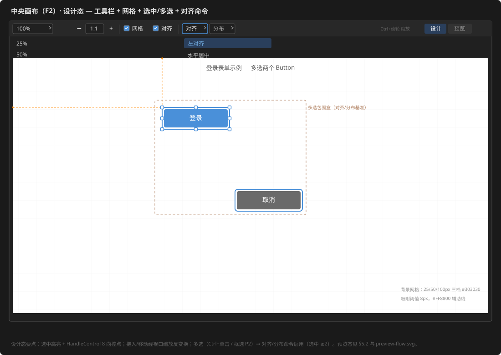

### 5.2 预览态（F6）

- 子视口内嵌 `LoadLayout(json)` 实时渲染当前内存模型。
- 点击可交互：所有已绑定事件经 `RegisterAction` 实演（未实现的动作占位提示）。
- 属性连续微调时 300ms 防抖刷新；切换预览态前自动保存未提交变更。

## 6. 右栏：属性 + 事件（Tab）

### 6.1 属性面板（F3）

- **分组折叠**（**2026-09-30 修订**：按属性语义四组，缺省全收起——初次创建/切换控件秒出，展开按需创建）：**背景色**（background 各态色槽）、**边框色**（border 各态色槽 + border-visible）、**字体及阴影**（text/text-shadow 各态色槽、shadow 开关与偏移、font 字体名 ComboBox、font-size）、**常规**（其余属性：playing、animation、资源图路径等）。
- **布局引擎属性**（UICS v1.1.1 支持，属性面板相应暴露）：
  | 属性 | 编辑控件 | 说明 |
  |------|---------|------|
  | x/y/w/h | NumericUpDown | 绝对定位 |
  | scale | NumericUpDown | xScale/yScale |
  | anchor / anchorOffset | ComboBox + NumericUpDown | 9 锚点 + 5 拉伸锚（top/bottom/left/right-stretch、fill） |
  | margin | 4×NumericUpDown | left/top/right/bottom |
  | padding / gap | 4×NumericUpDown / NumericUpDown | 容器布局间距 |
  | layout | ComboBox | 绝对 / h-flow / v-flow / grid |
  | columns / rows / flowWeight | NumericUpDown | grid 行列、flow 权重（条件显示） |
  | matchParentRect | CheckBox | 匹配父容器 |
  | sizeRatio | NumericUpDown | 尺寸比例 |
- 编辑控件映射（类型注册表驱动，动态生成）：
  | 属性类型 | 编辑控件 |
  |---------|---------|
  | 数值 | NumericUpDown（min/max/step） |
  | 颜色 | ColorPicker（#RRGGBBAA） |
  | 枚举 | ComboBox |
  | 布尔 | CheckBox |
  | 文本 | EditBox（数字/文本校验） |
  | 资源路径（Animation `luotiAni`） | EditBox（`.jsonc` 路径输入，仅托管不解析动画内容） |
- 多选时仅显示共有属性（批量编辑）。
- 底部：**重置默认值**按钮。
- 值变更即时回写画布（增量更新）+ 入 Undo 栈。

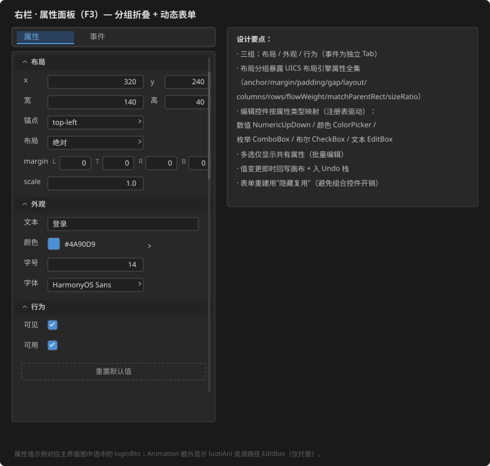

### 6.2 事件面板（F4）

- 绑定行：事件类型（ComboBox，**按控件类型注册表过滤可选事件**，04 §3.5）→ handler 名（EditBox + "建议命名"按钮）。
- 已绑定事件列表（控件 id、事件、handler），可删除。
- 命名冲突/不合规：行内红色提示 + 阻止导出。

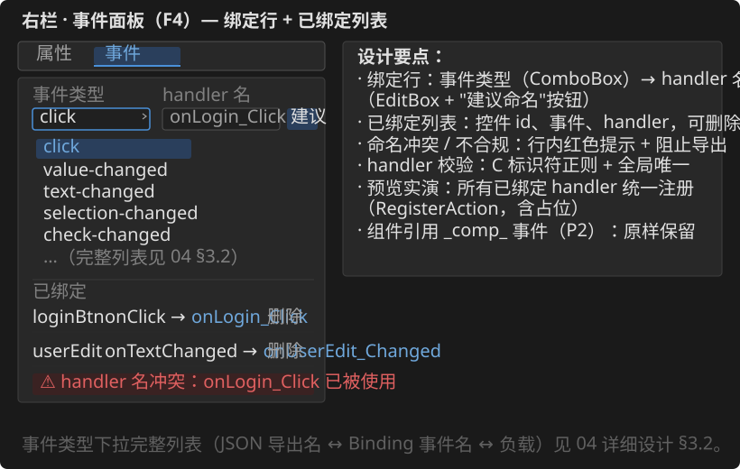

## 7. 状态栏

| 段 | 内容 | 字体规格 |
|----|------|---------|
| 左 | 操作提示（"就绪"；预览失败/解析错误红色显示） | font-ui 20px / text-secondary；错误态 text-warn |
| 中 | 当前选中：`id (type) x,y w×h`；多选时 `N 个控件` | font-ui 20px，数值部分 font-mono / text-primary |
| 右 | 缩放百分比、控件总数、网格/对齐开关状态（项目名与未保存 `*` 在标题栏，见 §10） | font-ui 20px / text-secondary |

> 状态栏高 28（规格修订，原 52；§2 表已同步）。三段间 1px 竖线 #3A3A3A，上边框 1px #404040。字体令牌见 §9.1。

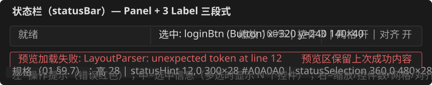

## 8. 配色与主题

| 元素 | 值 | 用途 |
|------|-----|------|
| 窗口背景 | #202020 | 主窗口底色 |
| 面板底色 | #282828 | 左/右栏、工具栏 |
| 区域边框 | #404040 | 分区分隔线 |
| 画布纸面 | #FFFFFF（可配置） | 被设计布局背景 |
| 选中边框 | #4A90D9 | 选中高亮、控点 |
| 对齐参考线 | #FF8800（80% 透明度） | 吸附提示 |
| 网格线 | #303030 | 参考网格 |
| 正文文本 | #E0E0E0 | 常规文本 |
| 次要文本 | #A0A0A0 | 提示/占位 |
| 警告 | #E06060 | 错误、命名冲突 |
| 错误行底色 | #3A2222 | 冲突/错误行背景（语义色，非界面主色） |

> 实现级参数（字体令牌/字号令牌/控件尺寸）见下方 **§9 界面参数规格**，本节颜色为概念级配色，二者互补，以本节 §9 为规格来源。本图集（§3–§7）已按 §9 令牌化。


## 9. 界面参数规格（Spec）

> 实现级参数（字体/字号/颜色/尺寸），全部界面参数以此为准，`main_layout.json` 按此落实。概念配色（§8）与此互补，以本节为规格来源。界面图（§3–§7）为概念示意，本节为其精确规格。

### 9.1 设计令牌

**字体令牌**（仅使用 `assets/fonts/` 内置字体）：

| 令牌 | 字体资源 | 说明 |
|------|---------|------|
| font-ui | HarmonyOS_Sans_SC_Regular | 界面主字体（中文/拉丁，默认） |
| font-mono | MapleMono-NF-CN-Regular | 等宽数据字体（坐标/统计/数值）；与 font-ui 不同族，专为数值/代码类展示设计 |

**字号令牌**（统一 20px）：

| 令牌 | 值 | 用途 |
|------|-----|------|
| size-title | 20 | 菜单栏菜单项、Tab 标题、面板标题、窗口标题栏 |
| size-body | 20 | 正文、控件名、菜单项、状态栏、属性行 |
| size-caption | 20 | 分组标题、搜索占位符、次要标注 |

**颜色令牌**（在 §8 基础上补齐实现级色阶）：

| 令牌 | 值 | 用途 |
|------|-----|------|
| bg-window | #202020 | 窗口底色、状态栏底色 |
| bg-panel | #282828 | 左/右栏、菜单栏、工具栏 |
| bg-raised | #2A2A2A | Tab 条、下拉弹出层（菜单面板） |
| bg-hover | #2A3F5C | 悬停/选中行底色 |
| border-panel | #404040 | 分区分隔、行分隔线 |
| border-subtle | #505050 | 控件描边（输入框、图标框） |
| border-active | #4A90D9 | 选中描边、Tab 下划线、激活态左条 |
| text-primary | #E0E0E0 | 主文字 |
| text-secondary | #A0A0A0 | 次要文字（提示、快捷键、未激活 Tab） |
| text-dim | #808080 | 占位符、弱化标注 |
| text-active | #6FA8DC | 激活/选中文字 |
| text-warn | #E06060 | 错误、命名冲突 |
| canvas-grid | #303030 | 画布参考网格 |
| canvas-paper | #FFFFFF | 画布纸面（可经属性改色） |
| canvas-snap | #FF8800 | 对齐参考线（80% 透明度） |

### 9.2 主窗口骨架（1200×800，设计坐标）

| 区域 | 位置坐标（x,y） | 尺寸（w×h） | 底色 | 字体 |
|------|----------------|-------------|------|------|
| 菜单栏 menuBar | 0,0 | 1200×28 | bg-panel | size-title / text-primary |
| 左栏 toolboxPanel | 0,28 | 240×744 | bg-panel | — |
| 左分隔条 leftSplitter | 240,28 | 6×744 | bg-window | — |
| 画布区 canvasArea | 246,28 | 708×744 | bg-window | — |
| 右分隔条 rightSplitter | 954,28 | 6×744 | bg-window | — |
| 右栏 propertyPanel | 960,28 | 240×744 | bg-panel | — |
| 状态栏 statusBar | 0,772 | 1200×28 | bg-window（上边框 border-panel） | size-body（见 §9.7） |

> 坐标自洽：1200 = 240 + 6 + 708 + 6 + 240；纵向 = 28（菜单栏）+ 744（栏区）+ 28（状态栏）= 800，无空隙。此表为规格定稿，覆盖 §2 的主窗口布局表（原 52 高状态栏已修订为 28）。

### 9.3 菜单栏

| 元素 | 规格 |
|------|------|
| 栏高 | 28（0,0 起，全宽 1200） |
| 菜单项 | 由 UICS 按 caption 顺序排版：项内左右 padding 8，项间距 36；行高 20（栏内垂直居中）；字号 size-title / text-primary；悬停/展开底色 bg-hover，文字 text-active |
| 下拉面板 | 宽 264，底色 bg-raised，描边 border-active（展开态） |
| 菜单项行高 | 24，字号 size-body / text-primary；悬停行底色 bg-hover，左条 border-active 3px |
| 快捷键 | 行尾右对齐（右缘 8px），size-body / text-secondary |
| 子菜单箭头 | 右三角 4×3，text-secondary |
| 分隔线 | 1px，border-panel |

### 9.4 左栏 Tab 区（工具箱/控件树/资源）

| 元素 | 位置/尺寸 | 规格 |
|------|----------|------|
| Tab 条 | 0,0 240×32 | Tab 字号 size-title；激活文字 text-active + 下划线 2px border-active；未激活 text-secondary |
| 搜索框 | 12,40 216×22 | 底色 bg-window，描边 border-subtle，占位符 size-caption / text-dim |
| 分组标题 | 12,68 起，行高 20 | size-caption / text-dim |
| 列表项 | 12,88 起，行高 26 连续 | 图标 16×16；控件名 size-body / text-primary；选中行 bg-hover + 左条 border-active 3px + 文字 text-active |
| 资源面板行 | 行高 26：name 列 12..112 / path 列 120..228 | 行内 EditBox 高 20；名称冲突行文字 text-warn |

### 9.5 画布（设计态）

| 元素 | 位置/尺寸 | 规格 |
|------|----------|------|
| 画布工具栏 | canvasArea 内 0,0 708×28 一行 | 底色 bg-panel，描边 border-panel；按钮 22 高、垂直居中，元素间距 8，起始 x 8，文字 size-body |
| 缩放 ComboBox | 8,3 88×22；下拉列表宽 120 | 选项 25/50/75/100/150/200% |
| −/1:1/+ 按钮 | ComboBox 后，各宽 40 | 符号 size-title |
| 网格/对齐 CheckBox | 1:1 后 | 勾选态描边 border-active |
| 设计/预览切换 | 行尾右对齐（−8） | 激活钮 bg-hover + 文字 text-active |
| 纸面 | 工具栏下 28px 起，四周余 16px | canvas-paper，可配置；纸面外区 bg-window |
| 网格 | 25/50/100px 三档 | canvas-grid（纸面上） |
| 选中态 | 蓝色边框 border-active + HandleControl 8 向控点（UICS 默认视觉） |
| 对齐参考线 | 1px，canvas-snap（80% 透明度），吸附距离 8px |

### 9.6 右栏（属性面板/事件面板）

| 元素 | 规格 |
|------|------|
| 分组标题 | 行高 20，字号 size-title / text-secondary |
| 属性行 | 行高 24：标签 size-body / text-secondary，值编辑控件高 22 |
| 事件绑定行 | 行高 24：类型 ComboBox + handler EditBox（高 22）；冲突行文字 text-warn |

### 9.7 状态栏

| 段 | Label id | 位置/尺寸 | 内容 | 字体 | 颜色 |
|----|----------|----------|------|------|------|
| 左 | statusHint | 12,0 300×28 | 操作提示（"就绪"） | font-ui size-body | text-secondary；错误态 text-warn |
| 中 | statusSelection | 360,0 480×28 | 选中信息 `id (type) x,y w×h` | font-ui size-body，数值部分 font-mono | text-primary，数值部分 text-secondary |
| 右 | statusRight | 908,0 280×28 | `缩放 N% | 控件 N | 网格 开/关 | 对齐 开/关` | font-ui size-body | text-secondary |
| 三段分隔 | — | 300 / 840 处 1px 竖线 | — | — | #3A3A3A |
| 上边框 | — | 顶边 1px | — | — | border-panel |

> 状态栏高 28（原 §2 的 52 修订为 28，与菜单栏等高，视觉更紧凑）。Label 垂直居中于 28 高栏内。

## 9. 三联动交互流

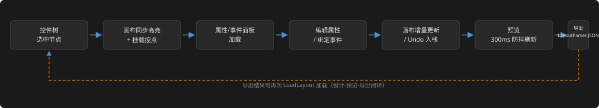

## 10. 窗口状态与阶段

| 状态 | 界面表现 |
|------|---------|
| 无项目 | 画布区居中提示"新建或打开项目（Ctrl+N / Ctrl+O）"，其余面板禁用 |
| 编辑中 | 标题栏显示项目名 `*.csd`；有未保存变更时显示 `*` |
| 预览失败 | 状态栏红色提示 + 预览区保留上次成功内容 |
| 导出成功 | 状态栏提示输出路径 |

## 11. 需求覆盖对照

| 需求 | 界面承载 |
|------|---------|
| F1 工具箱 | 左栏"工具箱"Tab（分组 + 搜索） |
| F2.1 拖拽编辑 | 中央画布设计态 + HandleControl 控点 |
| F2.2 控件树 | 左栏"控件树"Tab（CreateTreeView） |
| F2.3 缩放平移 | 画布工具栏 + Ctrl+滚轮（视口缩放机制） |
| F2.4 对齐辅助线 | 画布覆盖层（8px 吸附） |
| F2.5 撤销重做 | 编辑菜单 + Ctrl+Z/Y |
| F2.6 多选 | Ctrl+单击 / 框选 + 属性交集 |
| F2.7 背景网格 | 画布工具栏开关 |
| F3 属性编辑 | 右栏"属性"Tab（动态表单 + 分组） |
| F4 事件管理 | 右栏"事件"Tab + 导出 |
| F5 文件管理 | 文件菜单（最近文件子菜单） |
| F6 预览 | 画布"预览"Tab（子视口 LoadLayout） |
| F7 导出 | 文件菜单（JSON/代码/报告） |

## 12. 待细化项（进入详细设计/实施阶段落实）

1. 工具箱控件图标资源（`assets/images/` 小图标集）
2. 画布工具栏按钮组最终形态（紧凑布局）——构成已定（缩放 ComboBox/−/1:1/+/网格/对齐/对齐分布组/设计预览，见 04 §9），剩余为图标与间距打磨
3. 右键上下文菜单完整清单
4. `layouts/main_layout.json`：原型已在 04 §9 定稿（坐标与本文档 §2 对齐），实施阶段一按原型落地

## 13. 可行性评估（基于 UICornerstone v1.1.1）

> 依据：v1.1.1 的 `UICornerstoneAPI.h` / `PropertyNames.h` / `HandleControl` 源码 / `binding/include/*.h` 逐一核对。

### 13.1 总体结论

**v1.1.1 可直接支撑本概念设计的主干功能**（预计 ≥90% 界面零自研落地）；核心交互能力（选中缩放、树、菜单、属性表单、子视口预览、视口缩放）全部现成。仅需自研 4 处薄层（§13.3），且均为设计器业务逻辑层的小型组件，不触及 UICS 内核。

### 13.2 逐区域对照

| 概念设计区域 | UICS v1.1.1 能力 | 实现方式 | 说明 |
|---|---|---|---|
| 窗口/布局骨架 | 全部支持 | `Config::WithWindow` + JSON 静态骨架（`rect/anchor/gap/padding/visible/bgColor/borderColor`） | 21 种 JSON 控件类型齐备 |
| 菜单栏 + 快捷键 | 全部支持 | `menu-bar`/`menu-item`（`caption`/`shortcut` 属性 + `click` 事件）+ `RegisterAction` | JSON 键 `shortcut` 确认存在 |
| 左栏/右栏 Tab 切换 | 部分支持 | **自研**：两个 Label 切换钮 + 内容 Panel `visible` 切换 | UICS 无 Tab 控件，实现简单 |
| 工具箱分组列表 | 全部支持 | 静态 JSON 分组 + 程序式 `Create*` 工厂动态填充；类型注册表驱动 | 图标资源自备（§12.1） |
| 控件树 | 大部分支持 | `tree-view`（`items/label/children/expanded/selected-id`、`selected`/`hover` 配色） | item 无 icon 字段 → 文本符号变通（P2） |
| 搜索框 | 全部支持 | `edit-box` + `placeholder` + `text-changed` 过滤 | |
| 画布工具栏 | 全部支持 | `button`/`check-box`/`combo-box`/`image-button` | |
| 纸面 + 网格 | 全部支持 | `panel` 背景色 + **程序生成网格纹理 → `AdoptResource`（内存资源，v1.1.1 新增）→ `image` 铺底** | 无需网格图片文件 |
| **选中态 + 8 向控点** | **现成** | **`HandleControl` 内置**：虚线选择框 + 8 控点 + 中心移动十字 + 缩放/拖拽/最小尺寸/坐标反变换/系统光标反馈/自动跟随目标 | 核心自研零成本（§13.4 说明） |
| 对齐参考线 | 部分支持 | **自研**：1px 橙色 `image` 纹理（内存资源）按吸附位置显隐 | UICS 无矢量画线控件 |
| 属性动态表单 | 全部支持 | `numeric-up-down`（min/max/value/step/decimals）、`color-picker`（`color` + `color-changed`）、`combo-box`（items/selection-changed）、`check-box`、`edit-box` | 映射表见 §6.1 |
| 动画控件托管（需求 §7 补充） | 全部支持 | `type="animation"` + `luotiAni` 资源路径字符串（`test_layout.json` 实测 `"luotiAni": "assets/animations/rotateBtn/rotateBtn.jsonc"`），rect 常规编辑，预览由 UICornerstone 播放 | 内容级编辑不做（时间轴/关键帧仅托管保留） |
| 资源面板（P1） | 全部支持 | 布局顶层 `resourceProviders`（name/path）增删改 + `provider:<id>` 引用 | 无 ResourceLoader 控件，为布局级配置 |
| 组件系统（P2） | 全部支持 | 引擎级 `components`（props/template/`{{ }}`/`_comp_`，test_layout_advanced.json 实测含嵌套）；设计器做组件编辑器 + 工具箱动态分组 | 编辑模式与 props 表单为业务层实现 |
| 对齐/分布命令 | 部分支持 | **自研**（业务层包围盒坐标计算）：左/水平居中/右、顶/垂直居中/底、等宽/等高、水平/垂直分布，多选 ≥2 启用，入 Undo 栈 | 仅吸附线是 UICS 能力（吸附由设计器自绘层承担） |
| 布局引擎属性 | 全部支持 | `anchor`（9+5 锚）、`anchorOffset`、`margin`、`padding`/`gap`、`layout`（h-flow/v-flow/grid）、`columns`/`rows`/`flowWeight`、`matchParentRect`、`sizeRatio`（PN 实测）→ 属性面板 ComboBox/NumericUpDown 表单 | |
| 属性分组折叠 | 部分支持 | **自研**：分组标题 Label 点击切换内容 Panel `visible` | P2 可加动画 |
| 事件面板 | 全部支持 | `combo-box` + `edit-box` + Label 列表；冲突红色提示用 Label 前景色 | |
| 状态栏 | 全部支持 | `panel` + `label` | |
| 设计/预览双模式 | 全部支持 | 子视口 `CreateViewport` + `LoadLayout` 实时渲染 + `SetViewportScaleMode(1=fit)`/`SetCanvasSize` 缩放 | F6 核心机制现成 |
| 任意字体（F3.1） | 全部支持 | `font-file`/`font-resource`（v1.1.1 支持） | |
| 颜色编辑（F3.3） | 全部支持 | `color-picker` `color` 属性 + `color-changed` 回调 `{r,g,b,a}` | |
| 打开/保存文件 | 宿主能力 | Win32 `GetOpenFileName/GetSaveFileName` 薄封装（02 §7 / 04 §6，Binding 不含） | 非自绘 Dialog |
| 右键菜单 | 不支持 | **自研（P2）**：菜单按钮/双击替代；或 UICS 增强 `onContextMenu` 事件 | 事件全集 18 个无右键 |

### 13.3 需自研薄层清单（4 处，均在业务层）

1. **Tab 切换组件**（左/右栏）— Label 切换钮 + Panel visible
2. **网格 / 对齐线纹理** — 程序生成 RGBA 纹理经内存资源注册 + `image` 控件
3. **分组折叠** — 标题点击切换（P2 动画）
4. **右键菜单** — 属 P2 计划项，MVP 不阻塞（控件树右键同样 P2，P1 替代：属性面板 id 编辑 + 编辑菜单动作）

### 13.4 HandleControl 确认结论（源码级）

`src/HandleControl.cpp` 完整内置：虚线选择框（`m_selectionColor` 可配）、四角+四边中点 8 控点（填充/描边双色、active 变色）、中心十字移动指示器、8 向缩放与拖拽（含最小尺寸约束、父容器缩放反变换）、悬停系统光标（EW/NS/NWSE/NESW/Move）、目标过期自动隐藏。Binding 层经 `UICornerstone_CreateHandleControl(target, x, y, w, h, ...)` 使用，自动挂载到目标父容器并置顶、跟随目标。**概念图 §5 的选中样式即其默认视觉**。

### 13.5 可选 UICS 增强建议（非阻塞，P2 后评估）

| 增强 | 价值 | 成本 |
|------|------|------|
| HandleControl 视觉属性暴露到 C ABI/Binding（`handle-fill`/`handle-border`/`selection-color`/`handle-size`） | 设计器选中态可配主题色 | 低（属性系统已就绪） |
| 事件注入 `onContextMenu`（右键） | 设计器右键菜单能力 | 低 |
| TreeView item `icon` 字段 | 控件树类型图标 | 低 |

### 13.6 风险提示

- 对齐线/网格/控点等的"精确像素级"表现依赖 `image` 拉伸与内存纹理，需在实施阶段验证 1px 纹理在 `stretch` 下的锐利度（对齐线可改 `scaleType=none` + 整数坐标）。
- 属性面板动态表单按控件类型重建时，注意 UICS 组合控件（numeric-up-down 等）销毁/重建的实例开销，采用"隐藏复用"策略。

## 14. 静态控件映射表（各区域 UICornerstone 控件清单）

> 定位：定义设计器主界面中**静态部分**（布局骨架 + 固定结构）使用的具体 UICornerstone 控件类型。动态部分（工具箱列表、属性表单、控件树节点）另行定义。本表供实施阶段一（工程骨架）对照落地，确保 `main_layout.json` 与实际编码一致。

### 15.1 控件类型说明

| 标注 | 含义 |
|------|------|
| **JSON 静态** | 在 `main_layout.json` 中以 `{"type": "..."}` 定义，随布局加载一次创建 |
| **命令式动态** | 在 C++ 代码中以 `Create*` 工厂函数运行时创建，内容可动态增删 |
| **混合** | 容器为 JSON 静态，内部子控件部分为命令式动态 |

### 15.2 主窗口布局

| 区域 | JSON id | 控件类型 | 备注 |
|------|---------|---------|------|
| 根面板 | `root` | **panel**（JSON 静态） | 全窗口 1200×800，背景色 #202020 |
| 菜单栏 | `menuBar` | **menu-bar**（JSON 静态） | 高 28，4 组菜单（文件/编辑/视图/帮助） |
| 左分隔条 | `leftSplitter` | **splitter**（JSON 静态） | 竖排，宽 6，连接 toolboxPanel / canvasArea |
| 左栏容器 | `toolboxPanel` | **panel**（JSON 静态） | 240×744，边框色 #404040 |
| 画布容器 | `canvasArea` | **panel**（JSON 静态） | 708×744，边框色 #404040 |
| 右分隔条 | `rightSplitter` | **splitter**（JSON 静态） | 竖排，宽 6，连接 canvasArea / propertyPanel |
| 右栏容器 | `propertyPanel` | **panel**（JSON 静态） | 240×744，边框色 #404040 |
| 状态栏容器 | `statusBar` | **panel**（JSON 静态） | 1200×28，底部 |
| 状态栏左段 | `statusHint` | **label**（JSON 静态） | 提示文字 |
| 状态栏中段 | `statusSelection` | **label**（JSON 静态） | 选中信息 |
| 状态栏右段 | `statusRight` | **label**（JSON 静态） | 缩放/控件数/网格状态 |

### 15.3 左栏（工具箱 + 控件树 + 资源）

| 区域 | JSON id | 控件类型 | 备注 |
|------|---------|---------|------|
| Tab 切换区 | — | **命令式动态** | 3 个 Label 切换钮 + 3 个 Panel 内容区，互斥 visible |
| Tab 按钮"工具箱" | `tabToolbox` | **label**（命令式动态） | 点击切换 → 显示工具箱内容 |
| Tab 按钮"控件树" | `tabTree` | **label**（命令式动态） | 点击切换 → 显示控件树 |
| Tab 按钮"资源" | `tabResource` | **label**（命令式动态） | 点击切换 → 显示资源面板 |
| 工具箱内容区 | `toolboxContent` | **panel**（命令式动态） | 内容区容器，命令式填充工具项 |
| 工具项（每项） | — | **panel**（命令式动态） | 分组标题 panel + 工具按钮 panel，动态创建 |
| 工具按钮（如 button） | — | **panel**（命令式动态） | 内含 Label 显示名称，点击 → 放置模式 |
| 控件树 | `treeView` | **tree-view**（命令式动态） | `CreateTreeView`，展示内存模型层级 |
| 资源面板内容 | `resourceContent` | **panel**（命令式动态） | 内容区容器，命令式填充资源行 |
| 资源行（每行） | — | **panel**（命令式动态） | 内含 EditBox（name/path）+ Button（删除） |
| 添加资源按钮 | `addResourceBtn` | **button**（命令式动态） | "+ 添加资源"，点击新增空行 |

### 15.4 画布区（工具栏 + 子视口）

| 区域 | JSON id | 控件类型 | 备注 |
|------|---------|---------|------|
| 画布工具栏 | `canvasToolbar` | **panel**（JSON 静态） | 位于 canvasArea 顶部（y=32, h=32），z 序在 viewport 之下 |
| 缩放选择器 | `tb_zoom` | **combo-box**（JSON 静态） | items: ["25%","50%","75%","100%","150%","200%"]，selectedIndex=3 |
| 网格开关 | `tb_grid` | **check-box**（JSON 静态） | caption: "网格"，checked=true |
| 对齐开关 | `tb_snap` | **check-box**（JSON 静态） | caption: "对齐"，checked=true |
| 对齐命令组 | `tb_align` | **combo-box**（JSON 静态） | items: [6 种对齐模式]，enabled=false（选中≥2 时启用） |
| 预览切换 | `tb_preview` | **button**（JSON 静态） | caption: "预览" |
| 画布子视口 | — | **viewport**（命令式动态） | `CreateViewport`，承载被设计布局 |
| 画布覆盖层 | — | **image**（布局 children，Z 序可控） | 网格/选中框/控点/对齐线作为布局 image 节点 |

### 15.5 右栏（属性面板 + 事件面板）

| 区域 | JSON id | 控件类型 | 备注 |
|------|---------|---------|------|
| Tab 切换区 | — | **命令式动态** | 2 个 Label 切换钮 + 2 个 Panel 内容区 |
| Tab 按钮"属性" | `tabProp` | **label**（命令式动态） | 点击切换 → 显示属性表单 |
| Tab 按钮"事件" | `tabEvent` | **label**（命令式动态） | 点击切换 → 显示事件绑定 |
| 属性表单区 | `propForm` | **panel**（命令式动态） | 分组容器，动态构建属性行 |
| 属性分组标题 | — | **label**（命令式动态） | "布局"/"外观"/"行为"，点击折叠 |
| 属性行（数值） | — | **numeric-up-down**（命令式动态） | x/y/w/h/scale/anchorOffset 等 |
| 属性行（颜色） | — | **color-picker**（命令式动态） | background/text/border 等 |
| 属性行（枚举） | — | **combo-box**（命令式动态） | anchor/layout/style 等 |
| 属性行（布尔） | — | **check-box**（命令式动态） | visible/enabled/matchParentRect 等 |
| 属性行（文本） | — | **edit-box**（命令式动态） | caption/id/font 等 |
| 重置按钮 | `propResetBtn` | **button**（命令式动态） | "重置默认值" |
| 事件绑定行 | — | **panel**（命令式动态） | 每行：ComboBox（事件类型）+ EditBox（handler 名）+ Button（删除） |
| 建议命名按钮 | `suggestBtn` | **button**（命令式动态） | "建议命名" |
| 事件列表 | `eventList` | **list-view** 或 **panel+Label 行**（命令式动态） | 已绑定事件展示 |

### 15.6 动态 vs 静态边界总结

| 区域 | 静态（JSON） | 动态（命令式） | 理由 |
|------|-------------|---------------|------|
| 主窗口框架 | root / menuBar / statusBar / splitters / panels | — | 布局固定，零变更 |
| 左栏 Tab 切换 | — | tab 按钮 + content panels | 需按 Tab 显隐内容区 |
| 工具箱列表 | — | 工具项 panel + label | 由类型注册表驱动，运行时填充 |
| 控件树 | — | tree-view + 节点 | 随内存模型动态增删 |
| 资源面板 | — | 资源行 + 添加按钮 | 运行时 CRUD |
| 画布工具栏 | tb_zoom / tb_grid / tb_snap / tb_align / tb_preview | — | 固定位置，仅状态随选中变更 |
| 画布子视口 | — | viewport + 覆盖层 image | 承载被设计布局，覆盖层随选中更新 |
| 属性面板 Tab | — | tab 按钮 + 表单 | 表单按需重建 |
| 属性表单字段 | — | numeric-up-down / color-picker / combo-box / check-box / edit-box | 按选中控件类型动态生成 |
| 事件面板 Tab | — | tab 按钮 + 绑定行 | 列表随绑定变更 |
| 状态栏三段 | statusHint / statusSelection / statusRight | — | 固定结构，文字经 Binding 更新 |

### 15.7 实施阶段一落地检查清单

阶段一（工程骨架）需实现以下 JSON 静态控件，其余动态控件留待阶段四：

- [ ] `root` panel（1200×800）
- [ ] `menuBar`（28 高，4 组菜单）
- [ ] `leftSplitter` / `rightSplitter`（6 宽）
- [ ] `toolboxPanel` / `canvasArea` / `propertyPanel`（240×744）
- [ ] `statusBar`（28 高，3 个 label 子控件）
- [ ] `canvasToolbar` panel（700×32，内含 5 个子控件）
- [ ] `tb_zoom` combo-box（6 项）
- [ ] `tb_grid` check-box
- [ ] `tb_snap` check-box
- [ ] `tb_align` combo-box（6 项，enabled=false）
- [ ] `tb_preview` button

> 注：`canvasToolbar` 的静态定义已写入 `layouts/main_layout.json`（2026-08-27）。左栏 Tab 切换、右栏 Tab 切换、工具箱列表、控件树、资源面板、属性表单、事件面板均为命令式动态创建，不在 JSON 中定义。

---

## 15. 双接口规范：C++ Binding API vs 声明式 UI JSON

> 定位：本设计器采用 **"JSON 静态骨架 + Binding 命令式动态"** 双引擎方案（02 §2.2）。实施时**严禁混用两套命名规范**，以下对照表供审查与编码参考。

### 14.1 命名规范对照

| 类别 | C++ Binding API（命令式） | 声明式 UI JSON（布局文件） | 场景 |
|------|--------------------------|---------------------------|------|
| **属性名** | kebab-case（带连字符） | camelCase（驼峰） | 同一语义不同写法 |
| **事件名** | `click` / `check-changed` / `selection-changed` | `onClick` / `onCheckChanged` / `onSelectionChanged` | 加 `on` 前缀、驼峰 |
| **事件回调** | `SetCallback("click", lambda)` | JSON `"events": {"onClick": "handlerName"}` + `RegisterAction` | 命令式 vs 声明式绑定 |

### 14.2 典型属性对照表

| 语义 | Binding API（PropertyNames.h 常量） | JSON Schema（schema/declarative-ui.schema.json） | 备注 |
|------|-------------------------------------|--------------------------------------------------|------|
| 选中索引 | `"selected-index"` (`kSelectedIndex`) | `selectedIndex`（整数） | JSON 无连字符 |
| 复选状态 | `"check-state"` (`kCheckState`) enum | `checkState` enum `["unchecked","checked","indeterminate"]` | JSON 用枚举，Binding 用 SetEnum |
| 是否选中（旧属性） | `"checked"` (`kChecked`) bool | **不支持**（JSON 用 checkState） | ⚠️ 历史遗留，勿混用 |
| 文本内容 | `"caption"` (`kCaption`) | `caption`（字符串） | 一致 |
| 可见性 | `"visible"` (`kVisible`) | `visible`（布尔） | 一致 |
| 字体资源 | `"font-resource"` (`kFontResource`) | `fontResource`（字符串，`provider:name` 前缀） | JSON camelCase |
| 图片路径 | `"image"` (`kImage`) 只写 | `image`（字符串，相对 resourceRoot） | 一致 |
| 背景色状态 | `"background"` (`kBackground`) | `colors.background.normal`（对象结构） | JSON 嵌套 `{"normal":"#RRGGBBAA"}` |

### 14.3 关键差异示例

**复选框选中态**（常见错误源）：

```cpp
// ❌ 错误：把 JSON 的 checkState 当 Binding 属性用
checkBox.SetBool("checkState", true);  // 无效

// ✅ 正确 Binding：SetEnum + "check-state"
checkBox.SetEnum(PropertyNames::kCheckState, "checked");

// ✅ 正确 JSON：checkState 枚举值
{ "type": "check-box", "id": "cb1", "checkState": "checked" }
```

**下拉框选项**（JSON vs Binding 格式差异）：

```cpp
// ❌ 错误：把 JSON 数组格式当字符串传
combo.SetString("items", "[{\"label\":\"A\"},{\"label\":\"B\"}]");

// ✅ 正确 Binding：items 是字符串数组 JSON
combo.SetString(PropertyNames::kItems, "[\"A\",\"B\",\"C\"]");  // 简单字符串数组
// 或：
combo.SetString(PropertyNames::kItems, "[{\"label\":\"A\",\"value\":\"a\"}]"); // 对象数组

// ✅ 正确 JSON（同上格式，但用 camelCase 键）
{ "type": "combo-box", "items": ["A", "B", "C"] }
```

**事件绑定**（JSON 声明 vs Binding 注册）：

```cpp
// Binding 命令式：SetCallback + Event 具名访问器
button.SetCallback(PropertyNames::kEventClick, [&](const Event& e) {
    if (e.IsClick()) { /* ... */ }
});

// JSON 声明式：events 键 + RegisterAction
// main_layout.json:
{ "type": "button", "id": "btn1", "events": { "onClick": "onBtn1_Click" } }

// App.cpp:
ui->RegisterAction("onBtn1_Click", [](UICornerstone::Control ctl) { /* ... */ });
```

### 14.4 设计器实现原则

1. **静态骨架用 JSON**：`main_layout.json` 中所有属性键遵循 **Schema camelCase**（`selectedIndex`、`checkState`、`fontResource`）。
2. **动态行为用 Binding**：运行时通过 `Control::SetXxx` / `GetXxx` 操作控件，属性名遵循 **PropertyNames.h kebab-case**（`"selected-index"`、`"check-state"`、`"font-resource"`）。
3. **混合场景注意边界**：`FindControl` 查找的控件同时存在于两种命名空间——读取时用 Binding 键，写入 JSON 序列化时用 Schema 键（需转换）。
4. **颜色结构**：JSON `colors` 对象嵌套 `{normal: "#RRGGBBAA"}`；Binding `SetStateColor` 接受四态 UIColor 参数。导出序列化时保持嵌套结构。

### 14.5 已知踩坑记录（供后续实施参考）

| 问题 | 根因 | 解法 |
|------|------|------|
| `FindControl("tb_zoom")` 返回无效 | JSON 嵌套在 `canvasArea > canvasToolbar` 下，但 `FindControl` 只搜顶层 | 改用命令式创建后 `AddChild` 挂到 canvasArea 子树 |
| JSON `checked: true` 不生效 | Schema 要求 `checkState` 枚举，非 `checked` 布尔 | 改用 `"checkState": "checked"` |
| `selected-index` vs `selectedIndex` 混淆 | 混用 Binding 键名到 JSON（或反之） | JSON 用 `selectedIndex`，Binding 用 `"selected-index"` |
| Overlay `type:"image"` 加载失败 | 图片路径相对 `resourceRoot`，写错目录 | 纹理写 `<exe>/assets/gen/`，JSON 引用 `"gen/xxx.png"` |

---

> 本章节基于 UICornerstone v1.1.1 文档（`docs/cpp-binding.html` / `docs/declarative-ui.html` / `tools/schema/declarative-ui.schema.json`）整理，供 04 详细设计 §1.1 / §3.2 与 05 实施编码参考。
