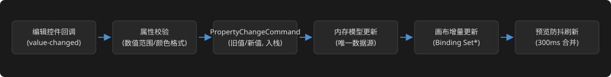
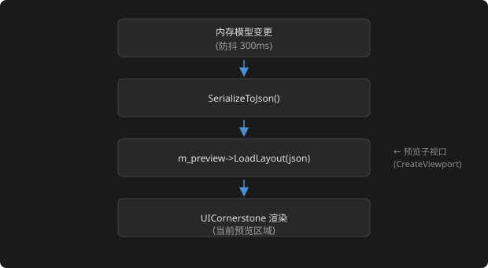

# CornerstoneDesigner 详细设计文档

> 修订记录：v3.17 —— §9 定稿 propertyTabs 页面细化：tabProperty（v-flow 三组表单：布局 x/y/w/h+锚点 ComboBox、外观 颜色/文本、行为占位 + 重置按钮）、tabEvent（事件类型 ComboBox/handler 弹性行 + 建议命名/添加绑定按钮）；记录经验（ComboBox items 对象数组、flowWeight 方向语义、行高 30）。
> 修订记录：v3.16 —— §9 定稿右栏 propertyPanel 补内部 TabControl（propertyTabs，`anchor:"fill"` 铺满，两 Tab：属性/事件），统一 `font:{size:20}`。
> 修订记录：v3.15 —— §9 定稿 toolboxTabs 统一字体继承：TabControl 设 `font:{size:20}`，三 page（tvToolbox/tvTree/lvResource）未声明时沿父链继承（v1.1.1 通用 font 键 + 继承机制）。
> 修订记录：v3.14 —— §9 定稿资源 Tab 由 tree-view(tvResource) 改为 list-view(lvResource)，`mode:"multi"`（Report 多列）展示 resourceProviders（columns 名称/路径 + rows）。
> 修订记录：v3.13 —— §9 定稿工具箱内容（阶段一·B）：tvToolbox items 填 4 分组 27 控件（含 leadingControl image 图标 `gen/icons/*.svg`）、tvTree/tvResource 占位；图标资源与 TreeView 字体（JSON `font:{size:20}`）详见 05 阶段一·B。
> 修订记录：v3.12 —— §9 定稿 toolboxTabs 三 Tab 页由 panel 改为 tree-view（工具箱 tvToolbox/控件树 tvTree/资源 tvResource，均 `anchor:"fill"` 铺满 tab 页内容区，带初始 items）。
> 修订记录：v3.11 —— §9 定稿 toolboxPanel 补内部 TabControl（v1.1.1 原生，`anchor:"fill"` 铺满，toolboxPanel 设 anchor 布局），三 Tab（工具箱/控件树/资源）。
> 修订记录：v3.10 —— §9.1 移除 Splitter 手动同步（按面板边界），改为引擎整链自动重排（splitter1 保持、splitter2/property 随 canvas 弹性链式移动），依 UICornerstone 主设计建议。
> 修订记录：v3.9 —— §9 定稿 middleArea 改 h-flow 五元素链式布局（toolbox|splitter1|canvas|splitter2|property），补 Splitter 引擎模式（v1.1.1 增强）；§9.1 补 Splitter 引擎模式规则。
> 修订记录：v3.8 —— §9 定稿升级为 v-flow+h-flow 嵌套布局：root v-flow（menu-bar 固定高 + middleArea flowWeight:1 弹性 + status-bar 固定高），middleArea 内 h-flow 三栏；§9.1 补 menu-bar/status-bar 布局模式（v1.1.1 增强）与更新验证记录。
> 修订记录：v3.7 —— §9 定稿改为三栏 h-flow 布局（root `layout:{type:h-flow,gap:0}`，左/右 flowWeight:0 固定 240、中 flowWeight:1 弹性），移除 menuBar/splitter/statusBar；新增 §9.1 窗口 resize 同步机制（SDL 动态解析 syncRootToWindow + UIWindowFlags::Resizable + 布局引擎选型结论 h-flow vs anchor fill + 锚点 kebab 小写）。
> 修订记录：v3.6 —— 全量刷新对齐 UICornerstone **v1.1.1**：§1.1 ControlProperties 补充 leadingControl 容器/shape primitives/listview rows-column/tabcontrol tabs/statusbar items/contextmenu items（均经 `extended` 结构化承载）；§3.2 事件表新增 onTabChange/onSplitterMoved/onColumnSort/onItemClick/AnimationEnded；§4.1 动态表单补 shape/TabControl/StatusBar/ListView/ContextMenu 属性行；§9 设计器自身布局注记 TabControl/StatusBar/ContextMenu 原生替代机会（P2）。
> 修订记录：v3.5 —— 等宽对比后回退，§9 定稿 font name 恢复 HarmonyOS_Sans_SC_Regular，与 `layouts/main_layout.json` 一致。
> 修订记录：v3.4 —— 界面字体切换 MapleMono-NF-CN-Regular（01 v2.6）：§9 定稿 font name 更新，与 `layouts/main_layout.json` 一致。
> 修订记录：v3.3 —— 字号统一 20px（01 v2.5）：§9 定稿全部 font size 20，与 `layouts/main_layout.json` 一致。
> 修订记录：v3.2 —— 字号统一 18px（01 v2.4）：§9 定稿全部 font size 18，与 `layouts/main_layout.json` 一致。
> 修订记录：v3.1 —— 字号统一 16px（01 v2.3）：§9 定稿全部 font size 16，与 `layouts/main_layout.json` 一致。
> 修订记录：v3.0 —— 字号令牌上调（01 v2.2）：§9 定稿 menuBar font 14、statusBar label 13，与 `layouts/main_layout.json` 一致。
> 修订记录：v2.9 —— 按 03 §9 界面参数规格刷新 §9 main_layout.json 定稿：状态栏 52→28 高（label 12px HarmonyOS + 段色 #A0A0A0/#E0E0E0）、栏区 720→744（28+744+28=800 坐标自洽）、menuBar/statusBar 补 font 规格；与 `layouts/main_layout.json` 实测完全一致。v2.8 —— 全链路一致性审核（02→05）：§10 补子控件越界提示（02 §4 M3 约束检测的 Dialog 提示落地）；其余 02 契约核对无冲突（模块职责、注册表、Binding API 映射、耦合边界、测试）。
> 修订记录：v2.7 —— 实施视角反向审核修正：§0 App 框架统一预览为 `m_ui->CreateViewport` 子视口（删除独立 m_preview 实例）；§6 补 `.csd` 项目文件顶层结构（metadata/layout/events/resourceProviders/components，layout 为唯一数据源）；§7.2 补生成代码与 C++ Binding 的 RegisterAction 挂接说明；§9 画布工具栏明确为面板内控件组（子视口之外，不依赖视口内嵌）；视图菜单补缩放 25%（Ctrl+0）与 §2.3 档位一致。
> v2.6 —— 第二轮正向核查（深挖 9 张面板 SVG 细节）：§4.1 补表单滚动（scroll-bar 容器）；§1.1 补字体 font-file/font-resource 加载落地。其余 SVG 细节（悬停态/子菜单/锁定/props 三列/多选包围盒/错误态等）均已覆盖。
> v2.5 —— 正向全量核查 03 v4（含 9 张面板 SVG）补 9 处：§1 窗口可拉伸/dpiScale；§2.3 Ctrl+滚轮缩放档位；§4.1 分组折叠交互；§8 纸面（视口背景默认白可配置）；§9 网格三档/切换入口、对齐线颜色、空白处右键 P2+P1 替代、控件树拖拽父子 P2；§10 导出成功提示。
> v2.4 —— 按概念设计（03 v4，含 9 张面板 SVG）二次全量刷新：新增 §3.5 事件面板 UI（绑定行/列表/红色冲突提示）；§9 补工具箱段落（搜索框 P2、双击放中心、组件动态分组 P2）与组件编辑模式（P2）；§6 资源提供者名称唯一校验；测试补事件面板 UI、资源重名用例。
> v2.3 —— 概念设计反向审核修正：§4.1 分组改三组（事件为右栏独立 Tab）；§9 编辑菜单补上移/下移、补控件树段落、窗口标题/未保存标记与无项目禁用、组件引用建模（P2）；§2.2 补双击放置/悬停提示注释；§2.3 平移、§2.4 框选标 P2。
> v2.2 —— 按概念设计（design/03 v3）刷新：§2.2 补对齐/分布/等宽等高命令（AlignMode，入 Undo）；§4.1 补资源路径编辑控件与表单"隐藏复用"策略；§5 补 AlignControlsCommand；§6 补 resourceProviders（P1）与 components（P2）管理接口；§3 补 `_comp_` 组件事件；§7/§8 组件导出保留与预览展开；§9 左栏三 Tab（含资源）、工具栏对齐/分布组；测试补对齐命令/资源面板/组件工作流。
> v2.1 —— 与概念设计文档（design/03）同步定稿 main_layout.json 原型：补全四组菜单（文件/编辑/视图/帮助）、增加右分隔条 rightSplitter、状态栏改为 Panel+3 Label 三段式、左栏 Tab（工具箱/控件树）结构说明；坐标遵循 1200 = 240+6+708+6+240。
> 前置条件：设计规格文档已审核通过。

## 0. 应用框架（App）

设计器使用 **C++ Binding 的 Embedded 模式**（`ProcessEvents / Update / Render / Clear / Present`）自持主循环，为多区域联动与测试注入保留最大控制权：

```cpp
// include/Designer/App.h（概要）
class App {
public:
    bool init();                                  // UICornerstone::Create(Config) + LoadLayout(骨架) + 建预览子视口
    int  run();                                   // Embedded 循环 + auto=<秒> 无人值守退出
    void shutdown();

private:
    std::unique_ptr<UICornerstone::UICornerstone> m_ui;    // 主实例（设计器自身 UI；预览为其内子视口，见 §8）
    std::unique_ptr<ControlModel>   m_model;      // 内存控件树（独立于渲染）
    ProjectManager  m_project;
    LayoutEngine    m_layout;
    EventManager    m_events;
    UndoRedoService m_undo;
    CodeGenerator   m_codeGen;
};
```

要点：

- 主实例 `m_ui` 负责设计器自身 UI（JSON 骨架 + 命令式动态区）；预览与设计态画布均为 `m_ui->CreateViewport(x,y,w,h)` 创建的子视口（非独立实例），与编辑器共享同一渲染循环。
- 鼠标/键盘事件经 `ProcessEvents` 派发给设计器控件树；业务回调（`Control::SetCallback`、`RegisterAction`）驱动内存模型变更。
- 全局快捷键（Ctrl+Z/Ctrl+Y/Ctrl+S 等）在 Embedded 循环中经键盘事件回调捕获，分发到 UndoRedoService/ProjectManager。

## 1. 控件内存模型（ControlModel）

设计器维护一套独立于 UICornerstone 渲染的控件属性内存模型。每次用户操作修改内存模型，再通过 Binding 同步到画布渲染；序列化以内存模型为唯一数据源。

### 1.1 属性系统

属性键名与 UICornerstone 属性系统对齐（`PropertyNames.h` 常量，Binding 构建时自动从核心复制，可直接 `#include "PropertyNames.h"` 使用）：

```cpp
// include/Designer/ControlModel.h

struct SRect {
    float x, y, w, h;          // 一律存储未缩放值（见 design-rules.md）
};

struct FontConfig {
    int size = 14;
    std::string family;        // 如 "HarmonyOS_Sans_SC_Regular"
    std::string style;         // "" | "bold"
};

struct ControlProperties {
    std::string type;          // 小写 kebab-case：panel/label/button/...
    std::string id;
    std::string caption;
    SRect rect;
    FontConfig font;
    nlohmann::json colors;     // 原始结构保留（background/text/border 的 normal/hover/...）
    bool visible = true;
    bool enable  = true;
    float scaleX = 1.0f;
    float scaleY = 1.0f;
    nlohmann::json extended;   // 控件特有属性原样保留（actor、luotiAni、alignment 等）
};
```

> 颜色等结构化属性以 `nlohmann::json` 原样承载，避免为每种控件重复建模；未知字段在往返序列化中原样保留（兼容性维护，见设计规格 §9）。布局引擎属性（anchor/anchorOffset/margin/padding/gap/layout/columns/rows/flowWeight/matchParentRect/sizeRatio）与控件特有属性（luotiAni 等）同样经 `extended` 原样承载，由类型注册表声明后属性面板方可编辑（§4.1）。字体资源经 `font-file`/`font-resource` 加载（03 §13.2 F3.1），`FontConfig.family` 与加载的字体名对应。
>
> **v1.1.1 新增承载**（均经 `extended` 结构化，toJson 递归原样输出）：
> - **leadingControl 容器**（TreeView/ListView/StatusBar）：`extended["leadingControl"]` = 子控件对象（`type`/`rect`/`id`/`colors` 等，TreeView 行首/ListView 列头+行首+单元格三级/StatusBar 段图标均可挂任意控件，SetPtr 运行时挂树）；`extended["leadingGap"]`（float）、`extended["leadingAlign"]`（9 锚点枚举）。
> - **Shape 图元**：`extended["shape"]`（枚举）/`extended["fill"]`（color）/`extended["stroke"]`（color）/`extended["lineWidth"]`（float）/`extended["radius"]`（float）/`extended["ringWidth"]`（float）/`extended["points"]`（[{x,y}] 数组）/`extended["primitives"]`（多图元组合数组，每项含 shape/rect/radius/fill/stroke/lineWidth/points）。
> - **TabControl tabs**：`extended["tabs"]`（数组），每项含 `title`/`icon`/`page`（子控件对象）；`extended["position"]`（top/bottom/left/right）/`extended["fontSize"]`（float）/`extended["currentIndex"]`（int）。
> - **ListView columns/rows**：`extended["columns"]`（数组，每项 `title`/`width`/`sortable`/`icon`）/`extended["rows"]`（数组，每项 `id`/`cells`/`icon`/`cellControls`）；`extended["mode"]`（multi/single）/`extended["multiSelect"]`/`extended["rowHeight"]`/`extended["headerHeight"]`/`extended["gridlines"]`/`extended["hover"]`。
> - **StatusBar items**：`extended["items"]`（数组，每项 `id`/`text`/`align`/`icon`/`menu`/`onClick`）；`extended["fontSize"]`/`extended["itemHeight"]`。
> - **ContextMenu items**：`extended["items"]`（数组，每项 `caption`/`shortcut`/`type(separator)`/`icon`/`onClick`）；控件级 `extended["contextMenu"]` 键绑定。
> - **Image 节点**：`extended["image"]`（文件路径，相对 resourceRoot）/`extended["imageResource"]`（内存资源 ID）/`extended["providerName"]`（ResourceProvider 引用）/`extended["scaleType"]`（stretch/fit-center/center-crop/none）/`extended["matchParentRect"]`/`extended["alpha"]`（0-255）。
> - **Animation/LuotiAni**：`extended["animation"]`（JSONC 路径字符串）/`extended["playing"]`/`extended["loop"]`/`extended["frame"]`。

### 1.2 控件树与事件

```cpp
class ControlModel {
public:
    std::string id;
    ControlProperties props;
    std::vector<std::unique_ptr<ControlModel>> children;
    ControlModel* parent = nullptr;
    int zIndex = 0;
    std::vector<EventBinding> events;   // 见 §3

    nlohmann::json toJson() const;              // LayoutParser 兼容格式
    static std::unique_ptr<ControlModel> fromJson(const nlohmann::json& j);
};
```

### 1.3 序列化规则（对齐 UICornerstone LayoutParser）

| 规则 | 说明 |
|------|------|
| 颜色格式 | 输出 8 位十六进制 `#RRGGBBAA`；输入兼容 6 位 `#RRGGBB`（补 FF）与对象格式 `{r,g,b,a}` |
| 空值省略 | 默认值属性不写入 JSON（与 test_layout.json 的省略惯例一致） |
| 空子控件 | `children` 数组为空时省略字段 |
| 数值精度 | 坐标和尺寸保留 1 位小数 |
| 控件类型 | 小写 kebab-case（`panel`、`menu-bar`、`edit-box`、`win-frame`…） |
| 未知字段 | 原样保留（`extended` 承载），往返不丢失 |
| 事件绑定 | `"events": { "onClick": "handlerName" }`（见 §3） |

### 1.4 JSON 输出示例（LayoutParser 兼容）

```json
{
  "version": "1.0",
  "controls": [{
    "type": "panel",
    "id": "root",
    "rect": { "x": 0, "y": 0, "w": 800, "h": 600 },
    "colors": { "background": { "normal": "#282828FF" } },
    "children": [
      {
        "type": "button",
        "id": "btn1",
        "caption": "Click Me",
        "captionSize": 16,
        "rect": { "x": 20, "y": 60, "w": 200, "h": 80 },
        "colors": { "background": {
          "normal": "#4A90D9FF", "hover": "#5BA0E9FF", "pressed": "#3A80C9FF"
        } },
        "events": { "onClick": "onBtn1_Click" }
      },
      {
        "type": "label",
        "id": "statusLabel",
        "caption": "Ready",
        "rect": { "x": 20, "y": 160, "w": 400, "h": 24 },
        "font": { "size": 14 }
      }
    ]
  }]
}
```

## 2. 画布渲染与控件树同步（LayoutEngine）

### 2.1 渲染同步策略

内存模型是唯一数据源；Binding 控件树是其视图。两种同步路径：

1. **全量重建**（放置/删除控件、Z-Order 变更）：从内存模型生成 JSON → `m_ui->LoadLayout(json)` 重建画布子视口内容（走与导出相同的 LayoutParser 链路，天然验证 N4）。
2. **增量更新**（属性微调/拖动）：`Control::SetColor/SetFloat/SetString/SetEnum/SetBool/SetInt` 定向写回已存在的 Binding 控件（`FindControl(id)` 定位）。

> 预览区刷新策略（300ms 防抖）见 §8。

### 2.2 接口

```cpp
enum class AlignMode { Left, HCenter, Right, Top, VCenter, Bottom };

class LayoutEngine {
public:
    // 放置/移动（画布坐标 → 控件坐标，见 2.3 反变换；双击工具箱项 = 放入画布中心，悬停提示默认尺寸，03 §4.1）
    SRect calculatePlacement(const SPoint& canvasPos, const std::string& controlType);
    bool isWithinBounds(const ControlModel* child, const ControlModel* parent) const; // 子不出父边界

    // 对齐吸附（阈值 kSnapThreshold = 8px）
    SPoint snapToGuides(const SPoint& pos, const std::vector<ControlModel*>& siblings) const;

    // 对齐/分布命令（03 §5.1：选中 ≥2 启用，作用于多选包围盒，业务层坐标计算，入 Undo 栈）
    void alignControls(std::vector<ControlModel*>& controls, AlignMode mode); // 左/水平居中/右/顶/垂直居中/底
    void distributeEvenly(std::vector<ControlModel*>& controls, bool horizontal);
    void makeSameSize(std::vector<ControlModel*>& controls, bool width, bool height); // 等宽/等高

    // Z-Order（binding 侧以 AddChild 顺序重排 + 全量重建）
    void bringToFront(ControlModel* control);
    void sendToBack(ControlModel* control);
    void moveUp(ControlModel* control);
    void moveDown(ControlModel* control);
};
```

### 2.3 坐标映射（含视口缩放反变换）

画布区为子视口，缩放由框架视口机制承担：

- 缩放档位：25%–200%（`SetViewportScaleMode`，fit/stretch 视设计规格 §6 选定；`SetCanvasSize(w,h)` 定义基准画布）。
- 鼠标反变换：`m_ui->GetViewportScale(sx, sy)` 取当前缩放 → `控件坐标 = (画布屏幕坐标 - 视口原点) / (sx, sy)`。
- 平移（P2）：调整视口锚点或画布滚动偏移，反变换同式。
- **Ctrl+滚轮缩放**（03 §5.1）：Embedded 循环滚轮事件回调，按缩放档位（25/50/75/100/150/200%）切换 `SetViewportScaleMode`。

```cpp
struct CoordinateMapper {
    static SPoint screenToControl(const SPoint& screen, const SPoint& viewportOrigin, float sx, float sy);
    static SPoint controlToScreen(const SPoint& control, const SPoint& viewportOrigin, float sx, float sy);
};
```

### 2.4 选中与控点

- 单击选中：画布点击 → 反变换 → 内存模型命中检测 → 高亮边框绘制 + 挂载 `CreateHandleControl(target, ...)`（8 方向缩放，回调写入 `MoveControlCommand`/`ResizeControlCommand` 并增量更新 rect）。
- 多选：Ctrl+单击维护 selection 集合；批量属性编辑见 §4；对齐/分布/等宽等高命令见 §2.2；框选（P2，03 §5.1）。
- 覆盖层（选中框、对齐辅助线、网格）绘制不破坏子视口裁剪状态（design-rules.md §4）。

## 3. 事件管理器（EventManager）

### 3.1 数据结构

```cpp
struct EventBinding {
    std::string controlId;
    std::string eventType;     // 内部事件名（Binding 层）："click"、"value-changed"…
    std::string jsonEventName; // 导出用 LayoutParser 事件名："onClick"…
    std::string handlerName;   // 用户指定的 C 函数名
};
```

### 3.2 事件类型注册表（JSON 导出名 ↔ Binding 事件名 ↔ 负载）

| JSON 导出事件名 | Binding 事件名（Event::GetName） | 负载 | 适用控件 |
|----------------|--------------------------------|------|---------|
| onClick | click | 无 | Button/MenuItem/ImageButton |
| onValueChanged | value-changed | floatVal / doubleVal | ScrollBar/Slider/NumericUpDown/Splitter |
| onTextChanged | text-changed | strVal | EditBox/TextArea |
| onSelectionChanged | selection-changed | {idx,val} | ComboBox / ListView（模式 multi） |
| onCheckChanged | check-changed | intVal（三态） | CheckBox |
| onColorChanged | color-changed | UIColor | ColorPicker（**轮询**，Binding 中 IsColorChanged 恒 false） |
| onPositionChanged | position-changed | floatVal | WinFrame 拖动 |
| onConfirm | confirm | 无 | Dialog |
| onCancel | cancel | 无 | Dialog |
| onClose | close | intVal = DialogResult | WinFrame/Dialog |
| onEnter | enter | 无 | 输入类控件 |
| onSelect | select | treeNode.id | TreeView / ListView（single 模式） |
| onExpand | expand | treeNode.id | TreeView |
| onCollapse | collapse | treeNode.id | TreeView |
| **onTabChange** | onTabChange | newIdx（int） | TabControl |
| **onSplitterMoved** | onSplitterMoved | ratio（float） | Splitter |
| **onColumnSort** | onColumnSort | {colIdx, ascending} | ListView |
| **onItemClick** | onItemClick | {rowId, cellIdx} | ListView |
| **AnimationEnded** | AnimationEnded | 无 | Animation（LuotiAni 非循环结束） |

> 组件引用对外事件（P2，03 §4.3）：引擎 `_comp_` 前缀事件名（`_comp_xxx`）原样保留，设计器在组件编辑模式/引用属性面板中可绑定，导出不做转换。

### 3.3 接口

```cpp
class EventManager {
public:
    bool addEvent(const std::string& controlId, const std::string& jsonEventName,
                  const std::string& handlerName);
    bool removeEvent(const std::string& controlId, const std::string& jsonEventName);
    std::vector<EventBinding> getEvents(const std::string& controlId) const;
    bool isHandlerNameUnique(const std::string& name) const;
    std::string suggestHandlerName(const std::string& baseName) const;  // 冲突自动追加编号
    bool isValidIdentifier(const std::string& name) const;               // C 标识符正则
    std::vector<EventBinding> exportAllEvents(const ControlModel* root) const;
};
```

### 3.4 预览实演

预览时把事件绑定桥接到运行回调：

```cpp
m_ui->RegisterAction("onSubmitClick", [this](UICornerstone::Control ctl) {
    // 用户绑定的事件按 handlerName 分发；未实现的动作给出占位提示
});
```

JSON 布局中的 `events.onClick = "handlerName"` 由 LayoutParser 解析后查找 `RegisterAction("handlerName", …)` 注册的 lambda。设计器将**所有**已绑定 handler 名统一注册（含占位），保证预览可点击。

### 3.5 事件面板 UI（右栏"事件"Tab，03 §6.2）

- **绑定行**（命令式构建）：事件类型 `CreateComboBox`（按控件类型注册表过滤可选事件，值 = JSON 导出名）→ handler 名 `CreateEditBox`（`text-changed` 实时校验）+ "建议命名"按钮（`suggestHandlerName` 自动追加编号）。
- **已绑定列表**：每行 = 控件 id + 事件名 + handler 名 + "删除"钮；命令式填充，数据源 `EventManager::getEvents`。
- **冲突/不合规提示**：handler 重复或非 C 标识符 → 行内 `Label` 前景色 #E06060 红色提示（03 §8 警告色）+ 阻止导出（与 §7.2 校验联动）。
- 数据持久化：`"events": { "onClick": "handlerName" }`（§1.3），导出经 `exportAllEvents`。

## 4. 属性编辑器（PropertyPanel）

### 4.1 动态表单

属性面板是命令式构建的动态区域：

- 按选中控件类型从类型注册表（ControlModel 注册表，含每个属性的编辑控件类型与校验规则）生成表单行。
- 每行 = `Label + 编辑控件`，编辑控件按属性类型选择：
  - 数值：`CreateNumericUpDown`（min/max/step，回传 `value-changed`）
  - 颜色：`CreateColorPicker`（`#RRGGBBAA`，`color-changed`）
  - 枚举：`CreateComboBox`（`selection-changed`）
  - 布尔：`CreateCheckBox`（`check-changed`）
- 文本：`CreateEditBox`（`text-changed`）
- 资源路径（Animation `luotiAni`/`animation`，03 §6.1）：`CreateEditBox`（`.jsonc` 路径输入，仅托管不解析动画内容）
- **Shape 图元**：`CreateComboBox` 选 `shape` 类型（rect/filled-rect/round-rect/circle/ellipse/polyline/polygon）；`CreateColorPicker` 编辑 `fill`/`stroke`；`CreateNumericUpDown` 编辑 `lineWidth`/`radius`/`ringWidth`；`points`/`primitives` 以"加行/删行"动态列表编辑（行内 x/y 或子图元 shape/rect/color）。
- **TabControl 页签**：`tabs` 数组以"加页/删页"动态列表编辑（行内 title/icon/page 选择器）；`position`（ComboBox 四方向）、`fontSize`（NumericUpDown）、`currentIndex`（NumericUpDown）。
- **ListView 列/行**：`columns` 以"加列/删列"动态列表编辑（title/width/sortable/icon）；`rows` 同理（id/cells/icon/cellControls）；`mode`（ComboBox multi/single）、`rowHeight`/`headerHeight`/`gridlines`/`hover`。
- **StatusBar 段**：`items` 以"加段/删段"动态列表编辑（id/text/align/icon/menu/onClick）；`fontSize`/`itemHeight`。
- **ContextMenu 项**：`items` 以"加项/删项"动态列表编辑（caption/shortcut/separator/icon/onClick）；控件级 `contextMenu` 绑定（ComboBox 选择已定义菜单 id）。
- **Image 节点**：`image`（EditBox 路径，相对 resourceRoot）/`scaleType`（ComboBox）/`alpha`（NumericUpDown 0-255）/`matchParentRect`（CheckBox）。
- **Animation/LuotiAni**：`animation`（EditBox JSONC 路径）/`playing`（CheckBox）/`loop`（CheckBox）/`frame`（NumericUpDown）。
- 分组：布局/外观/行为三组（Panel 嵌套实现；**事件为右栏独立 Tab**，见 §3 / 03 §6.2）；**分组标题点击折叠**——内容 Panel `visible` 切换（03 §13.3 薄层 3，P2 可加折叠动画）。
- 布局分组（对应 03 §6.1）：x/y/w/h、scale、anchor（9 锚点 + 5 拉伸锚）/anchorOffset、margin、padding/gap、layout（绝对/h-flow/v-flow/grid）、columns/rows/flowWeight、matchParentRect、sizeRatio——由类型注册表按 UICS v1.1.1 布局属性全集暴露。
- 多选：注册表求共有属性交集，仅显示共有项（批量编辑）。
- 表单重建策略（03 §13.6 风险提示）：切换选中控件时按注册表重建表单行，采用"**隐藏复用**"——优先复用同类型编辑控件（`FindControl` 定位 + 改值），避免组合控件（numeric-up-down 等）销毁/重建实例开销。
- **表单滚动**（03 §6.1 图：面板滚动条）：属性分组超出面板高度时，分组区嵌入滚动容器（`scroll-bar`，按内容高度更新滑块比例）。

### 4.2 回写管线



所有编辑经 `PropertyChangeCommand`（含旧值/新值）入 UndoRedo 栈，支持撤销与连续合并。

### 4.3 重置

从类型注册表取默认属性，走同一条 `PropertyChangeCommand` 管线。

## 5. 撤销/重做（UndoRedoService）

### 5.1 命令接口

```cpp
class ICommand {
public:
    virtual ~ICommand() = default;
    virtual void execute() = 0;   // 重做/执行
    virtual void undo() = 0;      // 撤销（内存模型 + 画布刷新）
    virtual bool canMergeWith(const ICommand& other) const { return false; }
};

class PropertyChangeCommand : public ICommand { /* target + 属性 + old/new */ };
class AddControlCommand      : public ICommand { /* parent + 插入位置 + 模型快照 */ };
class RemoveControlCommand   : public ICommand { /* parent + 位置 + 模型快照 */ };
class MoveControlCommand     : public ICommand { /* target + 移动增量（可合并） */ };
class ResizeControlCommand   : public ICommand { /* target + 尺寸增量（可合并） */ };
class AlignControlsCommand   : public ICommand { /* targets + 模式（AlignMode/等宽等高/分布）+ 旧位置快照 */ };
```

### 5.2 UndoRedoService

```cpp
class UndoRedoService {
    static constexpr size_t kMaxUndoSteps = 50;   // 需求 F2.5：至少 50 步
    std::vector<std::unique_ptr<ICommand>> undoStack;
    std::vector<std::unique_ptr<ICommand>> redoStack;
public:
    void record(std::unique_ptr<ICommand> cmd);   // 入栈即执行；新命令清空 redo
    void undo(); void redo(); void clear();
    bool canUndo() const; bool canRedo() const;
};
```

合并策略：

| 操作类型 | 合并条件 | 方式 |
|---------|---------|------|
| 连续移动 | 同一控件（`MoveControlCommand`） | 累加增量，保留最终位置 |
| 连续缩放 | 同一控件（`ResizeControlCommand`） | 累加增量，保留最终尺寸 |
| 连续属性编辑 | 同一属性/控件 | 保留最终值 |
| 对齐/分布/等宽等高 | 一次性快照（`AlignControlsCommand`） | 不合并，单步撤销到操作前状态 |

## 6. 项目管理（ProjectManager）

```cpp
class ProjectManager {
public:
    bool createProject(const std::string& path, int viewportW, int viewportH);
    bool openProject(const std::string& path);      // 解析 .csd（含 layout/events/resources/components/metadata）
    bool saveProject();                             // 写 .csd（JSON）
    bool importLayout(const std::string& jsonPath); // F5.2：导入 UICornerstone JSON
    bool exportLayout(const std::string& path);     // F7.1：LayoutParser 兼容 JSON
    bool exportCode(const std::string& outputDir);  // F7.2：events.h + events.c
    std::vector<std::string> recentFiles() const;   // F5.4：最近 10 个
    void addRecentFile(const std::string& path);

    // 资源面板（P1，03 §4.2）：布局级 resourceProviders 挂载点管理（name + path）
    bool addResourceProvider(const std::string& name, const std::string& path);   // name 唯一约束，重名返回 false
    bool updateResourceProvider(const std::string& name, const std::string& path);
    bool removeResourceProvider(const std::string& name);
    std::vector<std::pair<std::string, std::string>> resourceProviders() const;
    bool isProviderNameUnique(const std::string& name) const;                     // 重名时 UI 行内红色提示

    // 组件管理（P2，03 §4.3）：顶层 components 区读写（props/template/{{ }}/_comp_ 原样保留）
    nlohmann::json componentsJson() const;
    void setComponentsJson(const nlohmann::json& comps);
    bool componentExists(const std::string& name) const;

private:
    std::string m_projectPath;
    std::unique_ptr<ControlModel> m_layoutRoot;
    std::vector<EventBinding> m_events;
    nlohmann::json m_components;                    // 顶层 components（P2）
    ProjectMetadata m_metadata;                     // viewport/dpiScale/createdAt
};
```

- 文件对话框：Win32 `GetOpenFileName/GetSaveFileName` 薄封装（宿主能力，Binding 不含）。
- 自动保存：定时（如 60s）写 `*.csd.autosave`（.gitignore 忽略）。
- 资源面板数据（P1）随 .csd 顶层 `resourceProviders` 数组持久化；导出布局时按 `provider:<id>`/相对路径原样保留引用。

`.csd` 项目文件顶层结构（JSON，与内存模型一致；保存/加载/自动保存共用）：

```json
{
  "version": "1.0",
  "metadata": { "viewportW": 800, "viewportH": 600, "dpiScale": 1.0, "createdAt": "2026-08-15T10:00:00" },
  "layout": { ... },                  // LayoutParser 兼容布局（§1.4 结构，含控件树与 events 绑定）
  "events": [                         // 冗余视图：controlId/jsonEventName/handlerName 平铺（供校验与合并）
    { "controlId": "btn1", "jsonEventName": "onClick", "handlerName": "onBtn1_Click" }
  ],
  "resourceProviders": [ { "name": "main", "path": "assets" } ],   // P1
  "components": { ... }                                             // P2：原样保留
}
```

> `layout.events` 与平铺 `events` 以 `layout` 为唯一数据源，后者仅作校验/索引冗余；未知字段往返原样保留。

## 7. 代码生成器（CodeGenerator）

### 7.1 输出文件

```
output/
  layout.json      - UICornerstone 布局文件（LayoutParser 格式，§1.4；components 区与引用 type+props 原样保留，P2）
  events.h         - 事件函数声明（C 头文件）
  events.c         - 事件函数骨架实现
  event_list.json  - 事件列表（机器可读）
```

### 7.2 模板（与 C ABI 回调签名一致）

```c
// events.h - Auto-generated by CornerstoneDesigner
#pragma once
#include "UICornerstoneAPI.h"
#ifdef __cplusplus
extern "C" {
#endif
void onBtn1_Click(UIControlHandle ctl, void* user);
void onSubmit_Click(UIControlHandle ctl, void* user);
#ifdef __cplusplus
}
#endif
```

```c
// events.c - Auto-generated by CornerstoneDesigner
#include "events.h"
void onBtn1_Click(UIControlHandle ctl, void* user) {
    (void)ctl; (void)user;
    // TODO: Add your handler logic here
}
```

- 命名校验：`isValidIdentifier`（C 标识符规范）不通过则阻止导出并提示（F4.5）。
- 项目报告（F7.3）：控件/事件计数 + 清单文本。

**挂接说明**（生成代码与 C++ Binding 目标工程的关系，02 §7 约定）：骨架保持 C ABI 签名（`UIControlHandle` 来自核心头）；在 C++ Binding 工程中经 `RegisterAction` 包装桥接：

```cpp
// 目标工程接入示例（C++ Binding）
m_ui->RegisterAction("onBtn1_Click", [](UICornerstone::Control ctl) { onBtn1_Click(ctl, nullptr); });
```

设计器预览侧按 §3.4 将**所有**已绑定 handler 统一注册（含未实现的占位提示）；用户工程可自行替换为真实逻辑或直接以 lambda 实现。

## 8. 预览引擎（PreviewEngine）



| 项 | 设计 |
|----|------|
| 子视口 | 主实例 `m_ui->CreateViewport(x, y, w, h)`，`SetViewportBackgroundColor` 区分预览区底；**纸面**（03 §5.1）= 预览子视口背景，默认白色 #FFFFFF、可经属性改为深色 |
| 刷新 | 连续微调合并为 300ms 一次全量重建；高频拖动仅增量更新（满足 N2 ≥30FPS） |
| 事件实演 | 所有已绑定 handler 经 `RegisterAction` 统一注册（§3.4），点击真实响应 |
| 切换保护 | 设计 ↔ 预览切换前自动保存未提交变更（03 §5.2） |
| 组件渲染 | 组件引用由引擎侧展开渲染（v1.1.1 引擎级 `components` 支持，test_layout_advanced.json 实测含嵌套，P2 随组件系统落地） |
| 失败处理 | `LoadLayout` 返回 false → `GetLastError()` → 状态栏提示（§10） |

## 9. 设计器自身布局

设计器主界面为 JSON 静态骨架（`layouts/main_layout.json`），类型与属性命名严格遵循 LayoutParser 格式（与 `layouts/test_layout.json` 实际语法对齐：`colors.background.normal`、`shortcut`、`separator`、子菜单嵌套等均验证可行）；窗口可拉伸（最小 1024×768）、dpiScale 自适应（03 §1，宿主 Config 层）：

> **当前落地（阶段一·A）**：本段 §9 定稿为**v-flow + h-flow 嵌套布局**（菜单栏 + 三栏 + 状态栏 + 两分隔条）。root `layout:{"type":"v-flow","gap":0}`：`menuBar`（menu-bar 固定高 28）→ `middleArea`（panel `flowWeight:1` 弹性，内含 h-flow 五元素：toolboxPanel | splitter1 | canvasArea(flowWeight:1) | splitter2 | propertyPanel）→ `statusBar`（status-bar 固定高 28）。Splitter 引擎模式（v1.1.1）见下方「§9.1」。窗口 resize 自适应机制见下方「§9.1 窗口 resize 同步」。

```json
{
  "version": "1.0",
  "controls": [{
    "type": "panel",
    "id": "root",
    "rect": { "x": 0, "y": 0, "w": 1200, "h": 800 },
    "colors": { "background": { "normal": "#202020FF" } },
    "layout": { "type": "v-flow", "gap": 0 },
    "children": [
      { "type": "menu-bar", "id": "menuBar",
        "rect": { "x": 0, "y": 0, "w": 1200, "h": 28 }, "barHeight": 28,
        "font": { "name": "HarmonyOS_Sans_SC_Regular", "size": 20 },
        "menus": [
          { "caption": "文件(F)", "items": [
            { "caption": "新建", "shortcut": "Ctrl+N", "events": { "onClick": "onMenuNew" } },
            { "caption": "打开", "shortcut": "Ctrl+O", "events": { "onClick": "onMenuOpen" } },
            { "caption": "保存", "shortcut": "Ctrl+S", "events": { "onClick": "onMenuSave" } },
            { "caption": "导出 JSON", "events": { "onClick": "onMenuExportJson" } },
            { "caption": "导出代码", "events": { "onClick": "onMenuExportCode" } },
            { "type": "separator" },
            { "caption": "退出", "events": { "onClick": "onMenuExit" } }
          ]},
          { "caption": "编辑(E)", "items": [
            { "caption": "撤销", "shortcut": "Ctrl+Z", "events": { "onClick": "onMenuUndo" } },
            { "caption": "重做", "shortcut": "Ctrl+Y", "events": { "onClick": "onMenuRedo" } },
            { "type": "separator" },
            { "caption": "复制", "shortcut": "Ctrl+C", "events": { "onClick": "onMenuCopy" } },
            { "caption": "粘贴", "shortcut": "Ctrl+V", "events": { "onClick": "onMenuPaste" } },
            { "caption": "删除", "shortcut": "Del", "events": { "onClick": "onMenuDelete" } },
            { "type": "separator" },
            { "caption": "置前", "events": { "onClick": "onMenuFront" } },
            { "caption": "置后", "events": { "onClick": "onMenuBack" } }
          ]},
          { "caption": "视图(V)", "items": [
            { "caption": "缩放 100%", "shortcut": "Ctrl+3", "events": { "onClick": "onMenuZoom100" } },
            { "type": "separator" },
            { "caption": "网格", "shortcut": "Ctrl+G", "events": { "onClick": "onMenuToggleGrid" } },
            { "caption": "预览模式", "shortcut": "F5", "events": { "onClick": "onMenuPreview" } }
          ]},
          { "caption": "帮助(H)", "items": [
            { "caption": "关于", "events": { "onClick": "onMenuAbout" } }
          ]}
        ]
      },
      { "type": "panel", "id": "middleArea",
        "rect": { "x": 0, "y": 28, "w": 1200, "h": 744 }, "flowWeight": 1,
        "layout": { "type": "h-flow", "gap": 0 },
        "children": [
          { "type": "panel", "id": "toolboxPanel",
            "rect": { "w": 240, "h": 744 }, "flowWeight": 0,
            "layout": { "type": "anchor" },
            "colors": { "border": { "normal": "#404040FF" } },
            "children": [
              { "type": "tab-control", "id": "toolboxTabs",
                "rect": { "x": 0, "y": 0, "w": 240, "h": 744 }, "anchor": "fill",
                "position": "top", "fontSize": 20,
                "font": { "name": "harmonyos-sans-sc-regular", "size": 20 },   // 统一字体：三 page 未声明时沿父链继承
                "tabs": [
                  { "title": "工具箱", "page": { "type": "tree-view", "id": "tvToolbox",
                    "rect": { "x": 0, "y": 0, "w": 240, "h": 700 }, "anchor": "fill",
                    "defaultExpand": true, "rowHeight": 24,
                    "items": [ { "id": "grpBasic", "label": "基础控件", "expanded": true, "children": [
                      { "id": "tBtn", "label": "按钮 Button" }, { "id": "tLabel", "label": "标签 Label" } ] } ] } },
                  { "title": "控件树", "page": { "type": "tree-view", "id": "tvTree",
                    "rect": { "x": 0, "y": 0, "w": 240, "h": 700 }, "anchor": "fill",
                    "defaultExpand": true, "rowHeight": 24,
                    "items": [ { "id": "root", "label": "根面板", "expanded": true, "children": [] } ] } },
                  { "title": "资源", "page": { "type": "list-view", "id": "lvResource",
                    "rect": { "x": 0, "y": 0, "w": 240, "h": 700 }, "anchor": "fill",
                    "mode": "multi", "multiSelect": false, "rowHeight": 24, "headerHeight": 24, "gridlines": true,
                    "columns": [ { "title": "名称", "width": 100, "sortable": true },
                                 { "title": "路径", "width": 120, "sortable": true } ],
                    "rows": [ { "id": "resMain", "cells": [ "main", "assets/" ] } ] } }
                ]
              }
            ] },
          { "type": "splitter", "id": "splitter1",
            "orientation": "vertical", "thickness": 6, "ratio": 0.2,
            "minFirst": 100, "minSecond": 100 },
          { "type": "panel", "id": "canvasArea",
            "rect": { "w": 720, "h": 744 }, "flowWeight": 1,
            "colors": { "border": { "normal": "#404040FF" } } },
          { "type": "splitter", "id": "splitter2",
            "orientation": "vertical", "thickness": 6, "ratio": 0.8,
            "minFirst": 100, "minSecond": 100 },
          { "type": "panel", "id": "propertyPanel",
            "rect": { "w": 240, "h": 744 }, "flowWeight": 0,
            "colors": { "border": { "normal": "#404040FF" } },
            "layout": { "type": "anchor" },
            "children": [
              { "type": "tab-control", "id": "propertyTabs",
                "rect": { "x": 0, "y": 0, "w": 240, "h": 744 }, "anchor": "fill",
                "position": "top",
                "font": { "name": "harmonyos-sans-sc-regular", "size": 20 },
                "tabs": [
                  { "title": "属性", "page": { "type": "panel", "id": "tabProperty",
                    "colors": { "background": { "normal": "#282828FF" } },
                    "layout": { "type": "v-flow", "gap": 4, "padding": { "left": 8, "top": 6, "right": 8, "bottom": 6 } },
                    "children": [
                      { "type": "label", "id": "grpLayout", "caption": "布局", "rect": { "x": 0, "y": 0, "w": 224, "h": 26 }, "font": { "size": 18 }, "colors": { "text": { "normal": "#808080FF" } } },
                      { "type": "panel", "rect": { "x": 0, "y": 0, "w": 224, "h": 30 }, "layout": { "type": "h-flow", "gap": 6 },
                        "children": [ { "type": "label", "caption": "X", "rect": { "w": 30, "h": 30 }, "font": { "size": 16 } },
                                      { "type": "numeric-up-down", "id": "prop_x", "rect": { "w": 120, "h": 30 }, "font": { "size": 16 }, "range": { "min": 0, "max": 2000 } } ] },
                      { "type": "panel", "rect": { "x": 0, "y": 0, "w": 224, "h": 30 }, "layout": { "type": "h-flow", "gap": 6 },
                        "children": [ { "type": "label", "caption": "锚点", "rect": { "w": 30, "h": 30 }, "font": { "size": 16 } },
                                      { "type": "combo-box", "id": "prop_anchor", "rect": { "w": 120, "h": 30 }, "font": { "size": 16 },
                                        "items": [ { "label": "top-left", "value": "top-left" }, { "label": "top-center", "value": "top-center" }, { "label": "top-right", "value": "top-right" }, { "label": "center", "value": "center" }, { "label": "fill", "value": "fill" } ], "selectedIndex": 0 } ] },
                      { "type": "label", "id": "grpAppearance", "caption": "外观", "rect": { "x": 0, "y": 0, "w": 224, "h": 26 }, "font": { "size": 18 }, "colors": { "text": { "normal": "#808080FF" } } },
                      { "type": "panel", "rect": { "x": 0, "y": 0, "w": 224, "h": 30 }, "layout": { "type": "h-flow", "gap": 6 },
                        "children": [ { "type": "label", "caption": "颜色", "rect": { "w": 30, "h": 30 }, "font": { "size": 16 } },
                                      { "type": "color-picker", "id": "prop_color", "rect": { "w": 120, "h": 30 }, "font": { "size": 16 }, "color": "#4A90D9" } ] },
                      { "type": "label", "id": "grpBehavior", "caption": "行为", "rect": { "x": 0, "y": 0, "w": 224, "h": 26 }, "font": { "size": 18 }, "colors": { "text": { "normal": "#808080FF" } } },
                      { "type": "button", "id": "propReset", "caption": "重置默认值", "rect": { "x": 0, "y": 0, "w": 120, "h": 30 }, "font": { "size": 16 } }
                    ] } },
                  { "title": "事件", "page": { "type": "panel", "id": "tabEvent",
                    "colors": { "background": { "normal": "#282828FF" } },
                    "layout": { "type": "v-flow", "gap": 4, "padding": { "left": 8, "top": 6, "right": 8, "bottom": 6 } },
                    "children": [
                      { "type": "label", "id": "grpBind", "caption": "绑定事件", "rect": { "x": 0, "y": 0, "w": 224, "h": 26 }, "font": { "size": 18 }, "colors": { "text": { "normal": "#808080FF" } } },
                      { "type": "panel", "rect": { "x": 0, "y": 0, "w": 224, "h": 30 }, "layout": { "type": "h-flow", "gap": 0 },
                        "children": [ { "type": "combo-box", "id": "ev_type", "rect": { "w": 0, "h": 30 }, "flowWeight": 1, "font": { "size": 16 },
                          "items": [ { "label": "onClick", "value": "onClick" }, { "label": "onValueChanged", "value": "onValueChanged" }, { "label": "onTextChanged", "value": "onTextChanged" }, { "label": "onSelectionChanged", "value": "onSelectionChanged" } ], "selectedIndex": 0 } ] },
                      { "type": "panel", "rect": { "x": 0, "y": 0, "w": 224, "h": 30 }, "layout": { "type": "h-flow", "gap": 0 },
                        "children": [ { "type": "edit-box", "id": "ev_handler", "rect": { "w": 0, "h": 30 }, "flowWeight": 1, "font": { "size": 16 }, "placeholder": "handler 名" } ] },
                      { "type": "panel", "rect": { "x": 0, "y": 0, "w": 224, "h": 30 }, "layout": { "type": "h-flow", "gap": 4 },
                        "children": [ { "type": "button", "id": "ev_suggest", "caption": "建议命名", "rect": { "w": 108, "h": 30 }, "font": { "size": 16 } },
                                      { "type": "button", "id": "ev_add", "caption": "添加绑定", "rect": { "w": 108, "h": 30 }, "font": { "size": 16 } } ] }
                    ] } }
                ]
              }
            ] }
        ]
      },
      { "type": "status-bar", "id": "statusBar",
        "rect": { "x": 0, "y": 772, "w": 1200, "h": 28 },
        "fontSize": 20,
        "items": [
          { "id": "statusHint", "text": "就绪" },
          { "id": "statusSelection", "text": "未选中控件" },
          { "id": "statusRight", "text": "缩放 100%  |  控件 0  |  网格 开", "align": "right" }
        ]
      }
    ]
  }]
}
`````````

- 动态区域（toolbox 列表、canvas 内容、property 表单、treeview 数据、事件面板列表）由 Binding 命令式填充。
- 菜单动作经 `m_ui->RegisterAction("onMenuNew", …)` 等桥接到业务层。

### 9.1 窗口 resize 同步（整体随窗体自适应）

> 实现文件：`src/App.cpp`（`App::syncRootToWindow()`）+ `include/Designer/App.h`（`App::SdlApi`）。

- **问题**：UICS binding **未暴露窗口尺寸查询 API**（`Config` 仅创建期设置窗口尺寸），无法直接感知窗口 resize 后的新尺寸；且 UICS 不会自动把顶层 root 控件 `SetRect` 到窗口大小。
- **方案**：动态解析 `SDL3.dll` 的窗口 API（`App::SdlApi`）：
  - `SDL_GetWindows` → 取主窗口句柄 `windowHandle()`
  - `SDL_GetWindowSize(win, &w, &h)` → 查询当前窗口尺寸
  - `SDL_SetWindowSize`（备用/程序化 resize）
- **主循环流程**：`App::run` 每帧调用 `syncRootToWindow()`：
  1. 取窗口尺寸 `(w,h)`；与缓存 `m_lastWinW/m_lastWinH` 相同则跳过
  2. 变化时 `FindControl("root").SetRect(0, 0, w, h)`
  3. root 为 v-flow 布局容器 → UICS 在 `setRect` 时自动 `reflowChildren()` → 整体重排：menuBar 顶（固定高 28）、middleArea 弹性填充、statusBar 底（固定高 28）；middleArea 内 h-flow 五元素 reflow（左/右固定 240、中弹性、splitter 占 thickness 宽）
  4. **Splitter 链式移动**：引擎自动整链重排（splitter1 保持、splitter2/property 随 canvas 弹性移动），应用侧无需手动同步
  5. 更新缓存
- **Splitter 引擎模式（v1.1.1 增强，`docs/controls/splitter.html` §4.21.7）**：Splitter 放 h-flow/v-flow 容器 children 中自动进入引擎模式——无需 firstPanel/secondPanel 关联，两侧面板即前后邻居，任意数量 Splitter 链式累计布局。JSON：`{"type":"splitter","id":"splitter1","orientation":"vertical","thickness":6,"ratio":0.2,"minFirst":100,"minSecond":100}`；**Splitter 节点必须排在关联面板之后**；`orientation:"vertical"` → 左右分栏（竖条）；rect 可省略（由前后面板边界推导）；拖拽整链重排（前段固定→改前段固定宽等），`onSplitterMoved`（binding 事件 `moved`，`GetMovedPosition()`）拖拽结束触发。
- **窗口可调整大小**：`Config.WithWindowFlags(UIWindowFlags::Resizable)`（binding 语义化窗口标志，值对齐 SDL3 `SDL_WINDOW_RESIZABLE`，勿用硬编码数值）。
- **menu-bar/status-bar 布局模式**（v1.1.1 增强）：menu-bar 挂到顶层时全宽贴顶；挂入 panel / v-flow 等布局引擎容器时**自动切换手动定位**参与布局引擎重排（无需显式 `manual-position`），可作为 v-flow 的一行。弹出下拉面板始终挂到顶层（不被容器遮挡）。status-bar 同理为 v-flow 一行。
- **v1.1.1 更新验证记录**（2026-08-28）：早期版本 v-flow 存在缺陷（menu-bar `barHeight:28` 未生效实际 32、middleArea `flowWeight:1` 不弹性、status-bar 高度异常 56）；主设计开发更新 v1.1.1 后全部正常（窗口 1600×1000 时 menuBar 1600×28 / middleArea 1600×944 / statusBar 1600×28 / canvasArea 1120×944）。
- **布局引擎选型结论**：三栏中间自适应**不能用 anchor `fill`**（`fill` = 铺满整个父容器，会盖住左右固定面板）；正确方案是 **h-flow + flowWeight**（中栏 `flowWeight:1` 弹性）。锚点 `left-stretch/right-stretch` 虽固定左右宽并拉伸高度，但无"填充两兄弟之间剩余"的锚值。
- **锚点值大小写**：文档示例写大写 `LEFT_STRETCH`，但 JSON 布局实际解析用小写 kebab `left-stretch`（PropertyNames `kJsonAnchorLeftStretch` 一致）。实现以 **kebab 小写**为准。
- **左栏 Tab（工具箱/控件树/资源）**：UICS 无 Tab 控件，用自研薄层组件实现——三组 Label 切换钮（选中态高亮）+ 三个内容 Panel（`toolboxPanel` 内容区 / `treeViewPanel` / `resourcePanel`）互斥 `visible` 切换（概念设计 §13.3 薄层 1；**资源 Tab 为 P1**，对应 03 §4.2：resourceProviders 列表两列 name/path，EditBox 行内增删改 + 名称唯一校验（重名行内红色提示），实施阶段四落地）。
- **v1.1.1 原生 TabControl 替代机会（P2）**：v1.1.1 新增 `TabControl`（`position` 四方向、`currentIndex`、`tabs[].page`），可将左栏自建 Tab 替换为原生 TabControl，简化切换逻辑 + 键盘环行导航（←/→/Home/End/Ctrl+Tab）；代价 = 需更新 `main_layout.json` 结构 + 工具箱内容区迁移为 TabControl page。**当前阶段（P1）保留自建 Tab 以维持实施节奏，P2 评估切换。**
- **v1.1.1 原生 StatusBar 替代机会（P2）**：v1.1.1 新增 `StatusBar`（items 左右对齐、`fontSize`/`itemHeight`、段 `icon`/`menu`/`onClick`），可将底部自建 label 三段替换为原生 StatusBar；段可挂菜单/点击回调（如缩放百分比点击弹窗切换）。**当前保留自建，P2 评估。**
- **v1.1.1 原生 ContextMenu 替代机会（P2）**：v1.1.1 新增 `ContextMenu`（JSON `contextMenu` 键绑定、items 含 caption/shortcut/separator/icon/onClick），可将控件树/画布/属性面板的右键菜单替换为原生 ContextMenu。**当前空白处右键属 P2，P1 用编辑菜单动作替代。**
- **工具箱（03 §4.1）**：类型注册表驱动生成分组列表项（小图标 + 名称）；顶部搜索框（`edit-box` + `text-changed` 过滤，P2）；点击选中 → 画布拖拽放置（`calculatePlacement`，§2.2），双击 → 放入画布中心；"组件"动态分组（P2，03 §4.3）：已定义组件注册为可放置类型，拖入 = 创建引用。
- **控件树（03 §4.4）**：`CreateTreeView` 命令式填充内存模型层级（节点 = `{id, label, children, expanded}`），按控件类型生成文本符号图标（item 无 icon 字段，P2 可用树符号变通）；选中节点 → 画布同步高亮 + 右栏加载属性（三联动，03 §9）；右键菜单（重命名/复制/删除/置前/置后）属 P2，P1 用编辑菜单动作 + 属性面板 id 编辑替代；拖拽节点调整父子关系（P2）；组件引用节点以组件图标/前缀区分（P2）。
- **画布工具栏**：canvasArea 面板内、子视口之外的控件组（命令式构建：缩放百分比 ComboBox、−/1:1/+ 按钮、网格/对齐 CheckBox、**对齐/分布命令组（下拉，选中 ≥2 启用，03 §5.1 / §2.2）**、设计/预览切换钮）；**不依赖视口内嵌控件**——工具栏占面板顶部一行，子视口占其余区域（概念图"浮动"为视觉示意）。
- **网格/对齐参考线**：程序生成 RGBA 纹理（1px 线条）经 `AdoptResource`（内存资源注册）→ `CreateImage` 铺底/显示，随缩放联动（概念设计 §13.3 薄层 2；1px 纹理锐利度风险见 03 §13.6）；网格**三档 25/50/100px**（03 §5.1，颜色 #303030），档位经空白处右键"网格设置"或工具栏切换；对齐参考线 #FF8800（80% 透明度）。
- **空白处右键（03 §5.1）**：粘贴/全选/网格设置，属右键菜单整体 P2（03 §13.3）；P1 替代 = 编辑菜单粘贴（Ctrl+V）+ 视图菜单网格开关/缩放。
- **对齐/分布命令**：多选 ≥2 时画布工具栏"对齐/分布"下拉组启用（左/水平居中/右、顶/垂直居中/底、等宽/等高、水平/垂直分布），LayoutEngine 包围盒计算 + `AlignControlsCommand` 入 Undo 栈（§2.2 / §5.1）。
- **窗口标题与未保存标记（03 §10）**：标题栏项目名 + 未保存 `*` 由宿主更新（SDL `SDL_SetWindowTitle`），Embedded 循环检测脏标记刷新；无项目时画布居中提示"新建或打开项目（Ctrl+N / Ctrl+O）"，其余面板 `visible=false` 禁用。
- **组件引用建模（P2，03 §4.3）**：引用节点 `type=组件名`（动态注册到类型注册表），属性面板显示 props 传值表单 + `_comp_` 事件绑定；导出保留 `components` 区 + 引用原样（§7）。
- **组件编辑模式（P2，03 §4.3）**：双击画布组件引用（或工具箱组件项右键"编辑"）进入——模式切换：画布子视口切换为组件 `template` 编辑区（复用设计态/属性面板/控件树），旁挂 props 声明表单（名称/类型/默认值三列 + 增删行，`componentsJson/setComponentsJson` 读写 §6）；组件内控件默认锁定（禁止拖出引用侧）；顶部模式条含"返回"（退出回设计态）。

## 10. 错误处理策略

| 场景 | 处理方式 |
|------|---------|
| JSON 解析失败 | `GetLastError()` 定位，状态栏提示 + Dialog 展示错误 |
| 文件读写失败 | 返回错误码 + 错误消息字符串 |
| 控件 ID 重复 | 自动追加编号后缀 |
| 子控件越界（`isWithinBounds` 失败，02 §4 M3 约束检测） | 拖拽/放置时状态栏提示并阻止放置（必要时 Dialog 说明） |
| 无效事件函数名 | 实时 UI 提示并阻止导出 |
| 预览加载失败 | 状态栏显示错误信息，预览区保留上次成功内容 |
| Binding 控件失效（FindControl 失败） | `IsValid()` 判空后走全量重建路径 |
| 导出成功（03 §10） | 状态栏提示输出路径 |

---

## 本阶段测试内容

### 单元测试（无 UI 依赖，SDL3 构建通过、exit=0）

| 测试项 | 覆盖范围 | 通过标准 |
|--------|---------|---------|
| ControlModel 序列化 | toJson / fromJson / 颜色 6/8 位与对象格式 / 中文 / 未知字段保留 | 往返 100% 一致 |
| LayoutEngine 对齐 | snapToGuides / distributeEvenly / 边界 / 坐标反变换 | 对齐阈值精确（8px），往返映射误差 < 0.1px |
| LayoutEngine 对齐命令 | alignControls 六模式 / makeSameSize / distributeEvenly 包围盒计算 | 多选包围盒对齐结果与手算一致，单步 Undo 恢复 |
| CodeGenerator | headerGen / implGen / 全部事件类型 | 输出可编译 C 代码 |
| EventManager | add/remove/冲突检测/命名建议/标识符合规 | 命名唯一性正确，100% 合规 |
| UndoRedoService | 单步/多步/合并/50 步溢出 | 所有操作可准确撤销重做 |
| ProjectManager | 创建/保存/加载/.csd 往返/最近文件/资源提供者唯一校验 | 项目完整性 100%，重名拒绝 |
| JSON 端到端 | 构建控件树 -> 序列化 -> 反序列化 | 100% 一致 |

### 集成测试（应用冒烟，支持 auto=<秒>）

| 测试项 | 方法 | 通过标准 |
|--------|------|---------|
| 启动冒烟 | 启动 -> 加载骨架布局 | 窗口出现、无崩溃，auto=5 干净退出 |
| 拖拽放置 | 注入鼠标事件拖入 Button | 画布出现控件、内存模型同步 |
| 属性编辑 | 注入数值/颜色编辑 | 画布控件实时更新 |
| 事件绑定导出 | 绑定 onClick -> 导出 | events.h/.c 每事件一个函数 |
| 事件面板 UI | 绑定行 ComboBox/EditBox/建议命名 -> 列表 -> 冲突注入 | 冲突行内红色提示并阻止导出 |
| 资源面板（P1） | 资源 Tab 增/删/改 resourceProviders -> 保存/重开 .csd | 列表与 .csd 顶层往返一致，导出保留 provider: 引用，重名拒绝 |
| 组件工作流（P2） | 组件编辑 -> 工具箱动态分组 -> 拖入引用 -> 预览 | 引用渲染正确，props 传值生效 |
| 完整工作流 | 新建 -> 添加控件 -> 绑定事件 -> 导出 JSON -> 预览 | 预览区渲染正确 |

### 兼容性验证（N4）

| 测试项 | 方法 | 通过标准 |
|--------|------|---------|
| test_layout 兼容 | 导出 JSON 对照 UICornerstone `layouts/test_layout.json` | 结构完全一致 |
| test_layout_advanced 兼容 | 对照 `layouts/test_layout_advanced.json` | 结构完全一致 |
| LoadLayout 端到端 | 导出 JSON 在 UICornerstone 中 LoadLayout | 解析无报错 |
| 事件代码编译 | events.c/h 加入 UICornerstone 示例工程 | 编译无错误 |

### 测试数据

- 从 UICornerstone `layouts/` 获取样本 JSON 作为测试输入
- 边界测试：空布局、单控件、100+ 控件嵌套、中文 caption
- 无效输入：格式错误 JSON、ID 重复、非法颜色值
