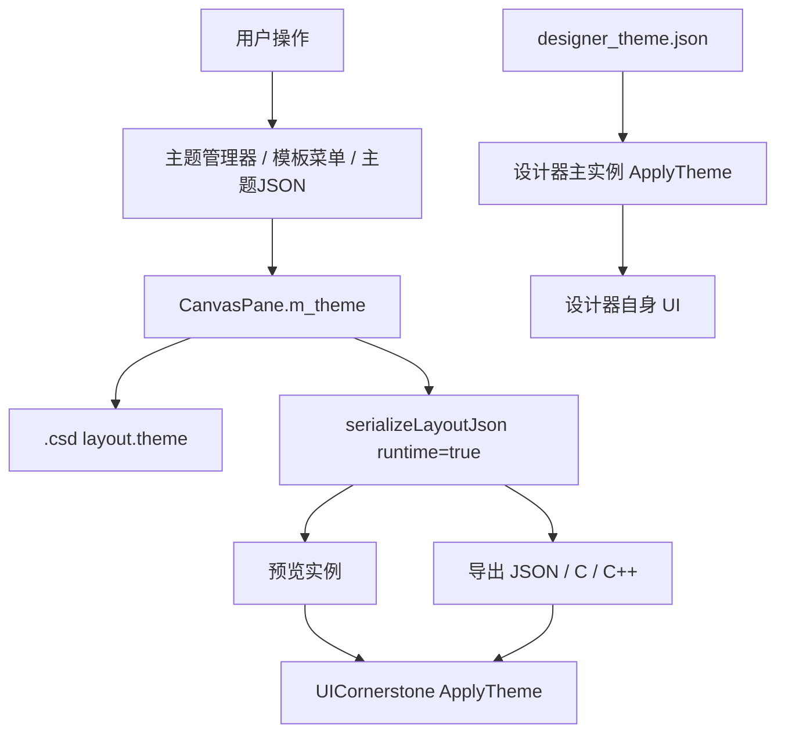

# CornerstoneDesigner 主题系统设计

> 修订记录：v1.1（2026-11-05）—— 按引擎复核意见修正：unknown 字段口径、`:selected` 限制、specificity/层序、content-padding 能力边界、scale 条件口径、设计器 UI 动态控件、重复条件 ID；补充评审响应与版本门禁。
> 修订记录：v1.0（2026-11-04）—— 主题系统 as-built 设计首版：项目主题数据模型、优先级、主题管理器、变量/类/变体/媒体/容器条件、内置明亮/暗黑模板、设计器 UI 主题、运行布局默认样式剥离、验证与限制。
> 前置：需求 F8（01）、设计规格 M9（02）、详细设计 §11（04）已同步；UICornerstone 子模块需包含 CR20261102001/002/003 主题能力。

## 1. 目标与范围

主题系统用于把重复的控件外观集中为可复用规则，避免逐个控件修改颜色、字体、圆角、间距和状态样式。

覆盖范围：

- **项目主题**：随 `.csd` 保存，作用于预览、报告截图和导出运行界面。
- **主题管理器**：可视化编辑规则、变量、类、变体、媒体条件和容器条件。
- **主题模板**：内置明亮/暗黑模板，编辑菜单快捷应用，也可加载任意主题 JSON。
- **设计器 UI 主题**：独立的 `designer_theme.json`，只影响设计器自身界面，不影响项目主题。
- **运行布局默认样式剥离**：让设计器放置控件时产生的默认外观不阻塞主题生效，同时保留用户自定义样式。

不在本设计内：UICornerstone 引擎内部 CSS 解析/层叠实现（由引擎 CR20261102001/002/003 负责）；主题规则的运行时性能实现。

## 2. 术语

| 术语 | 含义 |
|------|------|
| 项目主题 | 保存在 `.csd` 的 `layout.theme`，随布局导出 |
| 设计器 UI 主题 | `designer_theme.json`，只作用于设计器主实例 |
| 变量 | 主题 `variables` 中 `--name` 到值的映射 |
| 规则 | `selector + declarations` |
| 类 | 控件 `classes` 字段中的标签，供 `.class` 选择器匹配 |
| 变体 | `variants.<name>`，叠加在基主题之上的命名规则集 |
| 媒体条件 | 视口尺寸/方向/缩放满足时叠加的规则 |
| 容器条件 | 指定祖先容器内容区尺寸满足时叠加的规则 |
| 显式属性 | 属性面板/JSON/公开 Set* 直接写入控件的值 |
| 设计器默认样式 | `styleControl` 放置控件时写入的浅色外观（用于设计态可读性） |

## 3. 总体架构



职责边界：

- 设计器负责主题的**数据结构、编辑 UI、保存/加载、预览/导出和模板管理**。
- UICornerstone 负责选择器解析、层叠、变量解析、状态样式、媒体/容器匹配和实际渲染。
- 项目主题不直接作用于设计画布；预览和导出使用同一份主题 JSON。
- 设计器 UI 主题与项目主题相互独立，避免用户主题改坏设计器界面。

## 4. 项目主题数据模型

### 4.1 存储位置

- 运行时内存：`CanvasPane::m_theme`（`nlohmann::json` 对象）。
- 工程文件：`.csd` 的 `layout.theme`。
- 导出布局：`layout.json` 的 `theme`。
- 控件类：控件节点的 `classes`（数组或空格分隔字符串）。

### 4.2 主题对象结构

```json
{
  "variables": { "--primary": "#2D7FF9FF" },
  "styles": [
    { "selector": "button.primary",
      "declarations": { "background": "var(--primary)", "text-color": "#FFFFFFFF" } }
  ],
  "variants": {
    "dark": { "variables": {}, "styles": [] }
  },
  "media": [
    { "id": "compact", "query": "(max-width: 800px)", "variables": {}, "styles": [] }
  ],
  "containerQueries": [
    { "id": "narrow", "container": "panel.sidebar",
      "query": { "max-width": 280 }, "variables": {}, "styles": [] }
  ]
}
```

补充约定：

- `query` 可为字符串或对象；容器条件推荐对象形式，避免字符串解析歧义。
- `padding` / `content-padding` 都映射到通用内容内边距；Dialog 旧 `padding` 语义保持不变。
- `fonts` / `colors` 旧主题字段继续兼容，不做迁移强制。
- `content-padding` 已覆盖通用内容和主要文本控件；ListView/TreeView 的滚动内容区、部分自绘控件的内边距能力尚未完整保证，设计器属性/主题 UI 不应承诺这些区域完全可用（后续按引擎能力矩阵放开）。
- 未知字段由 JSON 保留；**设计器管理器负责输入校验，引擎对未知 query/声明通常忽略以保持兼容，不保证诊断**。

### 4.3 类与选择器

- 选择器 V1 支持：类型、`.class`、`#id`、复合、`:hover/:pressed/:disabled/:selected`、`*`。
- `:selected` 当前不是独立状态，按 pressed 通道近似；UI 不应承诺独立 selected 外观。
- 不支持：空格后代/子选择器、逗号分组、属性选择器、`!important`。
- 类名建议只使用字母、数字、`_`、`-`；多个类以空格分隔。
- 主题管理器“类应用到选中”从当前选择器的第一个 `.` 后提取类名，因此选择器必须包含类。

### 4.4 优先级

1. 控件显式属性（属性面板/JSON/公开 Set*）。
2. `#id`。
3. `.class`。
4. 类型。
5. 同权重按层序：基础 → 媒体 → 容器 → 变体，再按 source order。
6. 状态规则优先于同选择器无状态规则。

媒体/容器规则也要遵守选择器 specificity：`button` 不能覆盖 `button.primary`。设计器在媒体/容器作用域提示用户保持目标规则相同的 selector 权重。

## 5. 运行布局的默认样式剥离

### 5.1 问题

设计器放置 Button/Label/CheckBox/NumericUpDown/ComboBox/TabControl 时会通过 `styleControl` 写入浅色默认外观，并记录到模型 `extended.colors`。这些是显式属性，按优先级会覆盖主题，导致应用模板后只有 Bench 背景变化。

### 5.2 方案

- `.csd` 保存仍保留设计器默认颜色，设计画布显示不变。
- 生成**运行布局**（预览/导出）时调用 `serializeLayoutJson(true)`：
  - 仅当 `m_theme` 非空；
  - 仅当颜色组**精确等于** `styleControl` 默认值；
  - 移除该颜色组；用户手动修改过的组保留。
- 覆盖默认组：
  - Button：`background` / `border` / `text` / `text-shadow`；
  - TabControl：`text` / `background` / `border`；
  - Label、NumericUpDown、ComboBox：`text`；
  - CheckBox：`text` / `border`。
- 保存/撤销/内部布局快照使用 `serializeLayoutJson(false)`，避免改变设计态和撤销语义。

### 5.3 设计取舍

不直接清空模型颜色，因为：

- 会破坏设计画布可读性；
- 无法区分用户自定义颜色；
- 会影响 `.csd`/撤销/再打开。

只在运行时副本中剥离精确默认值，是影响范围最小的方案。

## 6. 主题管理器

### 6.1 入口

- 编辑 → 主题…：可视化主题管理器。
- 编辑 → 主题 JSON…：完整 JSON 编辑。
- 应用明亮主题模板 / 应用暗黑主题模板。
- 加载主题文件…。

### 6.2 界面结构

```text
┌ 作用域 [基主题/变体/媒体/容器]  变体名 [+新增变体] [删除作用域] [+媒体] [+容器] ┐
│ 条件ID [ ] 查询 [ ] 容器 [ ]                                                │
│ 选择器 [可编辑下拉]                                                        │
│ 背景色 / 文字色 / 边框色 / 文字阴影                                         │
│ 字体 / 字号 / 圆角                                                         │
│ 内边距 上 右 下 左                                                         │
│ box-shadow [可编辑预设下拉]                                                │
│ [新增规则] [删除规则] [类应用到选中] [变量…]                                │
│ 规则列表（选择器 / 声明数）                                                │
│ [应用] [取消]                                                              │
└────────────────────────────────────────────────────────────────────────────┘
```

### 6.3 作用域与条件

| 作用域 | 条件字段 | 说明 |
|--------|----------|------|
| 基主题 | 全部禁用 | 通用规则 |
| 变体 | 全部禁用 | 叠加基主题 |
| 媒体 | 条件ID、查询启用 | 容器字段禁用 |
| 容器 | 条件ID、查询、容器启用 | 容器为简单祖先选择器 |

- 条件 ID 为自由名称，仅用于识别，不参与匹配；**媒体/容器条件 ID 必须唯一**，管理器阻止重复。
- 新建变体：输入非空且不重名；成功后切到该变体。
- 删除作用域：删除当前变体、媒体或容器；基主题不可删除。
- 媒体/容器默认值：媒体 `mediaN` + `(min-width: 800px)`；容器 `containerN` + `.panel` + `(max-width: 599px)`。

### 6.4 字段约束与校验

| 字段 | 控件 | 约束/校验 |
|------|------|-----------|
| 选择器 | 可编辑 ComboBox + 预设 | 类型/类/ID/状态语法；拒绝空格、逗号、`!`、未知状态 |
| 查询 | 可编辑 ComboBox + 预设 | 支持键白名单；方向仅 portrait/landscape；尺寸/缩放为数字；scale 以 Bench 当前缩放为口径 |
| 容器 | 可编辑 ComboBox + 预设 | 简单祖先选择器；无空格、逗号、状态 |
| box-shadow | 可编辑 ComboBox + 预设 | 必须是对象；键白名单；color 字符串、其余数值 |
| 字体 | ComboBox | 引擎字体枚举列表 |
| 字号/圆角/内边距 | NumericUpDown | 数值范围限制 |
| 颜色 | ColorPicker | 取色器输出颜色值 |
| 作用域 | ComboBox | 只选现有作用域 |
| 条件ID | EditBox | 非空；自由命名 |

校验失败在底部状态栏提示，并阻止“新增规则/应用”。查询/容器对象形式由管理器保留，不强制降级为字符串。

### 6.5 规则编辑语义

- **新增规则**：用当前选择器/声明创建新规则；空选择器使用 `.new-rule`。
- **修改已有规则**：选中规则 → 修改字段 → 点“应用”或切换规则/作用域让 `StoreRule` 保存；不要点“新增规则”造成重复。
- 规则列表显示选择器与声明数量；选择行回填表单。
- **变量…** 打开变量编辑器；当前可视化规则表单主要写具体值，`var(--name)` 建议在“主题 JSON…”中编辑规则。

## 7. 内置模板与独立加载

### 7.1 内置模板

| 文件 | 菜单 | 内容 |
|------|------|------|
| `themes/theme_light.json` | 应用明亮主题模板 | 浅背景、白卡片、蓝色主按钮、输入/列表/树/菜单/状态栏 |
| `themes/theme_dark.json` | 应用暗黑主题模板 | 深背景、深卡片、亮色主按钮、输入/列表/树/菜单/状态栏 |

- 模板由 `CanvasPane::ApplyThemeFile(path)` 加载，支持直接主题对象或带 `theme` 字段的布局 JSON。
- 成功后设置 `m_theme`、进入撤销栈、更新状态栏。
- 预览已打开时，App 自动关闭并重建预览。
- 模板不删除控件、不改布局、不清空类；仅新增/替换项目主题。
- 显式自定义属性仍优先；设计器默认样式由 §5 在运行时剥离。

### 7.2 独立加载

- 编辑 → 加载主题文件… → 选择 JSON → `ApplyThemeFile`。
- 失败语义：文件不存在、JSON 非法、根不是对象 → 状态栏提示，当前主题不变。
- 不要求先打开主题管理器。

## 8. 设计器 UI 主题

- 文件：`layouts/designer_theme.json`，构建复制为 exe 同目录 `designer_theme.json`。
- 加载：`App::applyDesignerTheme()` 在骨架加载后调用 `m_ui->ApplyTheme(text)`。
- 菜单：视图 → 重新加载设计器主题。
- 作用范围：仅设计器主实例（菜单/工具箱/属性面板等）；不作用于设计画布子视口、预览实例或导出。
- 失败：文件缺失/非法/ApplyTheme 失败只打印诊断，不阻塞启动。
- **动态控件限制**：`ApplyTheme` 只作用于调用时已存在的控件；启动后新创建的属性行、浮层和对话框不会自动继承。当前设计器在骨架加载后应用主题，动态区域可能保持引擎默认外观；后续通过创建后刷新/统一主题应用时机补齐。

## 9. 保存、预览与导出

| 流程 | 行为 |
|------|------|
| 保存 `.csd` | `serializeLayoutJson(false)`；保留设计器默认颜色和 theme |
| 打开 `.csd` | 读 `layout.theme` 到 `m_theme`；设计画布仍按模型显式样式 |
| 预览 | `serializeLayoutJson(true)`；主题存在时剥离默认颜色；加载到预览实例 |
| 导出 JSON | `serializeLayoutJson(true)`，主题写入 `theme` |
| 导出 C/C++ | layout.json 同样使用 runtime 序列化；事件与宿主不依赖主题实现 |
| 报告 | 预览截图体现项目主题；报告统计不受影响 |

## 10. 验证与验收

### 10.1 功能验收

- 主题模板：默认放置控件应用明亮/暗黑模板，按钮、标签、面板、输入框均变化（不只 Bench 背景）。
- 自定义样式：用户改过的颜色组保留，不被模板覆盖。
- 管理器：选择器/查询/容器/box-shadow/重复条件 ID 非法值阻止保存并显示提示。
- 条件：媒体 1000/700px、容器 360/240px 对比产生预期样式差异。
- 预览：应用模板时已打开预览自动重建。

### 10.2 版本门禁

必须使用与子模块指针一致的最终引擎 Release（包含 HandleControl 父容器/stale handle 修复及主题最终修复）。旧 DLL 的崩溃/忽略变体变量、scale 条件问题不作为验收依据。重发布并更新子模块指针后，依次复测 Debug `auto=2`、`auto=3`、Release `auto=2`、`strict`。

### 10.3 当前本地结果

当前工作区使用最终 release DLL（SHA256 `f2aa7e0d7a2e0330aad4a2daee9b17592312c5b92e4b19c82ed6fb9f7a0b26cd`）：

- Debug `auto=2` **272/0**，`auto=3` **REPORT-OK**
- Release `auto=2` **272/0**
- `strict` **PASS**

### 10.4 子模块锁定状态

父仓当前 gitlink 为 `dbef739`（旧 release），子模块工作区已是最终 release `f2aa…`；需要将新 release 提交到子模块并更新父仓指针后，版本门禁才真正闭环。

## 11. 引擎评审响应（2026-11-05）

| 评审项 | 处理 |
|--------|------|
| §10 验证数据失效 | 增加版本门禁；当前本地结果仅作回归，最终 Release/子模块指针更新后重测 |
| 子模块指针未更新 | 待引擎最终 Release 同步后更新指针并复测 |
| 能力口径 | 设计明确最终 DLL 版本要求；旧 DLL 的变体变量/scale 条件不保证 |
| unknown 字段 | 改为设计器校验、引擎忽略/不保证诊断 |
| `:selected` | 明确按 pressed 近似，不承诺独立状态 |
| specificity | 补充层序与同权重提示 |
| content-padding | 标明 ListView/TreeView 滚动区/自绘控件边界 |
| scale 口径 | 明确以 Bench 当前缩放为口径 |
| 设计器 UI 动态控件 | 标注 `ApplyTheme` 只作用于已存在控件，动态区域待后续刷新 |
| 重复条件 ID | 管理器阻止媒体/容器条件 ID 重复；新建默认 ID 避撞 |

## 12. 已知限制

- 设计画布不渲染完整项目主题；以预览/导出为准。
- 主题管理器可视化表单只覆盖常用字段；复杂状态、变量引用、变体内的媒体/容器用“主题 JSON…”。
- 不支持后代/子选择器、逗号分组、属性选择器、`!important`、`opacity`。
- 主题不改变控件矩形；`content-padding` 只影响内容区。
- 当前管理器只追加类，不删除类；删除类需编辑控件 `classes`。
- 条件 ID 自由命名但不参与匹配；管理器禁止媒体/容器条件 ID 重复，避免 `GetActiveMedia` 字符串歧义。
