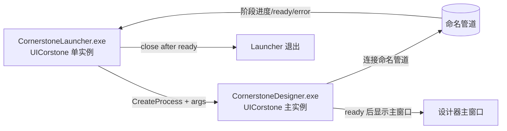
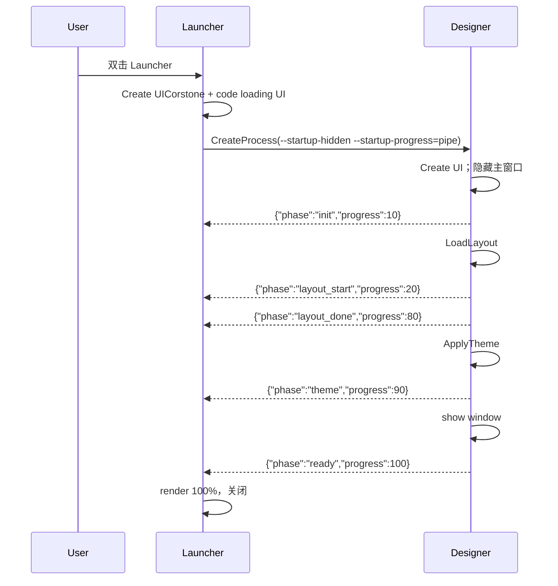

# CornerstoneDesigner 启动 Launcher 设计

> 修订记录：v1.2（2026-11-11）—— as-built 明确：Launcher 自身窗口在显示期间保持置顶，Designer 收到 ready 后 frame 30 调 `SetWindowAlwaysOnTop(false)` + `SetWindowForeground`；Launcher 已处理 Console attach/继承句柄，Designer 日志可在 Launcher 退出后延续。
> 修订记录：v1.1（2026-11-09）—— Designer ready 后只 `SetWindowForeground`，不再 `SetWindowAlwaysOnTop(true)`，避免设计器永久置顶。
> 修订记录：v1.0（2026-11-09）—— 引擎已补 `UIWindowFlags::Utility`；Launcher 改用命名枚举；EXSTYLE 实测 `WS_EX_TOOLWINDOW=True`、`WS_EX_APPWINDOW=False`。
> 修订记录：v0.9（2026-11-09）—— 集成 CR20261109001：窗口增加 Utility（任务栏/窗口列表隐藏）；当时 binding 头仅提供 C 宏，暂用宏。
> 修订记录：v0.8（2026-11-08）—— 集成 CR20261105004/CR20261108001：Launcher 使用 Borderless|Hidden|NoShadow + SetWindowAlwaysOnTop/SetWindowForeground，移除 DWM/EnumWindows/SetWindowLongPtr/SetWindowRgn 窗口样式与阴影兜底；ready 后不再枚举/抢占子窗口。进程/路径仍归 LauncherPlatform。
> 修订记录：v0.7（2026-11-06）—— 当前 Windows 实现改为 CreateProcessW + 进度文件（launcher_progress.log）；SDL Process PID/启动在用户环境不稳定，SDL Process 保留为后续平台层方案。Launcher 创建期 Borderless|Hidden，控件完成后再显示；无标题栏/置顶/居中/无窗口底色阴影已落地。
> 修订记录：v0.6（2026-11-06）—— 当前 Windows 临时策略：Launcher 暂不传 `--startup-hidden`，主窗口在 Launcher 置顶窗口下加载；ready 后 Launcher 退出，Designer 可见并切前台。待 CR20261105004/前台激活 API 后恢复隐藏加载。
> 修订记录：v0.5（2026-11-06）—— SDL3 native handle 在 Launcher 独立加载的 SDL3 中不可可靠使用；Windows 改为 Win32 临时样式，长期改用 CR20261105004 的 Borderless/AlwaysOnTop 引擎 API。
> 修订记录：v0.4（2026-11-06）—— Launcher 实施细节：无标题栏/关闭按钮、标题文字居中、窗口置顶；实现已落地。
> 修订记录：v0.3（2026-11-05）—— 进程启动改用 SDL3 Process API（跨平台），进度改走子进程 stdout；Launcher 不创建主窗口，主窗口仍由 Designer 的 UICorstone::Create 创建；窗口可见性依赖 CR20261105003。
> 修订记录：v0.2（2026-11-05）—— 按引擎评审补充：SDL3 native handle 隐藏为临时方案；明确 resourceRoot/fonts/只读 assets；ready/显示原子化；窗口可见性 API 另立 CR20261105003。
> 修订记录：v0.1（2026-11-05）—— 首版：独立 Launcher 进程、加载界面、阶段进度、主窗口隐藏/显示、进程与 IPC 契约；待用户与引擎评审。

## 1. 目标与范围

### 1.1 目标

在 CornerstoneDesigner 主程序之前运行一个轻量 `CornerstoneLauncher.exe`：

- 首帧尽快可见（目标 < 1s），显示品牌与加载状态；
- 主程序加载期间 Launcher 独立刷新动画；
- 按阶段显示进度，长阶段用“加载中”动画，不伪造细粒度百分比；
- 主程序 ready 后再显示主窗口，Launcher 退出；
- Launcher 与主程序均为独立进程，各自使用一个 UICornerstone 实例，不共享进程级全局状态。

### 1.2 非目标

- 不把主程序完整启动降到 1s；完整 UI 仍取决于 CR20261105002 的控件/主题优化；
- 不实现逐控件真实进度（需要引擎增量加载/回调，另立 CR）；
- 不替代现有 `CornerstoneDesigner.exe` 直接启动方式；
- 不把 Launcher 做成主程序的第二个 UI 实例运行在同一线程；
- 不在本设计内解决非 Windows 的进程/IPC 细节，但保留跨平台抽象层。

## 2. 背景与架构选择

当前主程序 `init()` 同步执行 `UICornerstone::Create`、`LoadLayoutFromFile`、`ApplyTheme` 等，首帧约 4.9s。加载期间主线程阻塞，无法在同一实例内刷新进度。

### 2.1 候选方案

| 方案 | 优点 | 缺点 | 结论 |
|------|------|------|------|
| A. 主实例内加载覆盖层 | 单窗口、改动小 | 主线程 `LoadLayout` 阻塞，动画冻结；只有阶段跳变 | 可作为无 Launcher 时的降级方案 |
| B. 同进程两个 UICorstone 实例/不同线程 | 看似并行 | 引擎无跨线程契约；SDL/字体/事件全局状态不安全 | **排除** |
| C. 独立 Launcher 进程 + Launcher 使用 UICorstone | 动画独立；跨平台潜力；进程隔离；可用代码控件 | 多一个进程/exe；需要 IPC 和窗口隐藏 | **选定** |
| D. Windows 原生 Launcher | 启动快、依赖少 | 绑定 Windows，未来跨平台需重写 | 作为平台兜底，不作为主方案 |

### 2.2 为什么不使用同进程第二实例

引擎当前多实例模型是**同线程、同一主循环**：预览窗口就是主循环内泵第二个实例。`UIContext` 的 active 列表、SDL 全局事件队列、字体/渲染器缓存、Binding 的动态 API 表都没有跨线程锁。Launcher 必须是**独立进程**；这样两个 UICorstone 实例不共享进程内全局状态。

## 3. 总体架构



进程边界：

- Launcher：唯一 UICorstone 实例；代码创建 loading 控件；负责启动子进程、读进度、退出。**Launcher 不创建 Designer 主窗口**。
- Designer：现有主程序；**自己通过 `UICorstone::Create` 创建主窗口**；新增启动参数、隐藏/显示窗口、阶段进度上报；不感知 Launcher UI。
- 不使用跨进程共享引擎对象；只传文本进度。
- 当前 Windows 实现由 `CreateProcessW` + 文件进度承担；长期由 `LauncherPlatform`/SDL3 Process 抽象，窗口可见性继续用 CR20261105003。

## 4. 启动时序



## 5. Launcher UI

### 5.1 实现方式

- Launcher 使用一个 UICorstone 实例，**代码创建**控件，不加载 JSON：
  - 全屏/窗口背景 Panel；
  - 标题 Label；
  - 状态 Label；
  - ProgressBar；
  - 版本/版权 Label（可选）。
- 建议窗口：640×360，固定尺寸，屏幕居中；不要求 Resizable。
- **无标题栏/关闭按钮**：使用 CR20261105004 的 `UIWindowFlags::Borderless`；不再枚举/改 Win32 窗口样式。
- **无系统阴影**：使用 CR20261108001 的 `UIWindowFlags::NoShadow`（SDL3 Windows best-effort）；DWM/CS_DROPSHADOW 由引擎处理，Launcher 不再直接调用 DWM。
- **窗口置顶/前台**：使用 CR20261105004 的 `SetWindowAlwaysOnTop` / `SetWindowForeground`；不再 `SetWindowPos(HWND_TOPMOST)`/`SetForegroundWindow`。
- **SDL3 native handle**：Launcher 不再依赖原生 handle 做窗口样式；跨平台窗口外观由引擎标志/方法负责。
- **标题文字居中**：`CornerstoneDesigner` Label 使用 `align=center`；状态文字同样居中。
- `resourceRoot` 指向 Launcher/Designer 共用 `assets`（至少 `fonts`/必要图片）；不调用 `LoadLayout`、不应用项目主题。
- 颜色沿用设计器主题令牌：背景 `#1B1F27`，面板 `#252B35`，强调色 `#4C8DFF`，正文 `#DCE5F2`，弱文本 `#9AA7B8`。
- Launcher 自身循环：`ProcessEvents → Update → Clear → Render → RenderOverlays → Present`，约 60fps。
- 代码控件仅存在于 Launcher 进程，不进入设计器布局模型/主题/导出。

### 5.2 进度展示

- 阶段进度是**权重百分比**，不是实际控件进度：
  - 初始化 5%；
  - 布局开始 20%，布局完成 80%；
  - 主题 90%；
  - 最近文件/收尾 95%；
  - ready 100%。
- `LoadLayout`/`ApplyTheme` 长时间执行时，Launcher 独立运行，显示“正在加载布局…”和动态省略号/脉冲，不伪造精确百分比。
- 如未来引擎提供增量加载回调，可将阶段百分比替换为真实进度；本设计不依赖该能力。

## 6. 主程序设计器侧改动

### 6.1 新增启动参数

| 参数 | 说明 |
|------|------|
| `--startup-hidden` | 创建主窗口后先隐藏，ready 时显示；未传时行为不变。当前 SDL3 下用 native handle 临时实现，跨后端依赖 CR20261105003 |
| `--startup-progress=stdio` | 向 stdout 写入阶段进度（调试用）；未传时不启用 |
| `--startup-progress-file=<path>` | 向指定文件追加阶段行（当前 Launcher 使用）；未传时不启用 |
| 现有项目路径/`auto=` 参数 | 原样透传，不得被 Launcher 改写 |

### 6.2 启动进度发射器

在 `App::init` 关键阶段发送行协议：

```json
{"phase":"init","progress":5,"message":"初始化"}
{"phase":"layout_start","progress":20}
{"phase":"layout_done","progress":80}
{"phase":"theme","progress":90}
{"phase":"recent","progress":95}
{"phase":"ready","progress":100}
{"phase":"error","message":"..."}
```

- 写入后立即 flush；管道不可用/断开不影响主程序启动。
- 主程序异常/提前退出时尽量发 `error`；Launcher 同时监控子进程退出码。
- 不修改现有 stdout 日志格式；进度管道独立。

### 6.3 窗口隐藏/显示

- 主窗口 `Create` 后若 `--startup-hidden` 生效，立即调用平台适配器隐藏窗口；
- ready（或初始化失败）时显示/关闭；
- **SDL3 临时实现**：引擎确认 `UICornerstone_GetNativeWindowHandle()` 在 SDL3 后端返回底层 `SDL_Window*`，可动态解析 `SDL_HideWindow/SDL_ShowWindow`；该句柄是 backend-specific，SFML/raylib 不得按 `SDL_Window*` 解释；
- 仅当 backend 为 `sdl3` 且 native handle 非空时使用；其他后端直接显示主窗口或由平台层实现；
- `Create` 后先可见再隐藏可能有一帧闪烁/抢焦点，验收必须覆盖；最终方案优先使用 `UIWindowFlags::Hidden`/`SetWindowVisible`（见 CR20261105003）；
- 隐藏期间不得让主窗口抢 Launcher 焦点；Launcher 应位于前台。

### 6.4 与现有启动行为的关系

- 直接运行 `CornerstoneDesigner.exe`：不传新参数，保持现有同步启动与主题行为；
- Launcher 启动：主窗口隐藏，Launcher 可见，ready 后显示主窗口；
- `auto=2/auto=3` 测试：不经过 Launcher；仍直接运行 Designer。

## 7. Launcher 进程与 IPC

### 7.1 进程启动

- Launcher 构造完整命令行（参数原样透传，路径加引号）；
- 工作目录 = Designer exe 所在目录；
- **当前 Windows 实现**：使用 `CreateProcessW` 直接启动 Designer，PID 取自 `PROCESS_INFORMATION`；避免 SDL Process API 在当前环境返回 PID=0/启动失败的问题；
- **长期抽象**：由 `LauncherPlatform::StartProcess` 封装 `CreateProcessW`/`posix_spawn`/SDL3 Process；SDL3 Process API 仅作为后续跨平台候选；
- Launcher 保存进程句柄/PID；ready/失败/超时按策略关闭或终止；
- Launcher 与 Designer 只读使用同一 `assets/` 与字体资源，不共享可写资源目录；Designer 热重载/写资源时 Launcher 不得读取半写文件。

### 7.2 进度通道（文件）

- Launcher 在 exe 目录创建/清理 `launcher_progress.log`，通过 `--startup-progress-file=<path>` 传给 Designer；
- Designer 在每个阶段调用 `emitStartupProgress`，向文件追加并 flush；
- Launcher 按文件 offset 轮询读取，解析阶段行；不依赖 stdout/pipe；
- `--startup-progress=stdio` 保留为调试通道，Launcher 当前使用文件通道；
- 文件不可写/超时：Launcher 继续显示到子进程退出或超时；
- 消息长度/字段仍需校验，避免异常输入影响启动界面。

### 7.3 生命周期与错误

- 收到 `ready`：Designer 必须先成功显示主窗口，再发送 `ready`；Launcher 收到后关闭，不再枚举子窗口；
- 子进程退出码非 0 / 未 ready 退出：显示错误状态，用户可关闭；不无限等待；
- 启动超时（建议 30s）：显示超时并终止子进程；
- 用户关闭 Launcher 且尚未 ready：发送取消/终止子进程，避免隐藏窗口残留；
- 主程序正常退出后 Launcher 已不在运行，不存在双重退出。

## 8. 跨平台考虑

- Launcher 使用 UICorstone + SDL3，理论上可跨平台；
- 进程创建、命名管道、窗口隐藏/显示抽为 `LauncherPlatform`；
- Windows 先行；macOS/Linux 分别用 `posix_spawn/fork+exec`、Unix domain socket/FIFO 实现；
- **窗口可见性**由 CR20261105003 的 `UIWindowFlags::Hidden` / `SetWindowVisible` 封装；**窗口外观/阴影**由 CR20261105004/CR20261108001 的 Borderless/AlwaysOnTop/Foreground/NoShadow 封装；Launcher 已移除 DWM/EnumWindows 窗口样式兜底。进程/路径仍在 LauncherPlatform。
- 主程序当前仍有 Win32 文件对话框、进程启动（CreateProcessW/Toolhelp）等平台代码，因此本设计只承诺 **Launcher 窗口层已由引擎封装**；进程/路径仍归 LauncherPlatform，不宣称整个设计器/启动器完全无 Win32。

## 9. 失败与降级

| 场景 | 行为 |
|------|------|
| Launcher 创建 UICorstone 失败 | 直接启动 Designer（无启动界面），或显示原生错误 |
| 子进程启动失败 | Launcher 显示错误并提供退出 |
| 进度文件不可用 | Designer 正常加载；Launcher 等待 ready/超时；日志可见失败原因 |
| SDL3 隐藏后出现一帧闪烁 | 验收记录；后续切换 CR20261105003 的创建期 Hidden/可见性 API |
| Designer 崩溃/未 ready 退出 | Launcher 显示错误 + 退出 |
| Designer ready 但窗口显示失败 | Launcher 至少结束；记录日志；主程序保留可见性兜底 |
| Launcher 被关闭 | 终止未 ready 的子进程，避免隐藏残留 |

## 10. 验收标准

1. 通过 Launcher 启动，Launcher 首帧 < 1s（本机 Release，冷启动不作为硬性单次判定；与 Designer 完整 UI 首帧分开报告）；
2. 主窗口在 ready 前不可见；Designer 先显示成功再发 ready，Launcher 后关闭；无双窗口抢焦点/无闪烁；
3. 进度阶段与主程序实际阶段一致；长阶段显示活动提示，不出现假精确百分比；
4. 项目路径/`auto=` 参数透传正确；
5. Launcher 关闭/子进程失败/管道断开/超时均有确定行为；
6. 直接运行 Designer 的既有行为、测试 `auto=2/auto=3`、主题/布局零回归；
7. Launcher 与 Designer 各自独立 UICorstone 实例，不出现共享全局状态/线程问题。

## 11. 风险与引擎确认

- **窗口隐藏/显示 API**：引擎确认 SDL3 `GetNativeWindowHandle` 返回底层 `SDL_Window*`，可直接 `SDL_HideWindow/ShowWindow`；但这是 backend-specific，非 SDL3 不支持。跨后端需 **CR20261105003**（`UIWindowFlags::Hidden` / `SetWindowVisible`）。
- **闪烁/焦点**：`Create` 后隐藏可能有一帧闪烁；验收必须覆盖；最终以 CR20261105003 的创建期隐藏消除。
- **多进程共享 DLL/assets**：引擎确认各进程独立加载同一 DLL/assets 可行；只读使用，不共享可写资源目录。
- **首帧**：Launcher Create 约 200–300ms 可接受；Launcher 首帧与 Designer 完整 UI 首帧分开验收。
- **进度协议/进程**：引擎确认阶段进度无需引擎回调；改用 SDL3 Process stdout 管道，避免平台 IPC；子进程退出由 Launcher 监控。
- **跨平台**：进程/IPC 抽象保留；窗口可见性当前为 SDL3-only 临时实现，跨平台依赖 CR20261105003 或平台层。

## 12. 实施拆分（评审通过后）

1. Designer：解析启动参数、阶段进度发射器、窗口隐藏/显示、ready 协议；
2. Launcher：UICorstone 代码控件 UI、进程启动、管道读取、错误/超时；
3. CMake：新增 `CornerstoneLauncher` target，复制同一运行依赖；保留 Designer 独立启动；
4. 测试：正常启动/项目参数/失败/超时/关闭/直接启动/auto 回归；
5. 文档：用户手册启动说明、开发构建说明。

## 13. 评审请求

请引擎重点评审：

- 独立进程方案是否符合引擎多实例/全局状态边界；
- 主窗口隐藏/显示的最佳 API，以及是否需要引擎侧小改动；
- Launcher 使用 UICorstone 代码控件是否有额外约束；
- 进度管道与现有引擎日志/生命周期是否冲突。

评审意见请写入 `Temp/Launcher_Design_引擎评审请求.md` 对应回复区，或另附评审文件。

## 14. 引擎评审响应（2026-11-05）

引擎对 v0.1 的结论为**有条件通过**，已采纳：

| 评审项 | 处理 |
|--------|------|
| 独立进程 + 单实例 | 通过；Launcher/Designer 各自进程，不共享全局状态。 |
| 窗口隐藏/显示 | SDL3 native handle 可按 SDL_Window* 使用；标注 backend-specific，非 SDL3 降级；建议另立 CR20261105003。 |
| 代码创建 loading 控件 | 通过；需先 Create + SetViewport + resourceRoot（fonts/assets），不调用 LoadLayout/项目主题。 |
| 进度管道 | 通过；Designer 阶段发送即可；auto 测试不经过 Launcher。 |
| 首帧/资源 | Launcher Create 200–300ms 可接受；不裁剪 assets 也可运行。 |
| 跨平台 | 进程/IPC 抽象正确；窗口可见性跨后端依赖 CR20261105003。 |
| ready/显示原子性 | Designer 先显示主窗口再发 ready；Launcher 后关闭。 |
| 其它 | assets 只读、无写竞争；闪烁/焦点验收；首帧指标分开。 |
| 进程启动封装 | Launcher 不创建主窗口；进程启动使用 SDL3 Process API（跨平台），不放入 UI 引擎；窗口可见性由 CR20261105003 封装；窗口外观待 CR20261105004。 |

**待办**：提 CR20261105003（窗口可见性 API）；实现前将 `--startup-hidden` 标注为 SDL3-only 临时方案。

## 15. 当前实现状态（2026-11-08）

- Launcher UI：UICorstone 单实例、代码控件；创建期 `Borderless|Hidden|NoShadow|Utility`，控件完成后再显示；标题/状态居中、进度条按实际宽度居中；`SetViewportBackgroundColor` 与面板同色。
- 窗口外观：Launcher 自身显示期间 `SetWindowAlwaysOnTop(true)` + `SetWindowForeground()`；Designer ready 后 frame 30 调 `SetWindowAlwaysOnTop(false)` + `SetWindowForeground()`，不保留永久置顶；不再使用 DWM/EnumWindows/SetWindowLongPtr/SetWindowRgn 样式兜底；Utility 负责任务栏/窗口列表隐藏。
- 启动：Windows `CreateProcessW` + `PROCESS_INFORMATION` PID；Designer `--startup-hidden` + `--startup-progress-file`。
- 进度：`launcher_progress.log` 文件轮询；`launcher.log` 记录 pid/ready/错误。
- Console：Launcher 若从已有控制台启动则 attach 并重定向 stdio；Debug 无控制台时 AllocConsole，Release 不创建新 Console。Designer Release 日志写入 `designer.log`，Launcher 日志写入 `launcher.log`。
- ready：Designer 先显示并发送 ready；Launcher 收到后关闭，不再枚举/抢占子窗口；Designer 在 frame 30 通过引擎 `SetWindowForeground` 抢前台（不置顶）。
- 后续：`LauncherPlatform` 抽象、SDL3 Process（跨平台）；进程/路径仍保留 Win32（CreateProcessW/Toolhelp/路径转换）。
