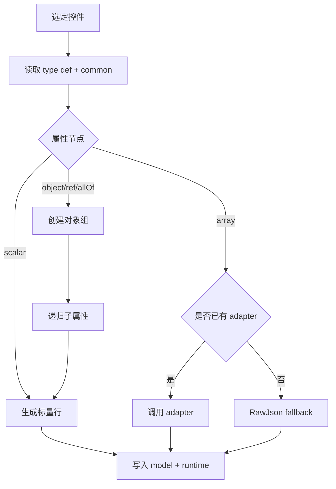

# 11_级构型 JSON 属性动态行设计

> 提出方：CornerstoneDesigner
> 状态：**v1.0（2026-11-16；引擎设计评审通过，正式 CR20261116001；待实施）**
> 评审结论：通过（设计阶段）——Q1~Q8 已确认；首批 V1 内嵌控件为 Button/CheckBox `caption-label` → `label`
> 关联：`design/06_属性表单Schema生成器设计.md`（Schema→表单总体设想）、CR20261112001（box-shadow）、`docs/schema/declarative-ui.schema.json`
> 范围：设计器属性面板的 **嵌套 JSON 属性 → 动态行** 通用机制；不改变控件运行时语义。

## 1. 目标与非目标

### 1.1 目标

为属性面板建立一层 **Schema 驱动的递归行构建器**，把以下结构自动转换为动态行：

- 简单对象：`box-shadow`、`margin`、`shadow`、`anchorOffset` 等；
- 对象中的标量字段：string / number / integer / boolean / enum / color；
- 一层或多层嵌套对象，只要字段有可用的运行时 setter 或模型映射；
- 保留现有复杂数组的专用编辑器（items/columns/rows/tabs/menus/points）。

目标是减少新增结构化属性时的定制代码，使 `box-shadow` 这类属性不再需要每次手写 5 条动态行、回填、撤销和引擎写入。

### 1.2 非目标（V1）

- 不自动把任意数组展开成可增删的复杂编辑器；数组继续走现有 adapter 或 JSON fallback；
- 不改 Engine LayoutParser、控件渲染、主题系统或运行时数据结构；
- 不替代事件面板、颜色组、`rect` 四边/锚定、`items` 等专用 UI；
- 不为未知/不可写的 schema 对象伪造运行时 setter；
- 不改变现有保存、导出、撤销格式；
- 通用内嵌控件的完整对象化不在 V1 基础机制内；它依赖引擎 schema/parser 补齐，作为 §5.8 的独立扩展项评审。

## 2. 现状与问题

### 2.1 当前实现

`CanvasPane::rebuildDynamicRows()` 已经按 `m_schema` 的 `$defs[type].properties + common.properties` 生成动态行：

- 标量字段：`string/number/integer/boolean/enum` 自动生成 TextArea/NumericUpDown/CheckBox/ComboBox；
- 颜色组：`colors` 按 schema 状态子集展开 ColorPicker；
- `font`、`anchor`、`layout` 等少量键有特判；
- 对象/数组：通用循环在 `effT != string/number/integer/boolean` 时跳过；
- `box-shadow` 当前由新的专用 5 行代码处理；
- `items`、`columns`、`rows`、`tabs`、`menus`、`points` 由各自 adapter 处理。

因此目前 **不是**“任意嵌套 JSON 自动成行”；简单对象仍要定制，复杂数组必须适配器。

### 2.2 需要解决的重复成本

每新增一个对象属性，通常要重复实现：

1. schema 子字段读取；
2. 动态行创建与 row-pool key；
3. 模型 `extended` 对象回填；
4. 引擎运行时 setter 映射；
5. 撤销/重做；
6. 选中切换/重建后的刷新；
7. 回归测试。

`box-shadow` 是当前样本：5 个字段本可以完全由 schema 推导，只因缺少通用对象行机制而写成定制代码。

### 2.3 命名层次澄清：JSON 路径 ≠ 引擎运行时键

`box-shadow` 同时存在三种不同层次的名字，不能混用：

| 层次 | 示例 | 用途 |
|---|---|---|
| 布局 JSON 对象 | `box-shadow: { color, offset-x, offset-y, blur, spread }` | 声明式布局文件/模型对象 |
| 设计器模型路径 | `extended["box-shadow"]["color"]`；逻辑显示路径 `box-shadow.color` | 属性面板/回填/撤销 |
| 引擎运行时属性 | `box-shadow-color`、`box-shadow-offset-x`、`box-shadow-offset-y`、`box-shadow-radius`、`box-shadow-spread` | `Control::SetColor/SetFloat` / C ABI |
| 动态行显示标签 | `box-shadow.color`、`box-shadow.offset-x`；`text-shadow.blur` | 面向用户的层级路径 |

因此：

- `box-shadow.color` / `box-shadow.offset-x` 是**模型对象路径**，不是当前引擎的运行时 setter 键；
- 当前引擎源码/头文件中对应运行时键是 `box-shadow-color`、`box-shadow-offset-x`、`box-shadow-offset-y`、`box-shadow-radius`、`box-shadow-spread`（`PropertyNames.h`）；
- schema 字段是 `blur`，运行时键是 `box-shadow-radius`，不存在 `box-shadow.radius` 运行时键；
- 点号在现有引擎属性系统中主要用于状态后缀（如 `colors.background.normal`）和 UI 逻辑路径，不是通用对象成员运行时分发符；
- **显示规则**：嵌套对象子字段用点号（与现有 `shadow.enabled` / `shadow.offset.x` / `background.normal` 一致）；直接 schema 标量保持 schema 键（如 `font-size`、`box-shadow`）；运行时 kebab 键不作为主显示标签；
- **内嵌 Label 的柔光规范键**：`caption-label.shadow.blur`；运行时写 `text-shadow-blur`；顶层 `text-shadow-blur` 仅作为 standalone Label 的兼容别名，在内嵌组中通过 `exclude` 隐藏，避免双入口；
- 如果引擎希望把运行时属性改成 `box-shadow.color` 形式，需要新增/修改属性分发契约；本设计不预设这种改动。

## 3. 假设（Assumptions）

> 这些假设需要在引擎评审中确认；若任一不成立，设计范围应相应收缩或改由 adapter 处理。

- **A1**：`declarative-ui.schema.json` 是设计器与引擎共同消费的契约；设计器只读取它，不在运行时修改引擎 schema。
- **A2**：schema 中的局部 `$ref`（`#/$defs/...`）和 `allOf` 可被设计器安全展开；V1 不处理跨文件引用。
- **A3**：对象属性的字段可以拆成标量运行时属性写入；无法映射的字段允许 fallback 到 JSON 文本，而不是静默丢弃。
- **A4**：模型 `extended` 可以原样保存 schema 对象，`modelPropsJson()`/导出已能保留未知或对象字段。
- **A5**：V1 以单选编辑为主；多选仅沿用现有标量/颜色交集语义，不承诺任意嵌套对象的多选批量编辑。
- **A6**：引擎不需要新增 API；若 schema 注解或运行时映射不足，先通过设计器侧 metadata overlay 补足，必要时另立 CR。
- **A7**：任意宿主控件只要在 schema 中以 `x-embedded-control` 声明 `schema`/`handle`，且 `GetPtr(handle)` 返回稳定的内嵌控件，就可以纳入通用递归行；不要求设计器为每种宿主写 switch。
- **A8**：内嵌控件行采用“schema 指引 + handle adapter + 懒加载缓存”，不以引擎 schema 当前是否展开子属性为唯一依据；但导出/重开要跨进程保真，仍需引擎 parser/schema 补齐。

## 4. 前提（Preconditions）

- **P1**：schema 对象节点具有可识别的 `type`/`properties`/`$ref`/`allOf`；无法解析的节点不自动生成子行。
- **P2**：对象字段的运行时属性名可通过 `jsonKeyToProp`、已有映射或 metadata overlay 得到；无法得到时只能 raw JSON fallback。
- **P3**：设计器动态行仍使用现有 row-pool/撤销/`m_propSync` 生命周期；新机制不得引入第二条状态同步路径。
- **P4**：现有 structured adapters（`items/columns/rows/tabs/menus/points`）保留优先级，通用构建器不得递归进入它们的数组元素。
- **P5**：schema 嵌套深度有限（建议 max 8）且无循环 `$ref`；超过深度/检测到循环时 fallback 为 raw JSON 行。
- **P6**：引擎评审确认 `box-shadow`、`margin`、`shadow` 等对象的字段名与运行时 setter 映射；未确认的对象不进入自动行。
- **P7**：通用内嵌控件行仅在 schema 已标注、且所有选中控件都能成功取到同一 `handle` 时生成；句柄缺失时隐藏/禁用该组，不回退到伪造宿主键。
- **P8**：`GetPtr(handle)` 返回的目标控件类型必须与 `x-embedded-control.schema` 一致；不一致时禁用该组并记录诊断，不能按错误类型强写属性。

## 5. 设计

### 5.1 核心结构

```cpp
enum class SchemaRowKind { Group, Scalar, ObjectGroup, RawJson, Adapter };

struct SchemaRowSpec {
    SchemaRowKind kind = SchemaRowKind::Scalar;
    std::string schemaPath;   // "box-shadow", "box-shadow.offset-x"
    std::string modelPath;    // "extended.box-shadow.offset-x"
    std::string runtimeKey;   // "box-shadow-offset-x"（可空）
    std::string group;        // "轮廓阴影"
    std::string label;        // "box-shadow.offset-x"
    nlohmann::json schema;    // 已解析的节点
};

struct SchemaRowBinding {
    std::string modelPath;
    std::string runtimeKey;
    enum class ValueKind { String, Number, Integer, Bool, Color, Enum } kind;
};
```

- `schemaPath` 是行池/状态稳定键（不依赖显示文本）；
- `modelPath` 用于读写 `ControlModel::props.extended`；
- `runtimeKey` 用于引擎 `SetString/SetFloat/SetBool/SetColor`；为空时不可 live apply；
- `group` 来自 metadata overlay 或默认顶层键；`label` 可本地化，不参与路径。

### 5.2 递归行流程



流程：

1. `SchemaResolver` 展开 `$ref`/`allOf`，返回带路径的 object 节点；
2. `SchemaRowBuilder` 按 sort/group 规则生成 `SchemaRowSpec`；
3. 对象生成组标题 + 子行；标量按类型生成控件；
4. 行控件不直接保存 schema 指针，使用 `SchemaRowBinding` 副本；
5. 编辑回调统一 `writePath(modelPath, value)` + `applyRuntime(runtimeKey, value)`；
6. 选择/类型不变时只刷新行值，不重复构建。

### 5.3 对象组规则

- 顶层对象：
  - `box-shadow` → “轮廓阴影”组（metadata）；
  - `margin` / `shadow` / `anchorOffset` → 根据 metadata 或默认标签成组；
- 嵌套对象：优先沿用最近组；若 metadata 指定 `x-designer-group`，则新组；
- 组默认折叠，沿用现有 `m_collapsedGroups`；组标题点击展开；
- 对象子字段无 runtime setter 时，整个对象显示 raw JSON fallback 行，不生成半可用的子行；
- 空对象/未知对象不生成空组。

### 5.4 元数据来源（待引擎确认）

推荐 **Designer 侧 overlay**：`layouts/designer_schema_meta.json`（或代码常量），按 `defs.<type>.properties.<path>` 或全局路径提供：

```json
{
  "box-shadow": {
    "group": "轮廓阴影",
    "label": "box-shadow",
    "runtime": {
      "color": "box-shadow-color",
      "offset-x": "box-shadow-offset-x",
      "offset-y": "box-shadow-offset-y",
      "blur": "box-shadow-radius",
      "spread": "box-shadow-spread"
    }
  }
}
```

理由：

- 不把设计器 UI 细节塞入引擎 schema；
- 引擎 schema 更新时 overlay 可按路径失败回退；
- 若引擎愿意提供 `x-designer-*` 注解，可作为更高优先级覆盖，不改变本机制。

需引擎确认（已确认）：

- overlay 仅用于纯 UI 的组名/标签、对象字段运行时映射；`x-embedded-control` 属于持久化/类型契约，必须放在引擎 schema，不能只放 overlay；
- `box-shadow` 等字段到运行时键的映射已确认稳定；
- schema 随 Release `docs`/`tools/schema` 同批发布，overlay 路径失效只影响属性行 UI。

### 5.5 与现有 structured adapter 的边界

V1 明确保留以下 adapter，不递归：

| 字段 | 原因 |
|---|---|
| `items`（MenuBar/ContextMenu/StatusBar/TreeView/ComboBox） | 需要引擎批量 API、item 事件路径/序号语义 |
| `columns` / `rows`（ListView） | 行/列结构化、表头/单元格样式与同步 |
| `tabs`（TabControl） | 页 Panel 与当前页/页面树绑定 |
| `points`（Shape） | 点集顺序/几何 |
| `colors` / `events` / `children` / `rect` / `scale` / `layout` / `anchor` / `anchorOffset` | 专用交互/树/命中/布局语义 |
| `font` / `context-menu` / `actors` / `cells` / `cellControls` | 专用结构或宿主转发 |
| 资源/图片路径、`padding` / `content-padding`、所有数组元素 | 资源/布局/批量语义 |

通用构建器只处理 **简单 object + scalar**；数组仍由 adapter 或 raw JSON 行处理。

### 5.5.1 Q3 对象适用性结论

“适用”指 **UI 可以由 schema 生成对象组/子行**；不等于运行时可以完全无适配地 live apply。三类对象的结论如下：

| 对象 | UI 自动行 | 运行时应用 | 结论 |
|---|---|---|---|
| `box-shadow` | 适用：5 个标量字段 | 现有分键 setter：`box-shadow-color/offset-x/offset-y/radius/spread` | 通用标量映射即可 |
| `margin` | 适用：left/top/right/bottom 四个字段 | 引擎有 `margin-left/top/right/bottom` 分键 setter（`PropertyNames.h`） | 通用标量映射即可 |
| `shadow` | 可生成 enabled/offset.x/offset.y 行 | 需区分控件本体、Button/CheckBox/WinFrame 内部 Label；`shadow.enabled` 与 offset 的写入目标可能不同 | UI 通用，apply 走 `shadow` adapter |
| `anchorOffset` | 可生成 left/top 行 | 运行时写父容器 `anchor-offset-x/y`，不是当前控件自身 | UI 通用，apply 走 `anchor` adapter |

因此 Q3 的答案是：**这些对象都适合对象行，但 `shadow`/`anchorOffset` 需要 apply adapter；`margin` 可直接走分键 setter，`box-shadow` 是首个无 adapter 试点。** 通用构建器需要支持 `apply` 类型的 metadata（`inline` / `adapter:shadow` / `adapter:anchor` / `rawJson`），不能假定所有对象都能仅靠子键 setter 完成 live 应用。

### 5.6 值与运行时应用

- 标量：
  - string → `SetString`；number → `SetFloat`；integer → `SetInt`；
  - bool → `SetBool`；enum → `SetEnum`；color → `SetColor`；
- 对象：
  - object 本身不调用引擎 setter；逐字段应用；
  - 修改时先更新模型对象，再更新 live 控件；
  - 无 runtime 映射的字段只更新模型并标 raw JSON；不声称 live 生效；
- 颜色字符串统一 `#RRGGBBAA`，alpha=0 保留为关闭语义；
- 所有写入经过 `commitUndo`（结构化键可合并 0.7s）；
- 加载/撤销/重建路径：`modelPropsJson` 保留对象；`applyModelToEngine` 按 metadata 回放标量分键。

### 5.7 UI/性能

- row-pool key = `"schema:" + schemaPath + ":" + widgetKind`，避免选择切换时重建所有行；
- 组折叠状态参与行集签名；
- 对象组默认折叠，避免一次展开全部嵌套字段；
- 深度/循环保护：max depth 8、`$ref` 访问栈；超限生成 raw JSON fallback；
- 多选：仅生成所有选中类型共有的对象组；无交集则显示 raw JSON 或隐藏。

### 5.8 通用内嵌控件（embedded control）递归行

#### 5.8.1 目标与边界

不是只为 Label 做特例。任何宿主控件，只要引擎 schema 声明“某个属性/句柄指向一个内嵌控件”，设计器就可以：

- 从指引中得到内嵌控件的类型（如 `label`、`button`、`panel`、`scroll-bar`）；
- 在属性面板中先放一个**默认折叠的组**；
- 用户展开时才解析目标类型的 schema 并生成子行；
- 通过 `GetPtr(handle)` 取得内嵌控件，读写标准属性；
- 缓存 schema 解析结果和行计划，避免展开/切换时重复构建。

边界：

- 只处理**宿主拥有、可持久化、可回放**的内嵌控件；
- 控件引用（如 Splitter 的 `first-linked`/`second-linked`）、动态 item 的 `leadingControl`、事件绑定目标不算内嵌控件；
- `children`、`items`、`columns`、`rows`、`tabs`、`menus`、`points` 等容器/数组仍走专用 adapter；
- 未在 schema 中标注、或引擎明确为运行时内部的句柄，不自动暴露给用户编辑。

#### 5.8.2 schema 指引（CR20261116001 最终契约）

**`x-embedded-control` 必须放在引擎 schema，属于持久化/类型契约**；Designer overlay 只负责纯 UI 的组名/标签和对象字段运行时映射。最终采用属性级注解：

```json
{
  "caption-label": {
    "type": "object",
    "x-embedded-control": {
      "schema": "label",
      "handle": "caption-label",
      "persist": "caption-label",
      "group": "内嵌文本",
      "hostForwarded": [
        "caption", "font", "font-size", "colors",
        "shadow.enabled", "shadow.offset.x", "shadow.offset.y"
      ],
      "include": [],
      "exclude": ["text-shadow-blur"],
      "propertyMap": {
        "alignment": "align",
        "shadow.blur": "text-shadow-blur"
      },
      "lazy": true,
      "owned": true,
      "serializable": true
    }
  }
}
```

字段语义：

| 字段 | 必填 | 含义 |
|---|---|---|
| `schema` | 是 | 目标控件类型，指向本地 `$defs` 的键（如 `label`） |
| `handle` | 否 | `GetPtr` 的键；默认等于属性名 |
| `persist` | 否 | 模型/JSON 持久化路径；默认等于属性名；`false` 表示仅设计态 |
| `group` | 否 | 属性面板组标题建议；设计器可本地化或忽略 |
| `hostForwarded` | 否 | 已由宿主键负责的**模型路径**（支持点号，如 `shadow.offset.x`），设计器去重 |
| `include` / `exclude` | 否 | 字段白名单/黑名单（支持点号路径）；缺省使用安全过滤 |
| `propertyMap` | 否 | schema/模型路径到运行时键的差异映射，源路径支持点号 |
| `lazy` | 否 | 是否展开时才解析；默认 `true` |
| `owned` | 否 | 是否宿主拥有；默认 `true`；引用型句柄标 `false`，不生成编辑组 |
| `serializable` | 否 | 是否可导出/重开还原；默认 `true`；`false` 时不得作为普通编辑组暴露 |

约束：

- `persist:false` 必须同时 `serializable:false`，设计器不得导出；
- `schema` 必须解析到本地 `$defs`；未知/循环/类型不匹配时禁用组并诊断；
- 多选仅当所有宿主 `(handle, schema)` 一致时显示该组；
- 不缓存裸 `Control*`，每次读写重新 `GetPtr(handle)`。

为什么放在属性上而不是类型级数组：

- 与现有 `properties`、`additionalProperties:false`、strict validator 的键检查一致；
- 属性名就是默认的 JSON 持久化路径；
- 将来新增内嵌控件时，引擎只需加一个属性 + 注解，设计器无需改 switch。

如果某个句柄没有对应的 JSON 属性，不要只靠设计器内部映射：应由引擎补一个属性（或类型级声明），并明确 `persist`/`serializable`；否则 strict validator 无法接受导出键，也无法形成稳定的持久化契约。parser 暂不支持的，标 `serializable:false` 或暂不标注。

#### 5.8.3 递归规则

1. 读取宿主 def 的 `x-embedded-control`，得到目标 `schema`、`handle`、`persist`；
2. 解析目标 `$defs[schema]`，合并 `common`；
3. 按 `include`/`exclude`/`hostForwarded` 过滤字段；
4. 缺省安全过滤：
   - 显示：string / number / integer / boolean / enum / color / 简单可写对象；
   - 默认排除：`type`、`name`、`id`、`rect`、`scale`、`margin`、`layout`、`anchor`、`anchorOffset`、`font`、`events`、`context-menu`、`actors`、`children`、`items`、`columns`、`rows`、`tabs`、`menus`、`points`、`cells`、`cellControls`、`padding`/`content-padding`、资源/图片路径类，以及所有数组元素；
   - 宿主已转发字段（`hostForwarded`）不重复生成；
   - `box-shadow`、`margin` 允许普通对象行；`shadow`/`anchorOffset` 允许 UI 通用但 apply 走 adapter；`caption-label`/`title-label` 走内嵌控件，不按普通 object 递归；
5. 子字段是另一个 `x-embedded-control` 时递归，生成下一层折叠组；
6. 深度上限 8，并用 `(hostType, handle, targetType)` 访问栈检测循环；超限时显示 raw JSON 或禁用组；
7. 读写时重新解析句柄，不缓存裸 `Control*`：
   - `void* h = host.GetPtr(handle);`
   - `Control inner = viewport->FromHandle(h);`
   - 写模型 `persist` 路径 + 写内嵌控件标准属性 + `commitUndo`；
8. `persist:false` 的字段只写 live 控件，不进入保存/导出；属性面板需明确标识“仅设计态”。

#### 5.8.4 懒加载与缓存

当前动态行已经是“收起组不创建行、展开时 `rebuildDynamicRows()`”。内嵌控件在此基础上再做两层缓存：

| 缓存 | 内容 | 失效条件 |
|---|---|---|
| Schema 解析缓存 | `$ref`/`allOf` 展开、字段过滤后的 `SchemaRowPlan` | schema 重新加载、控件类型变化 |
| 行控件缓存 | 现有 row pool，按 `path + widgetKind` 复用 | 类型变化、行池清理 |

流程：

1. 初次选中宿主控件：只解析顶层 schema，遇到 `x-embedded-control` 时生成一个折叠组头，**不解析目标 schema**；
2. 用户展开组：查 `SchemaRowPlan` 缓存；未命中才解析目标 def 并过滤字段；
3. 生成子行：行池 key 使用完整路径（如 `caption-label:alignment`），深度参与缩进；
4. 收起组：隐藏子行即可，不清模型值；
5. 句柄缺失：组头显示为不可用并给诊断，不生成半可用子行；
6. 多选：仅当所有选中宿主具有相同的 `(handle, schema)` 时显示该组，否则隐藏；
7. **不缓存内嵌控件指针**：CheckBox recreate、主题切换、控件重建后句柄可能变化，每次读写重新 `GetPtr`。
8. **组 key 使用稳定路径**（如 `embedded:caption-label`），显示标题可本地化；嵌套组默认放在独立“内嵌控件”根组下，`group` 可覆盖；不要用显示文本当折叠状态键。
9. **多选切换不重复解析**：只要 schema 版本和宿主类型未变，复用 `SchemaRowPlan`；选中不同实例只重新绑定回填/回调。

#### 5.8.5 V1 内嵌控件清单（CR20261116001 最终）

| 宿主 | 属性/句柄 | 目标 schema | owned | serializable | 结论 |
|---|---|---|---|---|---|
| Button | `caption-label` | `label` | true | true | **V1** |
| CheckBox | `caption-label` | `label` | true | true | **V1**（补 schema + parser） |
| WinFrame | `title-label` | `label` | true | 暂缓（无 schema/parser） | V1.5 |
| Dialog / ConfirmPopup | `confirm-button` / `cancel-button` | `button` | true | false（parser 仅 text/rect/visible） | 不纳入 V1 |
| ComboBox | `list-panel` / `list-scroll-bar` | `panel` / `scroll-bar` | true | false（内部件） | 不纳入 V1 |
| TreeView | `scroll-bar` / `h-scroll-bar` | `scroll-bar` | true | false（内部件） | 不纳入 V1 |
| Splitter | `first-linked` / `second-linked` | — | false（外部引用） | false | 排除 |
| MenuItem / cellControls / leadingControl | 动态引用 | — | false | false | 排除 |

WinFrame `title-label` 的 schema/parser 补齐后另开 V1.5 增量，不在本 CR 阻塞。

#### 5.8.6 UI 形态：树形行 vs TreeView

**方案 A（推荐，V1）：现有动态行 + 树形缩进/懒加载组。**
- 组头缩进显示 `▸ 内嵌文本 (caption-label)`；叶子行继续用现有 NumericUpDown/ColorPicker/ComboBox/CheckBox；
- 保留当前“左标签右编辑器”的行式体验；
- 只需要在行布局中加入 `depth` 和行池路径，不需要改引擎控件；
- 风险最低，和现有 `m_collapsedGroups`、`rebuildDynamicRows()` 兼容。

**方案 B：TreeView 作为层级导航 + 独立编辑区。**
- TreeView 节点显示属性路径/值摘要；选中节点后在下方或右侧编辑区显示具体编辑器；
- 优点：原生展开/折叠、滚动、层级清晰，适合属性很多的情况；
- 缺点：不能在每个节点行内直接放 NumericUpDown/ColorPicker 等任意控件；需要两段式编辑，交互变化较大。

**方案 C：TreeView 行内 `leadingControl`。**
- 引擎 TreeView 支持每个节点一个 `leadingControl`，但槽位在文字前，且只有一个控件，无法形成“左侧属性名 + 右侧任意编辑器”的完整行；
- 不推荐作为属性面板主方案；若未来要行内编辑，需要引擎增加 `trailingControl` 或整行 `rowControl`（另立 CR）。

结论：**V1 用方案 A**，保留现有行内编辑体验，把“树”体现在缩进和可折叠组上；内嵌控件机制与 UI 容器解耦，后续若层级变深再评估方案 B 或 TreeView 行控件扩展。

#### 5.8.7 后续首选：TreeView 行控件扩展（暂缓）

如果后续要把属性面板彻底树化，首选不是“TreeView 导航 + 独立编辑区”，而是给 TreeView 增加行控件能力。按改动量从小到大：

1. **`trailingControl`（优先）**
   - 节点行保持“展开箭头 + 缩进 + 属性名”在左，尾部放一个编辑器控件；
   - 可由引擎提供 `setNodeTrailingControl(id, control, width)`；高度沿用现有行高自适应逻辑；
   - 对属性面板足够：左侧属性名，右侧 NumericUpDown/ColorPicker/ComboBox/CheckBox；
   - 需要处理尾部宽度、控件挂摘、滚动裁剪、事件路由和节点重建后的重新绑定。

2. **整行 `rowControl`（兜底）**
   - 节点行内容整体交给一个自定义控件，TreeView 只负责箭头/缩进/选中/滚动；
   - 最灵活，可做复合行、分组控件、按钮组等；
   - 需要明确行高、命中、选中、焦点和事件冒泡归属，改动大于 `trailingControl`；
   - 只有在 `trailingControl` 无法满足复杂行时才需要。

建议：将来优先提 `trailingControl` 的引擎 CR；`rowControl` 作为兜底，不要求一次做到。两者都暂缓，本轮不实施、不作为当前引擎评审的阻塞项；V1 仍用树形行，通用内嵌控件机制不依赖 TreeView。

## 6. 动作（Actions）

### 6.1 V1 实施步骤

1. **新增 `SchemaResolver`**：解析局部 `$ref`/`allOf`，输出路径化对象节点；深度 8 + 循环访问栈；不支持节点 fallback。
2. **新增 `SchemaRowBuilder`**：object → group + scalar rows；`box-shadow`/`margin` 走通用标量对象行；`shadow`/`anchorOffset` 生成 UI 行但 apply 走 adapter；其余对象/数组按 §5.5 边界保留专用 editor。
3. **新增 metadata overlay**：仅承载纯 UI 组名/标签和对象字段运行时映射；`x-embedded-control` 从引擎 schema 读取，不放入 overlay。
4. **替换 `box-shadow` 定制代码**：删除专用 5 行，由 schema/overlay 生成 color/offset-x/offset-y/blur/spread；保持默认色、撤销、回放行为。
5. **`margin` 试点**：映射 `margin-left/top/right/bottom`；验证 `setMargin` recreate 语义与撤销/保存/打开。
6. **通用内嵌控件基础设施**：读取属性级 `x-embedded-control`；折叠组懒加载；`SchemaRowPlan` 缓存 + 行池；`GetPtr(handle)` 动态绑定；`hostForwarded`/`include`/`exclude`/`propertyMap` 支持点号路径；不缓存裸 `Control*`。
7. **V1 内嵌控件接入**：Button/CheckBox `caption-label` → `label`；等引擎 CR20261116001 交付 schema/parser 后启用 CheckBox；`shadow.blur` 规范键，`exclude:["text-shadow-blur"]` 去重；`line-height`/`line-spacing-ratio` 写内嵌 Label。
8. **边界与回归**：`owned=false`/`serializable=false` 不生成普通组；WinFrame/Dialog/ComboBox/TreeView/Splitter/MenuItem 等按 §5.8.5 排除；保持现有 adapter、auto=2/3、strict、Release 零回归。

> 引擎依赖：CR20261116001 的 schema 注解 + Button/CheckBox `caption-label` parser/持久化。设计器可先实现通用对象行和懒加载基础设施；内嵌行在引擎交付前保持休眠/不可用。

### 6.2 验收标准

- `box-shadow` 不再有专用动态行代码；由 schema/overlay 生成 5 行；模型 `extended["box-shadow"]`、引擎分键、撤销、保存/打开/导出一致；
- `margin` 通用对象行可用，`margin-left/top/right/bottom` 生效且 recreate 后不丢失；
- `shadow`/`anchorOffset` UI 行可用，apply 分别写内嵌 Label / 父容器 `anchor-offset-x/y`；
- Button/CheckBox `caption-label` 显示默认折叠的“内嵌文本”组；展开才解析；修改 `alignment`、`shadow.blur`、`line-height`、`line-spacing-ratio` 即时生效；保存/重开/导出回放一致；
- `shadow.blur` 为内嵌 Label 唯一规范入口，顶层 `text-shadow-blur` 不生成重复行；`hostForwarded` 的 caption/font/font-size/colors/shadow.enabled/shadow.offset.x/y 不重复；
- CheckBox `caption-label` 在 strict 模式下合法；不再报“控件级未知键”；
- 收起/展开不重建已有行，重复展开命中缓存；句柄缺失/类型不匹配禁用组并诊断；多选类型不一致时隐藏；
- 现有 `items`/`columns`/`rows`/`tabs`/`menus`/`points`/`colors`/`events`/`children` adapter 零回归；
- `auto=2`、`auto=3`、strict、Release 包验证通过；
- WinFrame `title-label`、Dialog 按钮、ComboBox/TreeView 内部件、Splitter linked、MenuItem/cellControls/leadingControl 不生成普通编辑组。

### 6.3 后续阶段（V1.5 / V2）

- **V1.5**：WinFrame `title-label` schema/parser 补齐后纳入；Dialog/ComboBox/TreeView 内部件按引擎确认的 serializable 边界再评估；
- **V1.5**：TreeView `trailingControl` / 整行 `rowControl` 引擎扩展（暂缓，优先 `trailingControl`）；
- V2：简单数组的通用 repeated-row 编辑；
- V2：可选的 schema `x-designer-*` 注解支持；
- V2：对象级多选批量写；
- V2：数组 adapter 的声明式注册（减少 switch/if）。

## 7. 风险与回退

| 风险 | 处理 |
|---|---|
| schema 路径/字段变化导致 overlay 失效 | 缺映射时 raw JSON fallback + 诊断，不崩溃 |
| 对象字段不是独立运行时 setter | 只更新模型；明确 raw JSON/不支持，不伪造 live |
| 递归过深/循环 `$ref` | 深度 8 + 访问栈；fallback |
| 行池复用导致旧回调 | 继续 `m_propSync` 抑制；row key 含 schema path |
| 多选交集复杂 | V1 仅共有的对象组；其余 raw JSON |
| box-shadow 迁移回归 | 以现有 5 行/默认色/引擎分键为基线做对照 |
| Button/CheckBox parser 漂移 | 引擎抽取公共 `parseEmbeddedLabel` helper；设计器以 schema 契约为准 |
| `shadow.blur` 与 `text-shadow-blur` 双入口 | 内嵌组规范键 `shadow.blur`；`exclude:["text-shadow-blur"]`；测试去重 |
| `hostForwarded` 粒度错误 | 路径级去重；Button/CheckBox 固定转发集合；回归测试 |
| 非 serializable 内部件误暴露 | `owned`/`serializable` 过滤；首批白名单 |

## 8. 引擎评审结论（2026-11-16，CR20261116001）

> 结论：**通过（设计阶段）**。正式 CR：**CR20261116001 通用内嵌控件 Schema 指引与递归属性行**。

1. **Q1 元数据归属**：Designer overlay 仅用于纯 UI 组名/标签和对象字段运行时映射；`x-embedded-control` 必须放引擎 schema，属于持久化/类型契约；`x-*` 不参与布局实例键校验。
2. **Q2 box-shadow 映射**：`color→box-shadow-color`、`offset-x→box-shadow-offset-x`、`offset-y→box-shadow-offset-y`、`blur→box-shadow-radius`、`spread→box-shadow-spread`；无点号运行时键，分键 setter 下一帧生效。
3. **Q3 可自动行对象**：`box-shadow`、`margin` 走通用标量对象行；`shadow`、`anchorOffset` 生成 UI 行但 apply 走 adapter；其余对象/数组走专用 editor/raw JSON。
4. **Q4 schema 展开**：仅保证局部 `$ref`/`allOf`；设计器自行展开，深度 8 + 循环保护；V1 不需要引擎展开 API。
5. **Q5 adapter 边界**：保留 `items`/`columns`/`rows`/`tabs`/`menus`/`points`/`colors`/`events`/`children`/`rect`/`scale`/`layout`/`anchor`/`anchorOffset`/`font`/`context-menu`/`actors`/`cells`/`cellControls`、资源/图片路径、`padding`/`content-padding` 及所有数组元素。
6. **Q6 发布与失效**：schema 随 Release `docs`/`tools/schema` 同批发布；overlay 失效只影响属性行 UI，不影响模型/保存/导出/预览。
7. **Q7 内嵌控件契约**：采用属性级 `x-embedded-control`；字段为 `schema/handle/persist/group/hostForwarded/include/exclude/propertyMap/lazy/owned/serializable`；`hostForwarded/include/exclude/propertyMap` 支持点号路径。V1 首批仅 Button/CheckBox `caption-label` → `label`；WinFrame V1.5；Dialog/ComboBox/TreeView/Splitter/MenuItem 等排除。
8. **Q8 持久化与转发**：`persist:false` 必须同时 `serializable:false`；Button/CheckBox 稳定转发集合为 `caption/font/font-size/colors/shadow.enabled/shadow.offset.x/shadow.offset.y`；`shadow.blur`、`line-height`、`line-spacing-ratio` 由内嵌 Label 写入并持久化；内嵌柔光规范键为 `shadow.blur`，运行时写 `text-shadow-blur`，顶层 `text-shadow-blur` 作为 standalone Label 兼容别名并在内嵌组 `exclude`。

## 9. 实施前置与状态

- **引擎侧**：按 CR20261116001 增加 Button/CheckBox `caption-label` 的 schema 注解、抽取公共 `parseEmbeddedLabel`、补齐 `line-height`/`line-spacing-ratio`/`shadow.blur` 解析；无新增 C ABI/Binding。
- **设计器侧**：先实施通用对象行（`box-shadow`/`margin`）和懒加载基础设施；引擎 schema/parser 交付后启用 Button/CheckBox `caption-label` 行。
- **状态**：设计器 `open` / 引擎 `open`；双方验证通过后分别置 `closed`。
- WinFrame `title-label`、Dialog/ComboBox/TreeView 内部件、TreeView `trailingControl`/`rowControl` 均为后续增量，不阻塞本 CR。
