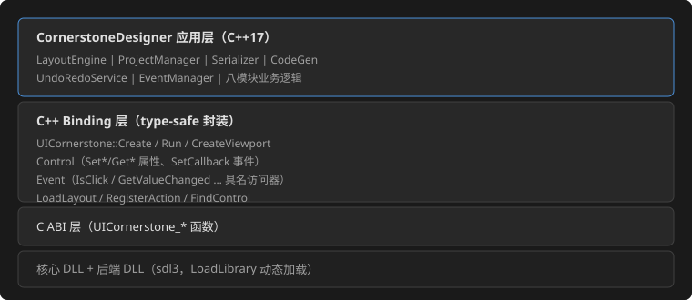
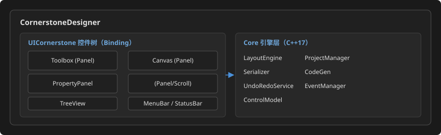
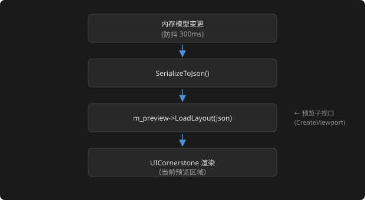

# CornerstoneDesigner 设计规格文档

> 修订记录：v2 —— 依据 UICornerstone **v1.0.0**（2026-08-14 发布，tag commit `202346a5`；C++ Binding 已发布，TreeView/NumericUpDown/ColorPicker/ComboBox/Splitter 等控件已全部实现并附测试），技术方案由"C ABI + JSON"细化升级为 **"C++ Binding + JSON"**。
> 前置条件：需求说明文档已审批通过。

## 1. 开发环境

| 项目 | 规格 |
|------|------|
| 语言 | C++17 |
| UI 框架 | UICornerstone（SDL3 后端，C++ Binding 层接入） |
| 构建系统 | CMake 3.16+ |
| IDE | Visual Studio 2022（含"使用 C++ 的桌面开发"工作负载） |
| 平台 | Windows 10+ |
| JSON 库 | nlohmann/json（UICornerstone 子模块内已带，复用） |

依赖获取方式：`git clone --recursive` 后 `subModules/UICornerstone/` 即提供核心库源码、预编译 SDK 与 binding 工程；编译 `build_scripts\build.bat sdl3` 产出核心/后端 DLL 与 `UICornerstoneBinding.lib`。

## 2. 技术选型：C++ Binding + JSON 双引擎方案

### 2.1 总体分层

CornerstoneDesigner 是 UICornerstone 的"dogfooding 应用"：通过 **C++ Binding**（`binding/`，纯动态加载封装）获得类型安全的控件代理、属性系统与事件回调，以 **JSON 声明式布局**搭建自身静态 UI 骨架，以 **Binding 命令式 API** 驱动画布、属性面板等动态区域。



### 2.2 双引擎分工

| 引擎 | 职责 | 对应场景 |
|------|------|---------|
| **JSON 声明式** | 主界面静态骨架：MenuBar、Toolbox、TreeView、PropertyPanel 框架、StatusBar、默认控件工厂定义 | `layouts/main_layout.json` 及其子面板 JSON |
| **Binding 命令式** | 动态行为：画布控件树增删改、属性面板动态表单生成、事件注册/解绑、预览刷新、撤销重做 | 用户拖拽/编辑/绑定事件的全过程 |

原则：**静态用 JSON，动态用代码**。静态骨架以 `LoadLayout` 加载并 `RegisterAction` 桥接菜单/按钮动作；画布与属性面板属于运行时高频变更区，用 Binding 工厂与属性 API 命令式构建，避免频繁整体重载。

### 2.3 为什么选 C++ Binding 而非裸 C ABI

| 维度 | C ABI 方案 | C++ Binding 方案（选定） |
|------|------------|--------------------------|
| 事件回调 | C 函数指针 + userData 手工管理 | `std::function` lambda 就地捕获，类型安全（`Control::SetCallback`） |
| 生命周期 | Create/Destroy 手动，易泄漏 | RAII + 句柄活性跟踪（`ControlState::alive`），`FindControl` 后判 `IsValid()` |
| 属性访问 | 8 组 Set/Get 函数签名区分 | `Control::SetColor/SetFloat/SetString/SetEnum/SetBool/SetInt` + 同名 `Get*` 重载 |
| 事件数据 | union 布局手工解析 | `Event` 具名访问器（`IsValueChanged/GetValueChanged`、`IsSelectionChanged`…）零误用 |
| 动态加载 | 手写 LoadLibrary/GetProcAddress | `Create(Config)` 内置，三后端运行时切换 |
| Dogfooding 价值 | 验证 C ABI | 同时验证 Binding 层，反馈更贴近编辑器用户 |

### 2.4 设计原则

- **Dogfooding**：设计器自身 UI = JSON 骨架 + Binding 动态区，与用户目标应用同构
- **事件驱动**：交互经 Binding 回调进入业务层；全局快捷键经 Embedded 循环 + 键盘事件通道解析
- **内存模型**：设计器维护独立于渲染的控件内存树（nlohmann::json 结构），与 Binding 控件树保持双向同步
- **JSON 核心**：.csd 项目、导出布局、内部交换均以 JSON 为载体
- **便利设施直用**：视口缩放（`SetViewportScaleMode/SetCanvasSize`）承担画布缩放；`HandleControl` 承担选中控点；`RegisterAction` 承担 JSON 事件桥接

## 3. 系统架构概述



## 4. 模块分解

### M1 项目模块 (ProjectManager)

| 职责 | 说明 | Binding/依赖映射 |
|------|------|------------------|
| 项目生命周期 | 创建、打开、保存、关闭 .csd 项目 | std::fstream + nlohmann::json |
| 文件对话框 | 打开/保存原生对话框 | Win32 `GetOpenFileName/GetSaveFileName`（Binding 不含此能力，宿主侧补） |
| 最近文件 | 记录最近 10 个文件路径 | JSON 配置文件 |
| 自动保存 | 定时自动备份 | 定时器线程 + Serializer |

### M2 控件内存模型 (ControlModel)

| 职责 | 说明 |
|------|------|
| 控件属性映射 | 内存中的控件属性表（nlohmann::json 承载），与 UICornerstone 控件类型对齐 |
| 类型注册 | 注册所有支持控件类型、默认属性与**Binding 工厂创建器**（`std::function<Control(...)>`，工具箱/属性表单/导出共用同一注册表驱动） |
| 序列化 | ToJson / FromJson；FromJson 负责把 LayoutParser 既有文件无损读入内存模型 |

### M3 布局引擎 (LayoutEngine)

| 职责 | 说明 | Binding/依赖映射 |
|------|------|------------------|
| 排版计算 | 用户拖拽 → 控件 rect | `Control::GetRect` 读、`SetRect` 写；网格/对齐取整 |
| 对齐/分布命令 | 多选 ≥2 控件 → 对齐/分布 | 业务层包围盒坐标计算（左/水平居中/右、顶/垂直居中/底、等宽/等高、水平/垂直分布），命令入 Undo 栈 |
| 画布缩放 | 25%–200% 缩放与平移 | 画布区为**子视口**：`SetViewportScaleMode(1|2)` + `SetCanvasSize(w,h)` 等比/拉伸缩放；`GetViewportScale` 做鼠标坐标 → 画布坐标反变换；平移经画布锚点/滚动 |
| 对齐辅助线 | 拖拽自动吸附（阈值 8px），等距分布 | 定位运算在内存模型上做；辅助线/网格/选框用图形绘制层呈现 |
| Z-Order | 置前/置后/上移/下移 | `AddChild` 顺序重排 |
| 约束检测 | 子控件不得超出父容器边界 | 内存模型校验 + 错误提示（Dialog） |
| 选中与控点 | 单击选中、8 方向缩放 | `CreateHandleControl(target,...)` 挂到选中控件上，拖动回调更新 rect（写入 Undo 命令） |
| 多选 | Ctrl+单击多选，批量编辑 | 内存模型维护 selection 集合 |

### M4 属性编辑器 (PropertyPanel)

| 职责 | 说明 | Binding/依赖映射 |
|------|------|------------------|
| 动态表单 | 按选中控件类型生成属性编辑 UI | 每行 = `Label + 数值微调/EditBox/ColorPicker/ComboBox/CheckBox`，`CreateNumericUpDown/CreateColorPicker/CreateComboBox` 等命令式构建 |
| 分组 | 布局/外观/行为/事件四组 | 面板内部分组（Panel 嵌套）；布局组含 anchor/margin/padding/layout（h-flow/v-flow/grid）/matchParentRect/sizeRatio 等 UICS 布局属性 |
| 值验证 | 数值范围、颜色格式、必填校验 | 编辑控件回调 + 校验器 |
| 批量编辑 | 多选仅显示共有属性 | 注册表求交集 |
| 回写管线 | 编辑 → 内存模型 → 渲染刷新 | `Control::SetColor/SetFloat/SetString/SetEnum/SetBool/SetInt` 更新画布对应控件；变更入 Undo 栈（合并策略：连续同类合并） |
| 重置 | 恢复默认值 | 注册表默认属性 |

### M5 事件管理器 (EventManager)

| 职责 | 说明 | Binding/依赖映射 |
|------|------|------------------|
| 事件绑定 | 为控件实例绑定事件并命名 | 数据存入 .csd 的 `events` 段；渲染侧由 `Control::SetCallback(event, lambda)` 实演 |
| 事件类型表 | 与 Binding `Event` 具名访问器全集对齐 | `IsClick/IsValueChanged/IsTextChanged/IsSelectionChanged/IsCheckChanged/IsPositionChanged/IsConfirm/IsCancel/IsSelect/IsExpand/IsCollapse…` |
| 命名检查 | 冲突检测与标识符合规 | 正则 + 全局符号表 |
| 导出 | 函数签名列表 + .h/.c 骨架 | CodeGen（M6） |

### M6 代码生成器 (CodeGen)

| 职责 | 说明 | 依赖映射 |
|------|------|----------|
| JSON 导出 | 控件树序列化为 **LayoutParser 兼容 JSON** | Schema 基准：UICornerstone `layouts/test_layout.json` / `test_layout_advanced.json`（N4 验证基准） |
| C/C++ 骨架 | `void handler(UIControlHandle ctl, void* user)` 函数定义 | C 标识符规范命名 |
| 项目报告 | 控件/事件清单（F7.3） | 文本生成 |

### M7 撤销/重做 (UndoRedoService)

| 职责 | 说明 |
|------|------|
| 命令模式 | 每个操作封装为可撤销命令对象（作用于内存模型；完成后触发画布刷新） |
| 历史栈 | 至少 50 步 |
| 合并策略 | 连续同类操作（移动/缩放）自动合并 |
| 快捷键 | Ctrl+Z / Ctrl+Y 经绑定层键盘事件通道派发 |

### M8 预览引擎 (PreviewEngine)



| 职责 | 说明 | Binding/依赖映射 |
|------|------|------------------|
| 内嵌实时预览 | 预览区即主实例内的**子视口**（`CreateViewport`），与编辑器其它面板共享同一渲染循环 | `instance->CreateViewport(x,y,w,h)` |
| 事件实演 | 预览中点击等事件按用户绑定响应 | `RegisterAction(handlerName, lambda)` 桥接；未实现的动作给出占位提示 |
| 防抖刷新 | 属性连续微调时 300ms 合并刷新，满足 ≥30 FPS | Embedded 循环内 `Update/Render` |

## 5. 控件类型注册表

支持控件与 UICornerstone v1.0.0 现状（原"新增控件"需求已全部交付，附对应测试）：

| 控件类型 | Binding 工厂 | 核心属性 | 特有属性 |
|---------|-------------|---------|---------|
| Animation | `CreateAnimation/CreateAnimatedButton` | rect, luotiAni | playing, loop（内容不编辑，仅托管） |
| Button | `CreateButton` | rect, caption, colors.background | actor, luotiAni, onClick |
| CheckBox | `CreateCheckBox` | rect, caption, checked | threeState |
| ColorPicker | `CreateColorPicker` | rect, color | RGB/Hex（F3.3） |
| ComboBox | `CreateComboBox` | rect, options | selectedIndex |
| Dialog | `CreateDialog` | rect | confirm/cancel/close |
| EditBox | `CreateEditBox` | rect, text, placeholder | password, maxLength |
| HandleControl | `CreateHandleControl` | rect, target | 选中控点（画布用，不列工具箱） |
| Image | `CreateImage/CreateImageButton` | rect, image | scale-type, anchor |
| Label | `CreateLabel` | rect, caption, font.size | textAlign |
| Menu / MenuBar | `CreateMenuBar/CreateMenuItem/CreateMenuPanel` | rect, items | orientation/子菜单 |
| NumericUpDown | `CreateNumericUpDown` | rect, value | min/max/step（F3.4） |
| Panel | `CreatePanel` | rect, children, visible | layout |
| ProgressBar | `CreateProgressBar` | rect, value | showPercentage |
| ScrollBar | `CreateScrollBar` | rect, orientation | min, max, value |
| Slider | `CreateSlider` | rect, value | min, max, 刻度 |
| Splitter | `CreateSplitter` | rect, orientation | 面板分割 |
| TextArea | `CreateTextArea` | rect, text | readOnly, scrollable |
| TreeView | `CreateTreeView` | rect, nodes | select/expand/collapse（控件树 F2.2） |
| WinFrame | `CreateWinFrame` | rect, caption, children | resizable |

> 工具箱（F1.1）分组：基础控件（Label/Button/CheckBox/EditBox/TextArea/ProgressBar/Slider/ScrollBar/Image）、容器控件（Panel/WinFrame/Splitter）、高级控件（Menu/ComboBox/TreeView/ColorPicker/NumericUpDown/Dialog）。不列 File 对话框等宿主能力。
>
> 动画（LuotiAni，JSON `type="animation"` / `CreateAnimation`/`CreateAnimatedButton`）：**基础托管**（需求 §7 补充）——画布可放置、rect 可编辑、属性面板可输入动画资源路径（`luotiAni` 字段，`.jsonc` 路径字符串，如 `assets/animations/rotateBtn/rotateBtn.jsonc`，v1.0.0 实测支持）；动画内容（时间轴/关键帧）不提供可视化编辑，仅原样保留。
>
> 组件（v1.0.0 引擎级组件系统）：顶层 `components` 区定义（`props` + `template` + `{{ }}` 占位符 + `_comp_` 事件），控件以 `type=组件名` 引用并传 props（test_layout_advanced.json 实测，支持嵌套）。设计器以 P2 落地：组件编辑器（模板 + props 表单）、工具箱"组件"动态分组（类型注册表扩展）。

## 6. C++ Binding API 映射表

| Designer 功能 | Binding API | 备注 |
|--------------|-------------|------|
| 应用入口 | `UICornerstone::Create(Config.WithBackend("sdl3").WithWindow(...))` | 核心/后端 DLL 纯动态加载 |
| 主循环 | `Run(update, render)`（Hosted）或 `ProcessEvents/Update/Render/Clear/Present`（Embedded） | 设计器用 **Embedded** 以预留多实例调度 |
| 静态骨架 | `LoadLayout(json)` | main_layout.json + 各面板 JSON |
| JSON 动作桥接 | `RegisterAction(name, ActionCallback)` | 菜单/按钮 → 业务层 |
| 控件查找 | `FindControl(id)` + `Control::IsValid()` | 骨架内控件定位 |
| 子视口 | `CreateViewport(x,y,w,h)` → 返回子视口代理 | 预览区/画布区 |
| 画布缩放/平移 | `SetViewportScaleMode(0\|1\|2)`、`SetCanvasSize`、`SetViewportAnchor`、`GetViewportScale` | F2.3 缩放 25%–200% |
| 控件创建 | `CreateButton/CreateLabel/.../CreateTreeView/CreateSplitter` 全工厂 | 画布放置 |
| 属性读写 | `Control::SetColor/SetStateColor/SetBool/SetInt/SetFloat/SetString/SetEnum` + `Get*` | F3.1 实时编辑 |
| 事件绑定 | `Control::SetCallback("click"\|"value-changed"\|..., lambda)`；`Event` 具名访问器 | F4.1 |
| 树操作 | TreeView 节点 select/expand/collapse 回调 + SetString(节点数据) | F2.2 |
| 选中控点 | `CreateHandleControl(target, ...)` | F2.1 调整控件 |
| 画布自绘层 | 图形原语 + 覆盖层控件 | F2.4 对齐线 / F2.7 网格 |
| 错误诊断 | `GetLastError()` | 加载/解析失败提示 |

## 7. 关键技术决策

| 决策 | 选择 | 理由 |
|------|------|------|
| 框架接入方式 | **C++ Binding**（动态加载） | 类型安全回调/属性访问；RAII 生命周期；与 C ABI 方案相比显著降低编辑器复杂度（§2.3） |
| UI 静态骨架 | JSON 声明式（LoadLayout） | dogfooding；与导出格式同构；布局调整零重编译 |
| 动态区域 | Binding 命令式 | 画布/属性面板高频变更，避免整树重载 |
| 预览方式 | 主实例内**子视口 + LoadLayout + RegisterAction** | 设计器自身即 UICornerstone 应用，天然支持，无需外部进程 |
| 画布缩放 | 视口缩放机制（ViewportScaleMode/CanvasSize） | 框架能力复用，鼠标坐标经 GetViewportScale 反变换 |
| JSON 库 | nlohmann/json | UICornerstone 已依赖，复用 |
| 撤销/重做 | 命令模式（≥50 步，连续同类合并） | 内存可控，支持批量 |
| 文件对话框 | Win32 原生对话框 | Binding 不含此能力，宿主侧薄封装 |

## 8. 工程结构

```
CornerstoneDesigner/
├── CMakeLists.txt                    # 根 CMake（链接 UICornerstoneBinding.lib）
├── doc/                              # 文档（01 需求/02 本规格/03 概念/04 详细/05 实施 + 控件需求输入）
├── build_scripts/
│   └── build.bat                     # 编译脚本
├── include/
│   └── Designer/
│       ├── App.h                     # 应用入口（Embedded 循环）
│       ├── ControlModel.h            # 控件内存模型 + 类型注册表
│       ├── ProjectManager.h          # 项目管理
│       ├── LayoutEngine.h            # 布局引擎（拖拽/缩放/对齐/Z-Order）
│       ├── EventManager.h            # 事件管理器
│       ├── CodeGenerator.h           # 代码生成器
│       ├── PreviewEngine.h           # 预览引擎
│       ├── UndoRedoService.h         # 撤销/重做
│       └── Serializer.h              # JSON 序列化
├── src/
│   ├── main.cpp                      # 入口
│   ├── App.cpp
│   ├── ControlModel.cpp
│   ├── ProjectManager.cpp
│   ├── LayoutEngine.cpp
│   ├── EventManager.cpp
│   ├── CodeGenerator.cpp
│   ├── PreviewEngine.cpp
│   ├── UndoRedoService.cpp
│   └── Serializer.cpp
├── layouts/                          # 设计器自身的 JSON 布局（静态骨架）
│   ├── main_layout.json              #   主界面布局（MenuBar/三栏/StatusBar）
│   ├── toolbar_panel.json            #   工具箱（注册表驱动展示）
│   ├── property_panel.json           #   属性面板框架（动态表单区）
│   └── event_panel.json              #   事件管理面板
├── subModules/UICornerstone/         # 子模块（含 binding 工程与预编译 SDK）
│   └── …/binding                     #   UICornerstoneBinding.lib + 头文件
└── assets/                           # 字体、图片等资源
```

## 9. 与 UICornerstone 的耦合边界

| 项 | 契约 |
|----|------|
| 依赖基线 | UICornerstone **v1.0.0**（tag commit `202346a5`；C++ Binding + 全部控件 + 视口缩放 + 内存资源已发布；官方发布包 `UICornerstone_full_v1.0.0.rar` 含核心/后端 DLL + assets + binding 源码 + 独立集成样例 `binding/CMakeLists.example.txt`） |
| 导出 JSON | 严格符合 `LayoutParser` 输入格式；以 `layouts/test_layout.json`、`test_layout_advanced.json` 为 Schema 基准（N4） |
| 事件类型范围 | 以 Binding `Event` 具名访问器全集为上限（click/value-changed/text-changed/selection-changed/check-changed/position-changed/confirm/cancel/close/select/expand/collapse） |
| 动画/特效 | LuotiAni（`type="animation"` / Button 的 `luotiAni` 字段）：rect 与资源路径（`.jsonc` 字符串）可编辑、仅托管；动画内容（时间轴/关键帧）不编辑，往返原样保留（需求 §7） |
| 资源挂载 | 无 ResourceLoader 控件；布局顶层 `resourceProviders`（`name`/`path`）+ 内存资源 `RegisterResource/AdoptResource` + `provider:<id>` 引用。设计器提供布局级资源面板（P1） |
| 组件 | 顶层 `components`（`props`/`template`/`{{ }}`/`_comp_`），`type=组件名` 引用；设计器 P2 提供组件编辑器与工具箱动态"组件"分组，导出原样保留 components 区 |
| 兼容性维护 | 恢复/迁移：从旧版本 JSON 读取时未知字段原样保留，避免往返丢失 |

---

## 本阶段测试内容

### 设计验证

| 测试项 | 方法 | 通过标准 |
|--------|------|---------|
| 架构评审 | 对照需求 F1-F7 检查架构覆盖率 | 每个功能需求映射到 >= 1 个模块 |
| Binding API 可行性 | 用官方样例（sample_cpp_hosted/embed/multiinstance/scale）验证 §6 映射表每项 API | 映射项全部可用（demo 级验证） |
| JSON 兼容性验证 | 导出 JSON 与 UICornerstone 的 layouts/ 样本对比 | 结构完全一致 |
| 事件命名检查 | CodeGen 输出符合 C 标识符规范 | 100% 合规 |
| 撤销覆盖 | 检查所有可编辑操作都有对应的 Undo | 无遗漏 |
| 接口评审 | 模块间接口清晰，无循环依赖 | 依赖图无环 |

### 设计器自身布局原型

- 使用 UICornerstone JSON 构建设计器主界面布局原型（main_layout.json），`LoadLayout` + `RegisterAction` 验证菜单/按钮动作桥接
- 验证关键交互流程：创建布局 -> 绑定事件 -> 导出，导出 JSON 以 `test_layout` 输入规格自检